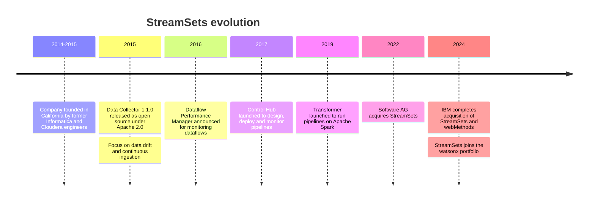

---
aliases:
  - StreamSets
  - Streamsets
  - StreamSets Data Collector
tags:
  - data-engineering
  - cdc
---
StreamSets is a [[Data Integration Platform]] for building data pipelines with a visual designer. A pipeline reads from an origin, optionally transforms the records with processors, and writes them to one or more destinations, in batch or streaming. It was created by StreamSets Inc. and is now part of IBM, which acquired it in 2024. It is a commercial product.

## Main products

| Product | What it is |
| --- | --- |
| **Data Collector** | The pipeline engine. Runs on its own JVM, reads from origins and writes to destinations in near real time. The product most CDC pipelines use |
| **Transformer** | An engine that runs pipelines on Apache Spark for large-scale transformations such as joins and aggregations |
| **Control Hub** | The management layer: it designs, deploys, schedules and monitors pipelines across many engines |

## Evolution



The founding year differs between sources (2014 or 2015). The timeline shows both.

## Pipeline model

```
Origin  ->  Processor(s)  ->  Destination(s)
```

- **Origin:** where the data comes from (a database, a file, Kafka, a cloud service).
- **Processor:** a transformation step. Examples are changing or removing fields, evaluating expressions, filtering and routing records.
- **Destination:** where the data is written. Examples are Kafka, S3, a data warehouse and another database.
- **Executor:** a stage that triggers an action after data is processed, such as running a query or a job.

Pipelines are built by dragging stages onto a canvas and configuring them in the UI. They can also be exported and managed as JSON, so they can live in version control.

## Reading data with CDC

Data Collector has origins that read the **transaction log** of the source database, like Debezium does:

| Source | Origin | What it reads |
| --- | --- | --- |
| MySQL | MySQL Binary Log | Binlog |
| PostgreSQL | PostgreSQL CDC Client | WAL, through logical decoding |
| Oracle | Oracle CDC Client | LogMiner |
| SQL Server | SQL Server CDC Client, SQL Server Change Tracking | CDC tables or change tracking |
| MongoDB | MongoDB Oplog | The oplog |
| Salesforce | Salesforce change events | Platform change events |

Each record carries the **operation type** (insert, update or delete) in a record header attribute, together with the changed fields. A pipeline can use it to route the records, for example to apply deletes differently from inserts, and then write them to the destination.

The exact origins and the supported database versions depend on the StreamSets version and edition, so check the documentation of the one you run.

### Query-based alternative

The JDBC Query Consumer origin polls a table incrementally, for example by an `updated_at` column. This is **not** true CDC: it misses deletes and intermediate updates, and it adds query load on the source.

## Example CDC pipeline

```
PostgreSQL CDC Client  ->  Field Remover  ->  Kafka Producer
```

1. The origin reads changes from the database's transaction log.
2. The processor drops columns that should not leave the source, such as personal data.
3. The destination publishes each change to a Kafka topic, where consumers or sink connectors pick it up.

## Prerequisites on the source database

- Log-based access must be enabled, for example `wal_level=logical` and a replication slot on PostgreSQL, ROW binlog format on MySQL, supplemental logging on Oracle.
- A dedicated user with the minimum privileges for reading the log.
- Enough log retention. If the pipeline is stopped for longer than the database keeps its logs, the origin loses its position and needs a new snapshot.

## Compared with Debezium

| | StreamSets | Debezium |
| --- | --- | --- |
| Form | A pipeline tool where CDC is one origin among many | A CDC-focused set of connectors |
| Runs on | Its own engine (Data Collector, Transformer) | Kafka Connect, Debezium Server or embedded |
| Output | Any destination StreamSets supports | Mainly Kafka topics |
| Transformation | Built into the pipeline stages | Light SMTs, with the rest in downstream tools |
| Interface | Visual designer plus UI-based monitoring | Configuration (JSON or YAML) and REST API |
| Licensing | Commercial | Open source |

Choose StreamSets when you want a visual tool, many source and destination types and built-in transformation in one product. Choose Debezium when Kafka is already the backbone and you want a lightweight, open-source CDC layer.

## Related

- [[data architecture/Apache Kafka/Debezium.md|Debezium]]
