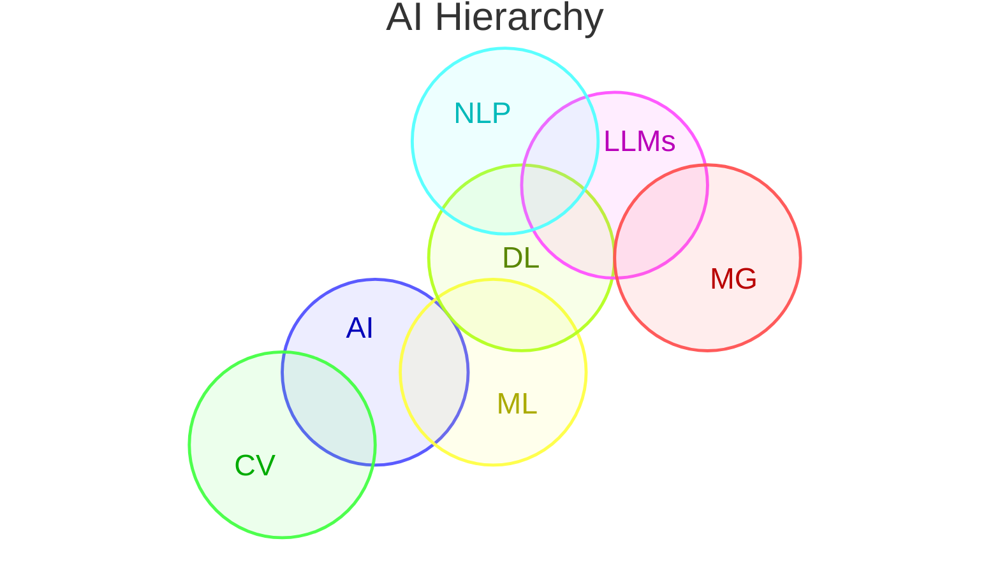

1. **[[Artificial Inteligence]]:** The overarching field of creating machines that can mimic human intelligence.
2. **[[Machine Learning]]:** A subset of AI where computers learn patterns from data without being explicitly programmed.
3. **[[Deep Learning]]:** A specialized subset of ML that uses massive, layered artificial neural networks (inspired by the human brain) to process complex, unstructured data like images, audio, and text.
4. **[[Large Language Models]]:** A highly specialized application of deep learning trained on massive text datasets specifically to understand and generate human-like language
5. [[Multimodal Generativ IA]]: Image, video and audio
6. [[Computer Vision]]:
