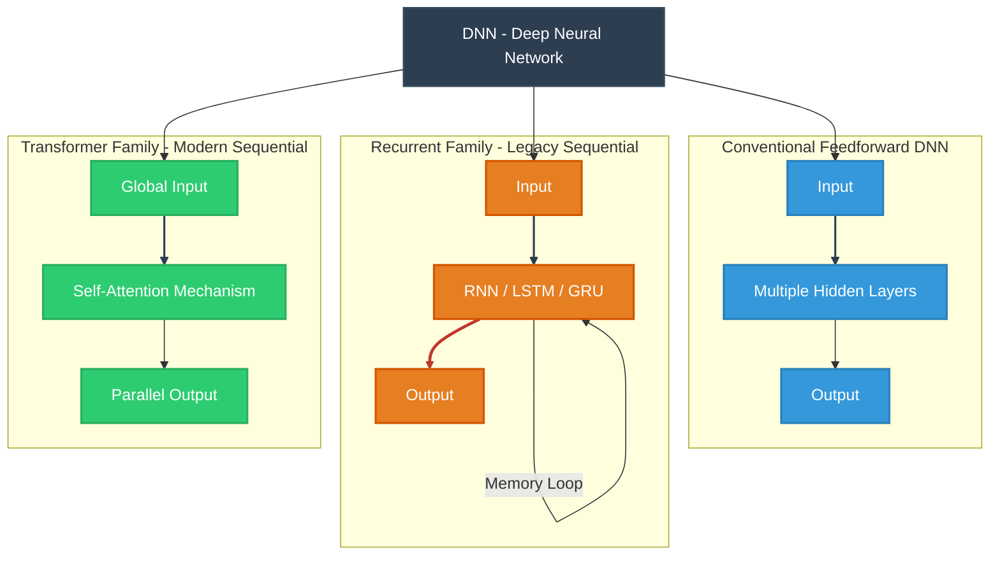

This is an umbrella term. Any neural network with an input layer, an output layer, and **multiple hidden layers** in between is a "deep" neural network.

1980 a 1990
- n-gramas
- Hidden Markov models (HMMs)

