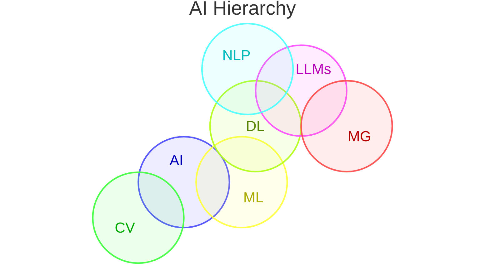

# AI Hiearchy

1. AI [[Artificial Inteligence]]: The overarching field of creating machines that can mimic human intelligence.
	1. ML [[Machine Learning|machine learning]]: A subset of AI where computers learn patterns from data without being explicitly programmed.
		1. DL [[Deep Learning]]: A specialized subset of ML that uses massive, layered artificial neural networks (inspired by the human brain) to process complex, unstructured data like images, audio, and text.
			1. LLM [[Large Language Models]]: A highly specialized application of deep learning trained on massive text datasets specifically to understand and generate human-like language
			2. MG [[Multimodal Generativ IA]]: Image, video and audio
			3. NLP
	2. [[Computer Vision]]
