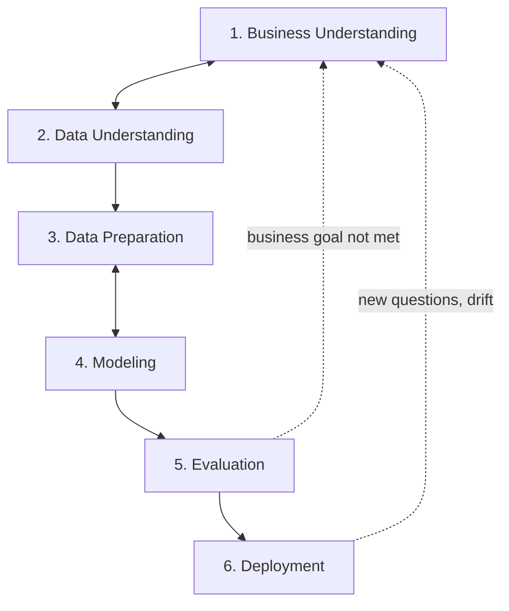

---
aliases:
  - Cross-Industry Standard Process for Data Mining
---
#process #data-science #methodology

**CRISP-DM** (*Cross-Industry Standard Process for Data Mining*) is a widely used, tool-independent process model for [[data mining]], [[data science/README|Data Science]] and [[Machine Learning]] projects. It was developed by an industry consortium in the 1990s (version 1.0 in 1999) and describes a project as **six phases** in an **iterative cycle**, starting from the business problem and not from the algorithm.

The arrows between phases are not a one-way waterfall: teams move back and forth (for example, modeling often sends you back to data preparation), and a finished project usually restarts the cycle.

## The six phases

### 1. Business Understanding
Define the problem and the goal in business terms, before touching data.

- Business objectives and **success criteria** (e.g. "reduce churn by 5%")
- Current situation, constraints, risks, available resources
- Translate the business goal into a **data science goal** (e.g. "predict which customers will churn in 30 days")
- Initial project plan

### 2. Data Understanding
Find out what data exists and whether it can support the goal.

- Collect the initial data and describe it (volume, fields, types)
- Explore it: distributions, relationships, first hypotheses
- Verify **data quality**: missing values, duplicates, inconsistencies, bias
- Check that the data actually contains the signal and that [[machine learning/concepts/Ground Truth|labels]] are available

### 3. Data Preparation
Build the final dataset used for modeling. Usually the most time-consuming phase.

- Select data and rows
- [[Data Cleaning]]: missing values, outliers, errors
- Construct and transform features ([[Feature Engineering]])
- Integrate sources and format the data for the modeling tool
- Split into training, validation and test sets **before** fitting any transformation, to avoid [[Data Leakage]]

### 4. Modeling
Select and train models.

- Choose techniques ([[Model Selection]])
- Design the test procedure (splits, [[K-Fold Cross-Validation]])
- Train, tune hyperparameters and compare models
- Watch for [[Overfitting]]

### 5. Evaluation
Check whether the result **meets the business goal**, not only whether the metric is good.

- Technical evaluation: [[Model Evaluation]] with the right metrics ([[Precision]], [[Recall]], [[ROC-AUC]], ...)
- Business evaluation: does it achieve the success criteria defined in phase 1?
- Review the whole process: was anything missed, is the model explainable and fair enough?
- Decide: deploy, iterate, or start a new project

### 6. Deployment
Put the result to use.

- Plan deployment, monitoring and maintenance
- Release safely: [[shadow deployment]], [[canary deployment]], [[champion and challenger]]
- Produce a final report and hand over (documentation, runbooks)
- Review what went well and what did not

Deployment can be as simple as a report, or as complex as a real-time service in production.

## Strengths

- **Business-first:** starts from the problem and the success criteria
- **Technology-neutral:** works for any tool, algorithm or industry
- **Iterative:** loops are expected, not a sign of failure
- **Common language** between business, data and engineering teams

## Limitations

- **Little on operations:** deployment is a single phase. It says almost nothing about monitoring, retraining, [[Model drift]] or CI/CD for models
- **No explicit quality assurance** or governance, such as risk, fairness and compliance
- **Light on team coordination:** it does not describe roles, agile practices or project management in detail
- **Dated:** it was written for classical data mining, before large-scale ML in production and LLMs. A planned update (CRISP-DM 2.0) was never released

## Extensions and alternatives

| Model | Idea |
|---|---|
| **CRISP-ML(Q)** | Extends CRISP-DM for machine learning with a **Monitoring and Maintenance** phase and quality assurance at every phase |
| **ASUM-DM** | IBM's refinement of CRISP-DM, adding agile and implementation guidance |
| **[[Knowledge Discovery in Databases (KDD)\|KDD]]** | Earlier academic process (selection, preprocessing, transformation, data mining, interpretation) |
| **SEMMA** | SAS process (Sample, Explore, Modify, Model, Assess), focused on the modeling steps |
| **TDSP** | Microsoft's Team Data Science Process, with team roles and project structure |
| **MLOps lifecycles** | Cover continuous training, monitoring and automated deployment after the first release |

For production machine learning, treat CRISP-DM as the **project-level frame** and add MLOps practices for what happens after phase 6 ([[CICD]], monitoring, retraining). For LLM applications, see [[LLMOps]].

## CRISP-DM in practice

| Phase | Typical question | Typical artifact |
|---|---|---|
| Business Understanding | What decision are we improving and how do we measure success? | Problem statement, success criteria |
| Data Understanding | Do we have the data, and is it good enough? | Data report, quality assessment |
| Data Preparation | How do we turn raw data into model-ready features? | Clean dataset, feature pipeline |
| Modeling | Which model and settings work best? | Trained candidates, experiment log |
| Evaluation | Does it solve the business problem? | Evaluation report, go/no-go |
| Deployment | How do we run and maintain it? | Deployed service, monitoring plan |

## Related

- [[Artificial Inteligence]]
- [[Model Evaluation]]
- [[Model drift]]
- [[champion and challenger]]
- [[LLMOps]]
