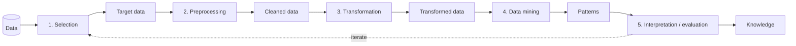

---
aliases:
  - KDD
  - Knowledge Discovery in Databases
  - Knowledge Discovery
---
#data-science #data-mining #methodology

**Knowledge Discovery in Databases (KDD)** is the overall process of extracting **valid, novel, useful and understandable knowledge** from data. [[Data Mining]] is its central step: KDD covers everything around it, from choosing the data to interpreting and using the results.

The term appeared in the late 1980s, in the research community around large databases, and the process was formalized in the mid-1990s (e.g. the 1996 paper *From Data Mining to Knowledge Discovery in Databases*). It is the academic ancestor of later process models such as [[CRISP-DM]].

## The five steps

| Step | What happens | Output |
|---|---|---|
| **1. Selection** | Decide which data, variables and records are relevant to the goal | Target data |
| **2. Preprocessing** | [[Data Cleaning]]: handle missing values, noise, duplicates and inconsistencies | Cleaned data |
| **3. Transformation** | Build features ([[Feature Engineering]]), scale, aggregate, reduce dimensions | Data ready for mining |
| **4. Data mining** | Apply algorithms (classification, clustering, association rules, ...) to find patterns | Patterns and models |
| **5. Interpretation / evaluation** | Validate the patterns, remove redundant or uninteresting ones, visualize and explain ([[Model Evaluation]]) | Knowledge |

The process is **iterative and interactive**: a finding at any step can send you back to an earlier one, and a human is involved throughout.

## The extended (nine-step) view

The original description also includes the work before and after the five steps:

1. Understand the application domain and the goals
2. Create the target dataset (Selection)
3. Clean and preprocess the data
4. Reduce and transform the data
5. Choose the data mining task (classification, clustering, ...)
6. Choose the data mining algorithm and parameters
7. Run the data mining
8. Interpret the discovered patterns, possibly going back to earlier steps
9. Use the discovered knowledge: act on it, document it, report it

## What makes a pattern "knowledge"

A pattern should be:

- **Valid:** holds on new data, not only on the sample (see [[Overfitting]])
- **Novel:** not already obvious or known
- **Potentially useful:** can support a decision or action
- **Understandable:** a person can interpret and explain it

## KDD vs Data Mining

| | KDD | Data Mining |
|---|---|---|
| **Scope** | The whole process, from raw data to knowledge | One step: finding patterns with algorithms |
| **Includes data preparation?** | Yes | Usually not, though the word is often used loosely for the whole thing |
| **Includes interpretation?** | Yes | No |

In practice the two terms are often used interchangeably, but strictly, data mining is a step inside KDD.

## KDD vs CRISP-DM

| KDD | CRISP-DM |
|---|---|
| (Domain understanding, in the extended view) | Business Understanding |
| Selection | Data Understanding |
| Preprocessing, Transformation | Data Preparation |
| Data mining | Modeling |
| Interpretation / evaluation | Evaluation |
| (Using the knowledge, in the extended view) | Deployment |

[[CRISP-DM]] is **business-oriented and industry-driven**, with an explicit business phase and deployment, while KDD comes from research and focuses on the data and the discovery of knowledge. Both are iterative. Neither says much about monitoring and maintenance in production (see [[Model drift]]).

## Pitfalls

- Treating it as linear and skipping the iterations
- Spending too little time on selection and preprocessing, which usually dominate the effort
- Reporting patterns that are spurious, obvious or not actionable
- Ignoring [[Data Leakage]] and [[Overfitting]] when validating
- Stopping at the patterns and never turning them into a decision

## Related

- [[Data Mining]]
- [[CRISP-DM]]
- [[data science/README|Data Science]]
- [[Data Cleaning]]
- [[Feature Engineering]]
- [[Model Evaluation]]
