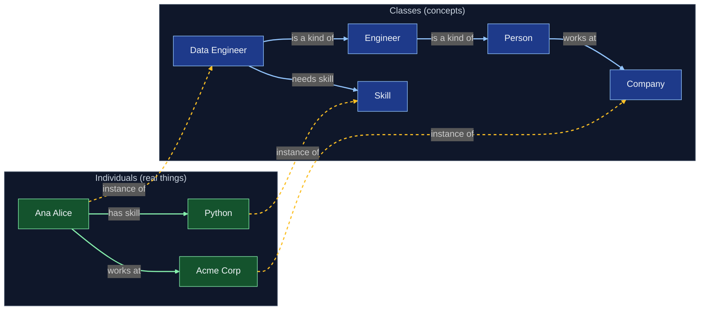

# Ontology

An **ontology** is a map of a subject: the **things** that exist in it, how they are **grouped**, and how they **relate** to each other.

## Idea

Imagine a shared dictionary plus the rules to use it. It answers three questions:

1. **What exists?** (concepts, e.g. `Person`, `Company`, `Job`)
2. **How are they grouped?** (`Engineer` is a kind of `Person`)
3. **How do they relate?** (`Person` *works at* `Company`)

## Example

Read the diagram above as follows:

- **Classes** are the concepts (the top box). A *Data Engineer* is a kind of *Engineer*, and an *Engineer* is a kind of *Person*. A *Data Engineer* needs a *Skill*, and *Python* is an instance of *Skill*.
- **Individuals** are real things that belong to a class (the bottom box). *Alice* is an instance of *Data Engineer*, and *Acme Corp* is an instance of *Company*.
- **Relations** connect things: *Alice* *works at* *Acme Corp* and *has skill* *Python*.
- Dotted orange arrows (*instance of*) link an individual to its class.
- Colors: blue = classes, green = individuals.

## Why it matters

- It gives people and machines the **same meaning** for the same words.
- It makes data **easier to connect and search**.
- It is the base of **knowledge graphs**, used to ground AI answers (see [[llm/concepts/RAG.md|RAG]]).

## Ontology vs. taxonomy

- A **taxonomy** is only a hierarchy ("is a kind of").
- An **ontology** is a taxonomy plus **relationships** and **rules**.

## Related

- [[llm/concepts/RAG.md|RAG]]
