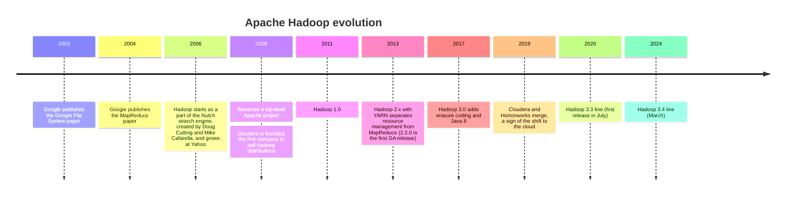
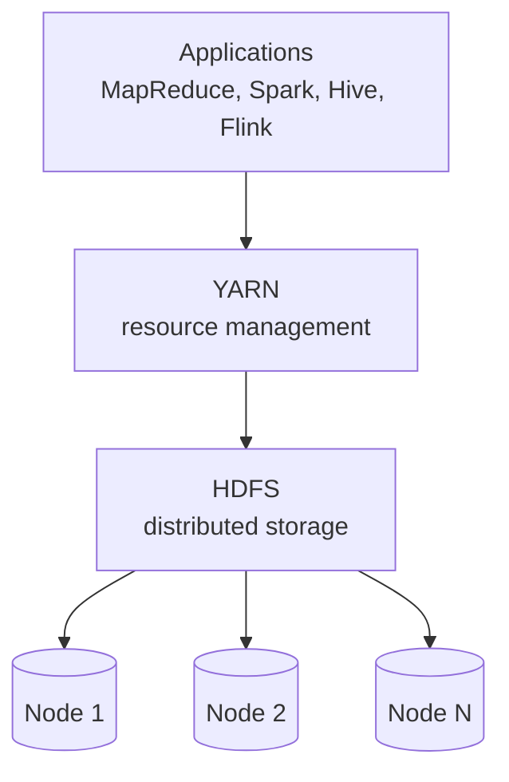
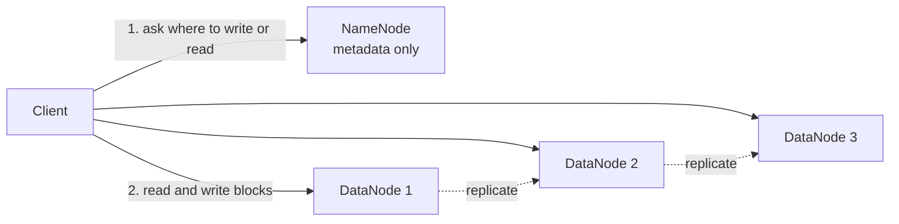
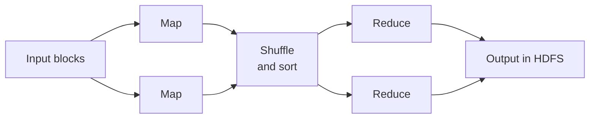

---
aliases:
  - Hadoop
  - Apache Hadoop
  - HDFS
  - MapReduce
tags:
  - data-engineering
  - big-data
  - hadoop
  - distributed-systems
---


**Apache Hadoop** is an open source framework to **store and process very large datasets on a cluster of ordinary (commodity) machines**. It was the technology that started the "big data" era. It gives you a distributed file system (**HDFS**), a resource manager (**YARN**) and a batch processing model (**MapReduce**), and it is built so that a machine failing is normal, not an exception.

>[!tip] Hadoop's idea: **move the code to the data**, not the data to the code. Split a huge file into blocks spread over many machines, then run the processing on the machines that already hold the blocks.

## Core components

| Component | Role |
|---|---|
| **HDFS** (Hadoop Distributed File System) | Stores files split in large blocks, replicated across machines |
| **YARN** (Yet Another Resource Negotiator) | Manages cluster resources (CPU, memory) and schedules applications |
| **MapReduce** | The original batch processing model, running on YARN |
| **Hadoop Common** | Shared libraries and utilities used by the other modules |



## HDFS

HDFS is made for **very large files, written once and read many times**, with high throughput rather than low latency.



| Concept | Meaning |
|---|---|
| **NameNode** | The master. Keeps the **metadata**: the directory tree and which blocks form each file and where they are. It does not store file data |
| **DataNode** | A worker. Stores the actual **blocks** and reports to the NameNode with heartbeats |
| **Block** | A file is split into blocks, 128 MB by default (much larger than a normal file system block) |
| **Replication** | Each block is copied to several DataNodes, 3 by default, usually on different racks, so a failed disk or node loses no data |
| **Rack awareness** | HDFS knows the rack of each node, to place replicas safely and to read from the closest one |
| **High availability** | A standby NameNode, shared edit log (JournalNodes) and automatic failover remove the single point of failure |
| **Federation** | Several NameNodes share the same DataNodes, to scale the metadata |
| **Erasure coding** | Since Hadoop 3, stores parity instead of full copies, so it uses about 50% extra space instead of 200%, at the cost of more CPU and network |

Useful commands:

```bash
hdfs dfs -ls /data                        # list a directory
hdfs dfs -put local.csv /data/raw/        # upload a file
hdfs dfs -get /data/raw/local.csv .       # download a file
hdfs dfs -du -h /data                     # space used
hdfs fsck /data -files -blocks            # check health and block locations
```

### The small files problem

The NameNode keeps **all metadata in memory**, and every file, directory and block costs a bit of it. Millions of small files exhaust the NameNode memory and make jobs slow, even if the total size is small. The fix is to **merge small files** into large ones (for example 128 MB or more) and to use container formats such as Parquet or ORC. The same problem exists in modern data lakes, see [[data architecture/Apache Spark/Apache Spark.md|Apache Spark]].

## MapReduce

MapReduce splits a job in two user-written steps, with an automatic **shuffle** between them:

1. **Map:** runs in parallel on each block and emits `(key, value)` pairs.
2. **Shuffle and sort:** pairs with the same key are moved to the same reducer and sorted.
3. **Reduce:** receives a key with all its values and produces the result.



Word count, the classic example:

```text
map("the cat the dog")        -> (the,1) (cat,1) (the,1) (dog,1)
shuffle                       -> the:[1,1]   cat:[1]   dog:[1]
reduce(the,[1,1])             -> (the,2)
```

Weaknesses that led to its decline: every step **writes its result to disk**, jobs with several steps are slow, there is high latency for each job, and the code is verbose (Java, or streaming scripts). [[data architecture/Apache Spark/Apache Spark.md|Apache Spark]] solved most of it by keeping data in memory and offering DataFrames and SQL.

## YARN

YARN turned Hadoop into a general cluster platform: any engine can request resources, not only MapReduce.

| Component | Role |
|---|---|
| **ResourceManager** | The master. Decides how resources are shared among all applications |
| **NodeManager** | Runs on each worker. Starts and monitors containers |
| **ApplicationMaster** | One per application. Asks for containers and coordinates its tasks |
| **Container** | A slice of CPU and memory where a task runs |
| **Scheduler** | Capacity or fair scheduling decides which queue or user gets resources |

## The Hadoop ecosystem

Hadoop became a family of tools on top of HDFS and YARN:

| Tool                 | Purpose                                                                                                     |
| -------------------- | ----------------------------------------------------------------------------------------------------------- |
| **Hive**             | SQL on files in HDFS. Its **metastore** (table definitions) is still widely used by Spark, Trino and others |
| **HBase**            | Wide-column NoSQL database on HDFS, for low-latency random reads and writes                                 |
| **Pig**              | Older data flow scripting language (mostly retired)                                                         |
| **Sqoop**            | Bulk transfer between relational databases and HDFS (retired in favor of other tools)                       |
| **Oozie**            | Workflow scheduler, replaced mostly by [[Apache Airflow]]                                                   |
| **ZooKeeper**        | Coordination service for distributed systems, used for high availability                                    |
| **Spark**            | The processing engine that replaced MapReduce. See [[Apache Spark]]                                         |
| **Kafka and Flink**  | Streaming. See [[Kafka]]                                                                                    |
| **Ranger and Atlas** | Security policies and metadata governance                                                                   |

## Why Hadoop declined

| Reason | Detail |
|---|---|
| **Cloud object storage** | S3, Google Cloud Storage and Azure storage are cheaper, practically unlimited and need no operation, compared with running HDFS |
| **Separation of storage and compute** | In HDFS, storage and compute are coupled in the same nodes. In the cloud they scale and are billed apart, and clusters can be temporary |
| **Operation complexity** | Many daemons, tuning, upgrades and security (Kerberos) need a specialized team |
| **Better engines** | Spark, Trino, Flink and cloud warehouses are faster and easier than MapReduce |
| **Kubernetes** | Became the standard way to schedule workloads, replacing YARN for new systems |
| **Lakehouse formats** | Delta, Iceberg and Hudi add ACID, schema evolution and time travel on object storage |

## Where Hadoop is still used

- **On-premises data centers** that cannot or will not move to the cloud, with large HDFS clusters.
- **Managed services built on it:** AWS EMR and [[providers/Google/GCP Dataproc.md|GCP Dataproc]] run Spark and other Hadoop tools, usually with data in object storage instead of HDFS.
- **Hadoop libraries inside modern tools:** Spark, Hive and others use Hadoop's file system connectors to read S3, GCS and Azure storage (for example the `s3a://` scheme).
- **Hive metastore** as the shared catalog of table definitions.
- **Migrations:** many data engineers are asked to move a Hadoop platform to the cloud, for example from HDFS and MapReduce or Hive to object storage and PySpark.

## Hadoop vs modern data lake

| | Hadoop (on-prem HDFS) | Cloud data lake or lakehouse |
|---|---|---|
| Storage | HDFS on the cluster nodes | Object storage (S3, GCS, ADLS) |
| Compute | Coupled to storage, YARN | Separate, elastic, often temporary clusters |
| Scaling | Add nodes (storage and compute together) | Scale each independently |
| Cost | Hardware, data center and a team | Pay for what is stored and used |
| Transactions | None by default | ACID through Delta, Iceberg or Hudi |
| Operation | Heavy | Mostly managed |
| Data locality | Code runs near the data | Data is read over the network, so formats and caching matter |

Related: [[data architecture/Data Lake/README.md|Data Lake]], [[data architecture/Data Lakehouse/Data Lakehouse.md|Data Lakehouse]] and [[data architecture/Data Lake vs Data Warehouse vs Data Lakehouse.md|Data Lake vs Data Warehouse vs Data Lakehouse]].

## Migrating from Hadoop to the cloud

A common path:

1. **Inventory** the jobs, tables, data volume, dependencies and users.
2. **Copy the data** from HDFS to object storage (for example with `distcp`), keeping the folder layout and partitioning.
3. **Move the catalog:** keep or recreate the Hive metastore, or use a cloud catalog.
4. **Rewrite the processing:** MapReduce, Pig and Hive jobs become Spark or SQL, and Oozie workflows become [[Apache Airflow]] DAGs.
5. **Run both in parallel** and compare the results (counts, checksums, [[data quality]] checks).
6. **Cut over** by consumer, then turn off the cluster.

## Best practices

- Use **large files** and columnar formats (Parquet, ORC) with compression.
- Keep the NameNode healthy: enable high availability, monitor its memory and avoid millions of tiny files.
- Choose the replication factor by the value of the data, and use erasure coding for cold data.
- Use **capacity queues** in YARN to protect critical jobs.
- Secure the cluster with Kerberos, encryption and policies (Ranger).
- Keep a backup or a replicated copy (`distcp`) for critical data. Replication protects against a node failure, not against a user deleting data.
- Enable the HDFS trash so accidental deletes can be recovered.

## Common pitfalls

- Treating HDFS as a place for many small files.
- A single NameNode with no high availability.
- Using MapReduce for new development when Spark or SQL would be simpler and faster.
- Thinking replication is a backup.
- Running hot data and cold data on the same expensive nodes.
- Underestimating the operational cost of a self-managed cluster.
- Moving the data to the cloud with the same file layout problems (small files) and expecting better performance.

## Interview questions

- What is Hadoop, and what problems did it solve?
- What are the roles of the NameNode and the DataNodes?
- Why is the HDFS block so large, and what is the replication factor?
- What is the small files problem, and how do you avoid it?
- Explain the map, shuffle and reduce phases with word count.
- What does YARN do, and why was it created?
- Why did Spark replace MapReduce in most cases?
- Why did cloud object storage replace HDFS in many companies?
- How would you migrate a Hadoop and Hive platform to the cloud?
- Is replication a backup? Why not?

## Links

- [[data architecture/Apache Hadoop/HDFS.md|HDFS]]
- [[data architecture/Apache Hadoop/YARN.md|YARN]]
- [[data architecture/Apache Hadoop/MapReduce.md|MapReduce]]
