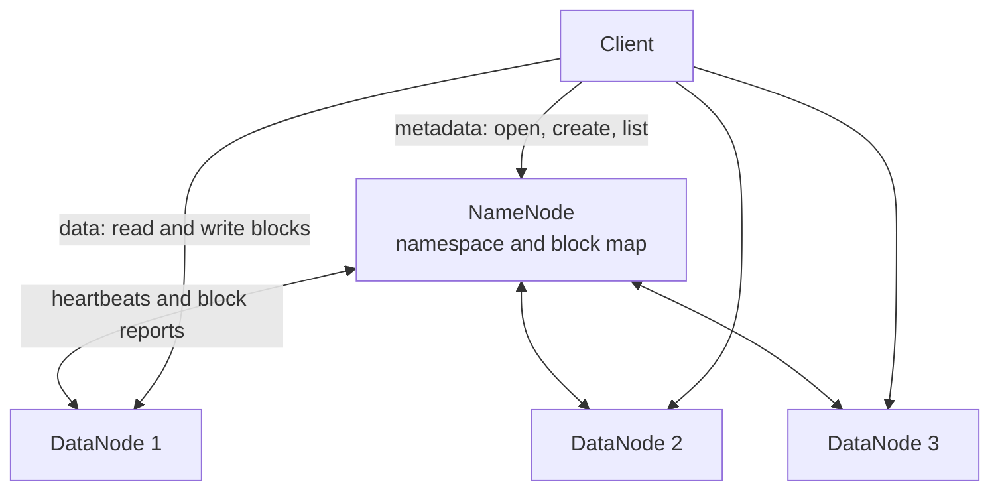
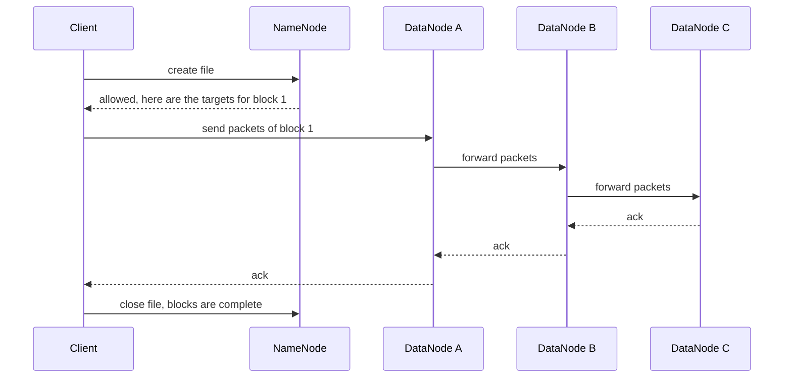

---
aliases:
  - HDFS
  - Hadoop Distributed File System
tags:
  - data-engineering
  - big-data
  - hadoop
  - storage
  - distributed-systems
---
**HDFS (Hadoop Distributed File System)** is the storage layer of Hadoop. It stores very large files across many ordinary machines by splitting each file into **blocks**, copying every block to several machines, and keeping a central index of where everything is. It is designed for **high throughput on huge files that are written once and read many times**, not for low latency or many small files.

>[!tip] HDFS has two kinds of machines. The **NameNode** knows *where* things are (metadata). The **DataNodes** hold *the data*. The client asks the NameNode, then talks directly to the DataNodes, so the data itself never flows through the NameNode.

## Design goals

| Goal | How HDFS does it |
|---|---|
| Store files larger than any single disk | Splits files into blocks spread over the cluster |
| Survive machine failures | Replicates every block (or uses erasure coding) |
| High throughput for scans | Large blocks, sequential reads, data locality |
| Run on commodity hardware | Assumes failure is normal and heals itself |
| Simple consistency | **Write once, append only**: no random updates in the middle of a file |

## Architecture



| Component | Role |
|---|---|
| **NameNode** | Keeps the **namespace** (directories, files, permissions) and the **block map** (which DataNodes hold each block). Everything is held **in memory** for speed |
| **DataNode** | Stores the block files on its local disks, serves reads and writes, sends a **heartbeat** every few seconds and a **block report** periodically |
| **Client** | The library that talks to both. It asks the NameNode for locations, then moves the data directly with DataNodes |

### How the NameNode stores metadata

- **fsimage:** a snapshot of the whole namespace on disk.
- **Edit log:** an append-only log of every change since the last snapshot.
- On start, the NameNode loads the fsimage and replays the edit log. **Checkpointing** merges the edit log into a new fsimage, done by the standby NameNode (or a secondary one), so the log does not grow forever.
- **Safe mode:** at startup the NameNode waits until enough blocks are reported by the DataNodes. The file system is read-only until then.

## Blocks and replication

- A file is cut into **blocks**, 128 MB by default (`dfs.blocksize`). The last block is only as big as the remaining data, it does not waste space.
- Each block is stored as **replicas**, 3 by default (`dfs.replication`), on different DataNodes.
- **Rack-aware placement** (default policy): the first replica goes on the writer's node (or a random one), the second on a node in a **different rack**, the third on a different node of the **same rack as the second**. It survives the loss of a node or a whole rack, while keeping most traffic inside a rack.
- If a DataNode dies, the NameNode notices the missing heartbeats and **re-replicates** its blocks from the remaining copies.
- Over-replicated blocks are removed, and under-replicated blocks are copied, automatically.

### Why blocks are so large

A 128 MB block keeps the metadata small (fewer blocks per file for the NameNode to track) and makes the time to **seek** small compared with the time to **transfer**, so reading is mostly sequential and fast.

## Write path



The replicas are written in a **pipeline**: the client sends data only once, and each DataNode forwards it to the next. A file is visible to other readers once it is closed (or when data is flushed).

## Read path

1. The client asks the NameNode for the block locations of the file.
2. The NameNode returns, for each block, the DataNodes sorted by **distance** from the client.
3. The client reads each block directly from the **closest** DataNode.
4. The client verifies the **checksum** of the data. If it is corrupt or the node fails, it reads another replica and reports the bad block.

This is why Spark and MapReduce can run the task **on the node that holds the block** (data locality).

## High availability and federation

| Feature | Purpose |
|---|---|
| **NameNode HA** | An **active** and a **standby** NameNode. They share the edit log through a quorum of **JournalNodes**, and **ZooKeeper** with a failover controller promotes the standby automatically. Without HA the NameNode is a single point of failure |
| **Federation** | Several independent NameNodes (namespaces) share the same DataNodes, to scale the number of files beyond what one NameNode can keep in memory |
| **Router-based federation** | A router presents several namespaces as a single one |

## Erasure coding

Since Hadoop 3, HDFS can store data with **erasure coding** instead of triple replication.

| | Replication (3 copies) | Erasure coding (for example 6 data + 3 parity) |
|---|---|---|
| Storage overhead | 200% extra | 50% extra |
| Failures tolerated | 2 nodes | Up to 3 blocks of a group |
| Read and write cost | Low | Higher CPU and network |
| Reconstruction | Copy a block | Compute from the other blocks |
| Best for | Hot, frequently accessed data | Cold, rarely read data |

Erasure coding is set per directory with a policy.

## Data protection and management

| Feature | What it does |
|---|---|
| **Checksums** | Every chunk of data has a checksum, checked on read and by a background scanner |
| **Trash** | Deleted files go to a trash folder for a configured time, so a mistake can be undone |
| **Snapshots** | Read-only point-in-time copies of a directory, cheap to create |
| **Quotas** | Limit the number of files or the space for a directory |
| **Balancer** | Moves blocks between DataNodes to even out disk usage after nodes are added |
| **Storage policies** | Place data on SSD, disk or archive storage (hot, warm, cold) |
| **Permissions and ACLs** | POSIX-like users, groups and permissions, with ACLs for finer control |
| **Encryption zones** | Transparent encryption at rest for chosen directories |
| **Kerberos** | Strong authentication of users and services |

>[!warning] Replication is **not** a backup. It protects against a hardware failure, not against a user, a bug or a job that deletes or overwrites data. Use snapshots, trash and a copy on another cluster or in object storage (`distcp`) for critical data.

## Commands

```bash
hdfs dfs -ls /data                          # list a directory
hdfs dfs -mkdir -p /data/raw                # create directories
hdfs dfs -put local.csv /data/raw/          # upload
hdfs dfs -get /data/raw/local.csv .         # download
hdfs dfs -cat /data/raw/local.csv | head    # read a file
hdfs dfs -du -h /data                       # space used per path
hdfs dfs -rm -r /data/old                   # delete (goes to trash)
hdfs dfs -setrep 2 /data/tmp                # change the replication factor
hdfs fsck /data -files -blocks -locations   # health and block placement
hdfs dfsadmin -report                       # cluster capacity and DataNodes
hadoop distcp hdfs://a/data s3a://bucket/data   # parallel copy between systems
```

## Key settings

| Setting | Meaning |
|---|---|
| `dfs.blocksize` | Block size, 128 MB by default |
| `dfs.replication` | Number of replicas, 3 by default |
| `dfs.namenode.name.dir` | Where the NameNode keeps the fsimage and edit log (use several disks) |
| `dfs.datanode.data.dir` | Disks where DataNodes keep the blocks |
| `fs.trash.interval` | Minutes deleted files stay in the trash (0 disables it) |

Defaults can change between versions, so confirm them in the documentation of your version.

## Limits of HDFS

- **Small files:** each file, directory and block uses NameNode memory (roughly 150 bytes each is a common rule of thumb). Millions of small files exhaust the memory and slow everything down. Merge them into large files and use columnar formats (Parquet, ORC).
- **Not for low latency:** it favors throughput. For fast random access use a database such as HBase on top of it.
- **No random writes:** you can append, but you cannot edit the middle of a file. This is why table formats such as Delta and Iceberg rewrite files.
- **Coupled storage and compute:** capacity and processing grow together on the same nodes.
- **Operation cost:** you run the NameNode HA, the DataNodes, upgrades and security yourself.

## HDFS vs cloud object storage

| | HDFS | Object storage (S3, GCS, ADLS) |
|---|---|---|
| Operation | You run it | Managed by the provider |
| Scaling | Add nodes | Practically unlimited |
| Compute coupling | Same nodes as compute | Separate from compute |
| Data locality | Yes, tasks run next to the data | No, data is read over the network |
| Directories and rename | Real directories, atomic and cheap rename | Flat keys, rename is a copy and delete |
| Updates | Append only | Objects are replaced as a whole |
| Cost | Hardware and team, 3x raw space with replication | Pay per stored GB and per request |
| Durability | Depends on your replicas and operation | Very high, built in |

Hadoop tools read object storage through connectors such as `s3a://`, `gs://` and `abfs://`. Because rename is not atomic there, table formats and committers that avoid rename are used. See [[data architecture/Data Lake/README.md|Data Lake]] and [[data architecture/Data Lakehouse/Data Lakehouse.md|Data Lakehouse]].

## Best practices

- Enable NameNode **high availability**, keep the metadata directories on redundant disks and back them up.
- Keep file sizes large (hundreds of MB), and compact small files regularly.
- Use **columnar, compressed** formats such as Parquet or ORC.
- Use rack awareness, and run the balancer after adding nodes.
- Use erasure coding and storage policies for cold data.
- Turn on the trash and snapshots for important directories.
- Monitor NameNode heap, number of files and blocks, missing and corrupt blocks, and DataNode disk usage.
- Keep a copy of critical data outside the cluster.

## Common pitfalls

- Creating millions of tiny files, which exhausts the NameNode memory.
- Running without NameNode HA.
- Believing that replication replaces a backup.
- Letting some DataNodes fill up while others are empty, with no balancer.
- Deleting with `-skipTrash` by habit.
- Setting a very low replication factor for important data to save space.
- Expecting S3-like behavior (cheap listing, no rename cost) or HDFS-like behavior from the other system.

## Related

- [[data architecture/Apache Hadoop/YARN.md|YARN]]
- [[data architecture/Apache Hadoop/MapReduce.md|MapReduce]]
- [[data architecture/Apache Spark/Apache Spark.md|Apache Spark]]

## Interview questions

- What are the roles of the NameNode and the DataNodes?
- What do the fsimage and the edit log do?
- How does HDFS write a file, and what is the replication pipeline?
- What is the default block size, and why is it so large?
- How does the default replica placement policy work?
- What happens when a DataNode fails? And the NameNode?
- How do NameNode high availability and federation differ?
- What is erasure coding, and when would you use it?
- What is the small files problem, and how do you fix it?
- Is replication a backup? What protects against accidental deletion?
- Why can HDFS not update the middle of a file?
- When would you prefer object storage to HDFS?
