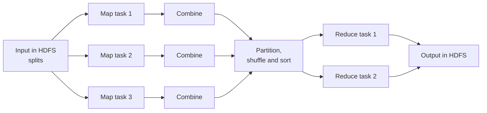
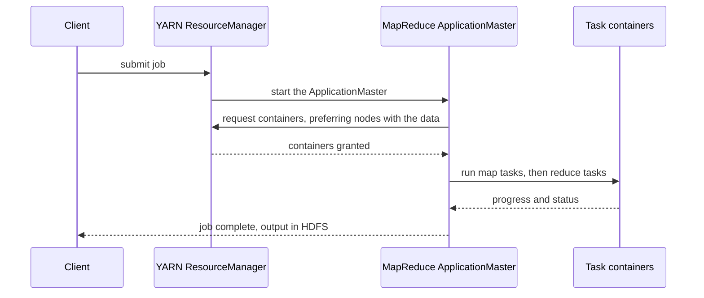

---
aliases:
  - MapReduce
  - Hadoop MapReduce
tags:
  - data-engineering
  - big-data
  - hadoop
  - batch-processing
  - distributed-systems
---
**MapReduce** is a **programming model and execution framework for processing huge datasets in parallel** on a cluster. You write two functions, a **map** and a **reduce**, and the framework takes care of splitting the input, running the code near the data, moving the intermediate results (the **shuffle**), handling failures and writing the output. It was introduced in a Google paper in 2004 and implemented in open source by Hadoop.

>[!tip] The model in one line: **map** turns each input record into `(key, value)` pairs, the framework **groups all values by key**, and **reduce** combines the values of each key into a result.

## The model

| Step | Who does it | What happens |
|---|---|---|
| **Input split** | Framework | The input in HDFS is cut into splits, usually one per block. One map task per split |
| **Map** | You | Runs in parallel on each split and emits `(key, value)` pairs |
| **Combine** (optional) | You | A mini-reduce on each mapper's output, to send less data over the network |
| **Partition** | Framework | Decides which reducer receives each key (by default a hash of the key) |
| **Shuffle and sort** | Framework | Moves the pairs to the reducers and sorts them by key |
| **Reduce** | You | Receives a key and all its values, and emits the result |
| **Output** | Framework | Each reducer writes a file to HDFS |



## Word count

The classic example: count how many times each word appears.

```text
Input line:         "the cat the dog"

map                 (the,1) (cat,1) (the,1) (dog,1)
combine (per node)  (the,2) (cat,1) (dog,1)
shuffle and sort    cat:[1]   dog:[1]   the:[2, ...]
reduce              (cat,1)   (dog,1)   (the,total)
```

### With Hadoop Streaming (Python)

Hadoop Streaming lets any program that reads standard input and writes standard output act as a mapper or reducer.

```python
# mapper.py
import sys

for line in sys.stdin:
    for word in line.strip().split():
        print(f"{word}\t1")
```

```python
# reducer.py  (input arrives sorted by key)
import sys

current, total = None, 0
for line in sys.stdin:
    word, count = line.rstrip("\n").split("\t")
    if word != current:
        if current is not None:
            print(f"{current}\t{total}")
        current, total = word, 0
    total += int(count)
if current is not None:
    print(f"{current}\t{total}")
```

```bash
hadoop jar $HADOOP_HOME/share/hadoop/tools/lib/hadoop-streaming-*.jar \
  -input /data/books \
  -output /data/wordcount \
  -mapper mapper.py \
  -reducer reducer.py \
  -file mapper.py -file reducer.py
```

The reducer relies on the keys arriving **sorted**, so it only needs to remember the current key. The same logic in a Java job uses the `Mapper` and `Reducer` classes.

## How a job runs



MapReduce runs on [[data architecture/Apache Hadoop/YARN.md|YARN]], reads and writes [[data architecture/Apache Hadoop/HDFS.md|HDFS]], and each task runs in a container. The framework tries to run each map task **on a node that holds its block** (data locality).

## Inside the shuffle

The shuffle is the heart, and the most expensive part, of a job:

1. **Map side:** map output goes to an in-memory buffer, is **partitioned** by reducer, sorted by key, and **spilled** to local disk when the buffer fills. Spill files are merged. The combiner may run here.
2. **Copy:** each reducer fetches its partition from **every** mapper over the network.
3. **Reduce side:** the fetched pieces are merged and sorted, and the reducer reads the groups of values per key.

Because the map output goes to the **local disk** and the final result to HDFS, every job pays disk and network costs, and a chain of jobs pays them again at each step.

## Fault tolerance

| Failure | What the framework does |
|---|---|
| A task fails | Reruns it on another node, up to a configured number of attempts |
| A node dies | Reruns its tasks elsewhere. Completed map outputs on the lost node are recomputed if still needed |
| A slow task (straggler) | **Speculative execution** starts a duplicate on another node and uses whichever finishes first |
| ApplicationMaster fails | YARN restarts it and the job recovers its progress |

Tasks must be **deterministic and side-effect free**, so that rerunning them gives the same result.

## Common patterns

| Pattern | How it works |
|---|---|
| **Filter and transform** | Map only (set the number of reducers to 0) |
| **Aggregation** | Key by the group, reduce with sum, count, min or max. Use a combiner when the operation is associative |
| **Sorting** | Use the framework sort, with a partitioner that keeps the key ranges in order |
| **Reduce-side join** | Mappers tag records from each dataset by join key, reducers join the records of the same key |
| **Map-side join** | Load the small dataset into memory in each mapper, so there is no shuffle (the idea behind the broadcast join in Spark) |
| **Top N** | Each mapper keeps a local top N, one reducer merges them |
| **Deduplication** | Use the whole record as the key, and emit it once in the reducer |

## Useful concepts

- **Counters:** named counters, built in or custom, that count events across all tasks (records read, bad records).
- **Combiner:** an optimization, not a guarantee. It may run zero, one or several times, so it must give the same result either way.
- **Partitioner:** controls which reducer gets a key. A bad partitioner or a hot key causes **skew**: one reducer runs much longer than the others.
- **Number of reducers:** set by the user. Too few is slow, too many produces many small output files.
- **Distributed cache:** ships small read-only files to all tasks.

## Limits and why Spark replaced it

| Limit of MapReduce | How Spark improves it |
|---|---|
| Writes intermediate results to disk between every job | Keeps data in memory and pipelines several steps in one job |
| Multi-step pipelines need many chained jobs | One program expresses the whole pipeline as a plan |
| High start-up latency per job | Faster start and reuse of executors |
| Verbose low-level code | DataFrames and SQL, in Python and Scala |
| Poor for iterative work (machine learning, graphs) | Caching makes iterations fast |
| Batch only | Batch and streaming with one API |

The ideas live on: a Spark `groupBy` or `reduceByKey` is a map side, a **shuffle** and a reduce side, and `broadcast` joins are map-side joins. See [[data architecture/Apache Spark/Apache Spark.md|Apache Spark]] and [[data architecture/Apache Spark/sql and optimization/Spark Joins.md|Spark Joins]].

## Where MapReduce is still seen

- **Legacy jobs** on on-premises Hadoop clusters, which are often migrated to Spark or SQL.
- **Hive** queries on older clusters that still use MapReduce as the engine (most moved to Tez or Spark).
- **Concept in interviews and design:** many distributed systems, from Spark to data warehouses, rely on the same map, shuffle and reduce idea.

## Best practices

- Use a **combiner** whenever the operation allows it.
- Choose a reasonable number of reducers, and avoid tiny output files.
- Watch for **skew** and a hot key, and use a custom partitioner or key salting.
- Use compressed, splittable or container formats (Parquet, ORC, or block-compressed sequence files).
- Avoid many small input files, because each one becomes a map task.
- Keep map and reduce functions deterministic and free of side effects.
- For new work, prefer Spark or SQL engines.

## Common pitfalls

- Millions of small input files, creating millions of short map tasks.
- A combiner that is not associative, giving wrong results.
- A single reducer by accident, which makes the job a bottleneck.
- A hot key that sends most data to one reducer.
- Reading all values of a key into memory in the reducer.
- A reducer that depends on a side effect or on the order of values.
- Chaining many jobs when one Spark pipeline would do.

## Related

- [[data architecture/Apache Hadoop/HDFS.md|HDFS]]
- [[data architecture/Apache Hadoop/YARN.md|YARN]]
- [[data architecture/Apache Spark/Apache Spark.md|Apache Spark]]

## Interview questions

- Explain map, shuffle and reduce with word count.
- What does the combiner do, and when is it safe to use?
- What does the partitioner do, and what is data skew?
- How are the number of map tasks and reduce tasks decided?
- What happens when a task or a node fails? What is speculative execution?
- How do you implement a join in MapReduce?
- Why is MapReduce slow for multi-step and iterative jobs?
- How does Spark improve on MapReduce?
- What is data locality, and how does the framework use it?
