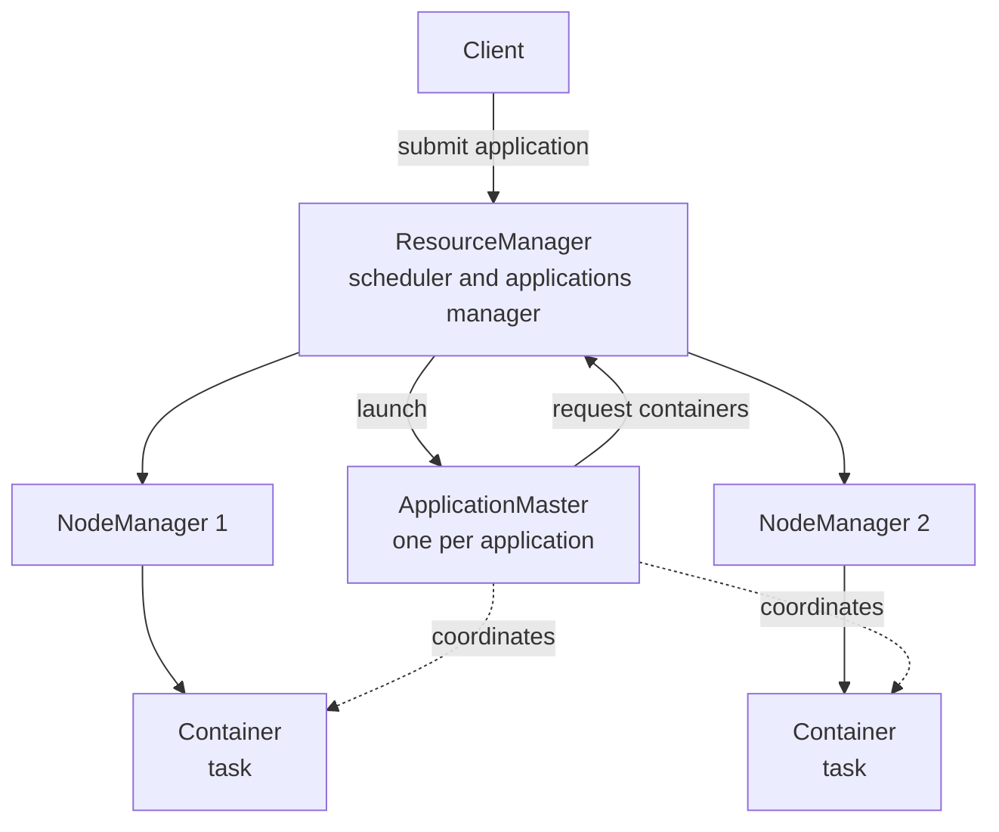
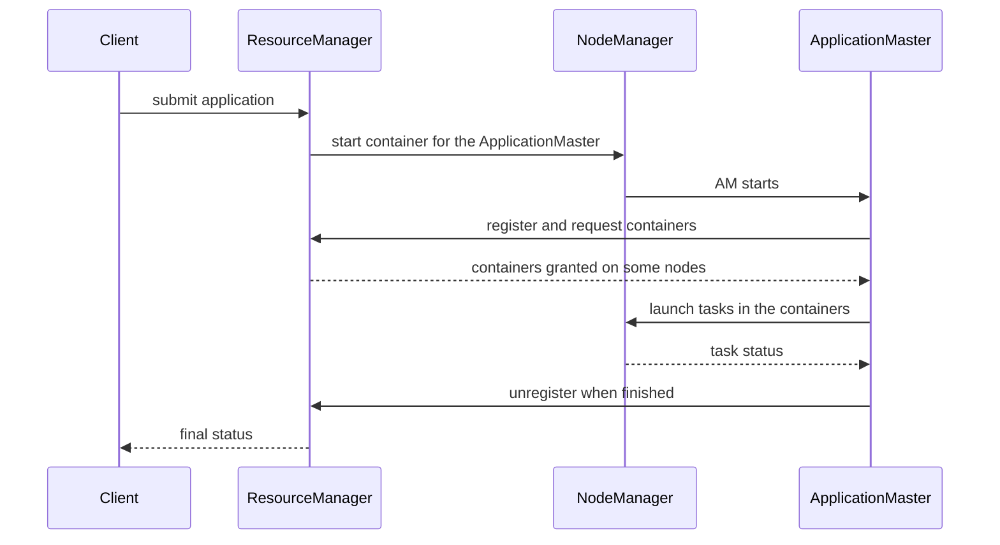

---
aliases:
  - YARN
  - Yet Another Resource Negotiator
  - Hadoop YARN
tags:
  - data-engineering
  - big-data
  - hadoop
  - scheduling
  - distributed-systems
---
**YARN (Yet Another Resource Negotiator)** is the **cluster resource manager** of Hadoop. It decides which application gets how much CPU and memory, on which machine, and for how long. It was introduced in Hadoop 2 to separate **resource management** from **data processing**, so engines other than MapReduce (Spark, Hive on Tez, Flink and others) can share the same cluster and the same data in HDFS.

>[!tip] Think of YARN as the operating system of the cluster: it does not process data, it **hands out containers** (slices of CPU and memory) to applications that do.

## Why YARN exists

In Hadoop 1, one component (the JobTracker) managed resources **and** scheduled every MapReduce job. It was a scalability limit and a single point of failure, and the cluster could only run MapReduce. YARN splits these roles:

| | Hadoop 1 | Hadoop 2 and later |
|---|---|---|
| Resource management | JobTracker | **ResourceManager** (YARN) |
| Per-job coordination | JobTracker | **ApplicationMaster** (one per job) |
| Worker agent | TaskTracker with fixed map and reduce slots | **NodeManager** with flexible containers |
| Workloads | MapReduce only | MapReduce, Spark, Tez, Flink, and more |
| Scalability | About 4,000 nodes | Much larger clusters |

## Architecture



| Component | Role |
|---|---|
| **ResourceManager (RM)** | The master. Knows the total resources of the cluster and decides who gets them. It has a **scheduler** (allocation policy) and an **applications manager** (accepts jobs, starts the ApplicationMaster) |
| **NodeManager (NM)** | Runs on every worker. Reports its resources and health, starts and monitors containers, and enforces their limits |
| **ApplicationMaster (AM)** | A per-application process. Asks the RM for containers, tells the NMs to run tasks in them, tracks progress and handles task failures |
| **Container** | A bundle of resources (memory, vcores, and optionally GPUs) on one node where a task runs |

## Application lifecycle



## Schedulers

The scheduler shares the cluster among users and teams.

| Scheduler | Behavior | Use it when |
|---|---|---|
| **FIFO** | Jobs run in order of arrival | Tests, a single user. A long job blocks everyone |
| **Capacity** | Hierarchical **queues** with a guaranteed share of the cluster. Idle capacity can be borrowed | Many teams that each need a guaranteed minimum |
| **Fair** | Resources are divided so that, over time, every running application gets an equal share | Mixed workloads that should share evenly |

- **Queues** group users or teams and give them limits and priorities.
- **Preemption** takes containers back from a queue that uses more than its share, to give them to a queue below its guarantee.
- **Node labels** mark nodes (for example GPU or memory-heavy) so that some applications run only there.

## Resource model

- Resources are requested as **memory** and **vcores** (and GPUs in recent versions).
- Each NodeManager offers part of its machine, for example `yarn.nodemanager.resource.memory-mb` and `yarn.nodemanager.resource.cpu-vcores`.
- The scheduler never gives a container more than `yarn.scheduler.maximum-allocation-mb`, and rounds requests up to `yarn.scheduler.minimum-allocation-mb`.
- A container that **uses more memory than it asked for** is killed by the NodeManager. This is the most common YARN error (see pitfalls).

## Data locality

When the AM asks for containers it can state a **preference** for nodes that hold the HDFS blocks it needs. The scheduler tries, in order: the same node, the same rack, then any node. Running the task next to the data avoids moving big blocks over the network. See [[data architecture/Apache Hadoop/HDFS.md|HDFS]].

## High availability

- **ResourceManager HA:** an active and a standby RM, coordinated through ZooKeeper. After a failover, running applications can recover their state.
- **NodeManager failure:** the RM detects the lost heartbeats and the AMs ask for replacement containers.
- **ApplicationMaster failure:** the RM restarts it up to a configured number of attempts.

## Running Spark on YARN

[[data architecture/Apache Spark/Apache Spark.md|Apache Spark]] can use YARN as its cluster manager.

```bash
spark-submit \
  --master yarn \
  --deploy-mode cluster \
  --num-executors 10 \
  --executor-memory 8g \
  --executor-cores 4 \
  my_job.py
```

| Mode | The Spark driver runs | Use it for |
|---|---|---|
| `cluster` | Inside the cluster, in the ApplicationMaster container | Production jobs, so the job survives the client leaving |
| `client` | On the machine that submitted the job | Interactive work such as a shell or notebook |

Each Spark executor is a YARN container. With dynamic allocation, Spark asks YARN for more executors under load and gives them back when idle.

## Commands

```bash
yarn application -list                       # running applications
yarn application -status <app_id>            # details of one application
yarn application -kill <app_id>              # stop an application
yarn logs -applicationId <app_id>            # aggregated logs after it finishes
yarn node -list                              # NodeManagers and their state
yarn queue -status <queue>                   # capacity and usage of a queue
```

The ResourceManager web UI shows queues, applications, containers and node health, and links to the logs of each task.

## YARN vs Kubernetes

| | YARN | Kubernetes |
|---|---|---|
| Origin | Built for Hadoop and big data jobs | General purpose container orchestration |
| Unit of work | Container of a task, no image | Pod with a container image |
| Data locality | Natively aware of HDFS blocks | Not aware, data usually in object storage |
| Isolation and dependencies | Shared Java and Python on the nodes | Each job brings its own image |
| Ecosystem | Hadoop tools | Whole cloud native ecosystem |
| Trend | Legacy and on-premises Hadoop | Standard for new platforms, Spark and others run natively on it |

New platforms usually choose Kubernetes, while existing Hadoop clusters keep YARN.

## Best practices

- Use the **Capacity** or **Fair** scheduler with queues per team, and set limits for ad hoc users.
- Size containers to the real need. Too small gets killed, too big wastes the cluster.
- Leave memory for the operating system and daemons when setting the NodeManager resources.
- Enable log aggregation, so you can read the logs after a container is gone.
- Enable ResourceManager HA and monitor node health.
- Use node labels for special hardware.
- Run production Spark jobs in `cluster` mode.

## Common pitfalls

- A container is killed for **exceeding its memory limit**: the JVM or Python process uses more than requested (memory overhead, off-heap, Python workers). Increase the memory overhead or fix the leak.
- One big job takes all the cluster because there are no queues.
- A request larger than the maximum allocation never gets scheduled.
- Too many vcores per container makes tasks fight for the same CPU.
- No log aggregation, so the logs disappear with the container.
- Idle executors holding resources, because dynamic allocation is off.
- Sending all teams to the same default queue.

## Related

- [[data architecture/Apache Hadoop/HDFS.md|HDFS]]
- [[data architecture/Apache Hadoop/MapReduce.md|MapReduce]]
- [[data architecture/Apache Spark/Apache Spark.md|Apache Spark]]
- [[Apache Airflow]]

## Interview questions

- What problem did YARN solve compared with Hadoop 1?
- What are the roles of the ResourceManager, NodeManager and ApplicationMaster?
- What is a container?
- Describe what happens from `spark-submit` to the first task running.
- What is the difference between the Capacity and the Fair scheduler?
- What is preemption, and why is it used?
- Why would YARN kill a container, and how do you fix it?
- What is the difference between Spark `cluster` and `client` mode on YARN?
- How does YARN support data locality?
- Why are new platforms moving from YARN to Kubernetes?
