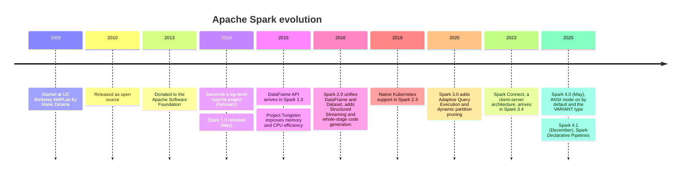
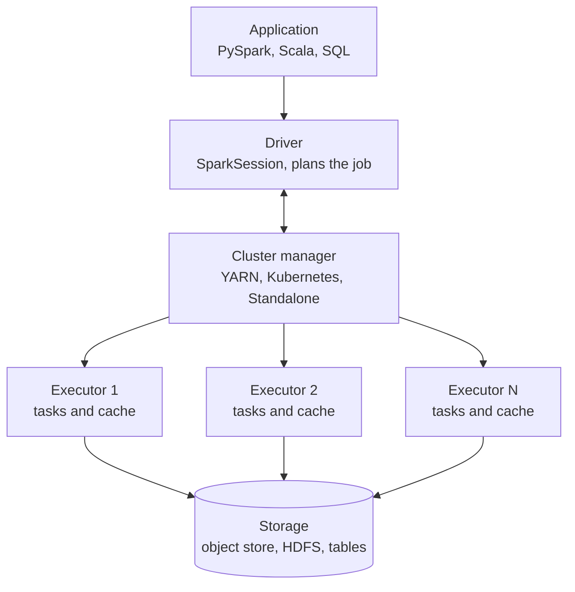
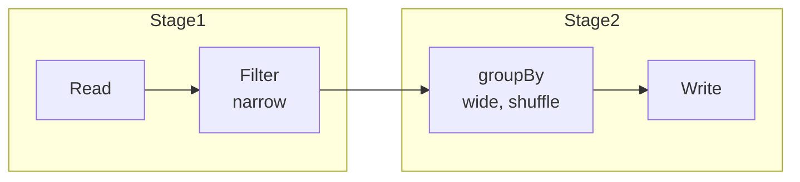

---
aliases:
  - Spark
  - Apache Spark
  - PySpark
tags:
  - data-engineering
  - big-data
  - spark
  - distributed-systems
description: "Overview of Apache Spark, the distributed data processing engine: why it exists, architecture, execution model, APIs, optimizer, modules, deployment, tuning and common pitfalls."
---


**Apache Spark** is an open source, **distributed data processing engine** for large datasets. It splits the data into partitions, spreads the work across a cluster of machines, and keeps intermediate data **in memory** when it can. It runs batch jobs, SQL, streaming and machine learning with one engine and a common API, in Python, Scala, SQL, Java and R.

>[!tip] Spark is a **compute engine**, not a database. It reads data from storage (object storage, HDFS, databases, [[data architecture/Apache Kafka/Kafka.md|Kafka]]), processes it in parallel, and writes the result back. It stores nothing by itself.

## Why Spark

Before Spark, Hadoop MapReduce wrote every intermediate result to disk, which made multi-step and iterative jobs slow. Spark keeps the working data in memory and builds an **optimized execution plan** for the whole job, so it is much faster for pipelines and iterative algorithms, with a far simpler API.

| | Hadoop MapReduce | Spark |
|---|---|---|
| Intermediate data | Written to disk between steps | In memory when possible, spilled to disk if needed |
| API | Low level map and reduce | DataFrames, SQL, high-level operators |
| Workloads | Batch only | Batch, SQL, streaming, ML, graphs |
| Optimization | Manual | Automatic query optimizer |

## Architecture

![[Spark Architecture.excalidraw|1024]]



| Component           | Role                                                                                                                   |
| ------------------- | ---------------------------------------------------------------------------------------------------------------------- |
| **Driver**          | Runs your program, builds the plan, splits it into stages and tasks, and tracks them. If it dies, the application dies |
| **Executor**        | A process on a worker that runs tasks and holds cached data. Many executors run in parallel                            |
| **Cluster manager** | Gives resources to the application: Standalone, YARN, Kubernetes (Mesos support was removed in Spark 4)                |
| **SparkSession**    | The entry point of the application                                                                                     |
| **Partition**       | A slice of the data. One task processes one partition                                                                  |

## Execution model

- **Lazy evaluation:** transformations (`filter`, `select`, `join`, `groupBy`) only build a plan. Nothing runs until an **action** (`count`, `collect`, `write`, `show`).
- **Narrow transformation:** each output partition depends on one input partition (`filter`, `select`, `map`). No data movement.
- **Wide transformation:** needs data from many partitions (`groupBy`, `join`, `distinct`, `orderBy`). It triggers a **shuffle**: data is written, moved across the network and regrouped. It is the most expensive step.
- **Job, stage, task:** an action creates a **job**. The job is cut into **stages** at each shuffle boundary. Each stage runs one **task** per partition.
- **Fault tolerance:** Spark keeps the **lineage** (how each partition was built), so it can recompute a lost partition instead of replicating data.



## APIs

| API | Notes |
|---|---|
| **SQL** | Plain SQL over tables and views. Same engine and optimizer as the others |
| **DataFrame** | A distributed table with named columns. The default choice. Optimized by Catalyst |
| **Dataset** | Typed DataFrame for Scala and Java |
| **RDD** | Low-level distributed collection. Gives control, but no automatic optimization. Use it rarely |

```python
from pyspark.sql import SparkSession, functions as F

spark = SparkSession.builder.appName("daily_revenue").getOrCreate()

orders = spark.read.parquet("s3://bucket/raw/orders/")

daily = (
    orders
    .filter(F.col("status") == "paid")
    .groupBy("customer_id", F.to_date("created_at").alias("order_date"))
    .agg(F.sum("amount").alias("revenue"))
)

daily.write.mode("overwrite").partitionBy("order_date").parquet("s3://bucket/gold/daily_revenue/")
```

Use the built-in functions in `pyspark.sql.functions`, not Python code, whenever you can (see UDFs below).

## Catalyst and Tungsten

- **Catalyst optimizer:** turns your query into a logical plan, optimizes it (predicate pushdown, column pruning, join reordering, constant folding), then picks a physical plan. See the plan with `df.explain()`.
- **Tungsten:** efficient binary memory layout and **whole-stage code generation**, so Spark compiles a stage into tight JVM code.
- **Adaptive Query Execution (AQE):** re-optimizes the plan **while it runs**, using real statistics: it coalesces small shuffle partitions, switches a join to a broadcast join and splits skewed partitions. It is on by default in recent versions.

## Modules

| Module | Purpose |
|---|---|
| **Spark SQL and DataFrames** | Structured data processing. The core module |
| **Structured Streaming** | Streaming as an unbounded table, with micro-batches. Reads from Kafka and files, with exactly-once results for supported sinks |
| **MLlib** | Distributed machine learning algorithms and pipelines |
| **GraphX** | Graph processing (mostly Scala, little used today) |
| **Pandas API on Spark** | Pandas-like API on distributed data |
| **Spark Connect** | Thin client talks to a remote Spark server, so apps and notebooks do not run the driver locally |

## Deployment

| Option                                             | Notes                                                                 |
| -------------------------------------------------- | --------------------------------------------------------------------- |
| **Standalone**                                     | Spark's own cluster manager. Simple, good for learning                |
| **YARN**                                           | Common in Hadoop environments                                         |
| **Kubernetes**                                     | Executors run as pods. The usual choice for new self-managed clusters |
| **AWS EMR**                                        | Managed Spark on AWS                                                  |
| [[providers/Google/GCP Dataproc.md\|GCP Dataproc]] | Managed Spark and Hadoop on Google Cloud                              |
| [[Databricks platform]]                            | Managed Spark platform from the original Spark creators               |

Running locally for development needs only Java and `pip install pyspark`, in `local[*]` mode.

## Storage and table formats

- **Columnar files** such as Parquet and ORC are the default for analytics: they allow **column pruning** and **predicate pushdown**.
- **Table formats** such as Delta Lake and Apache Iceberg add ACID transactions, schema evolution and time travel on top of files, which is the base of a [[Data Lakehouse]] and the [[Medallion architecture]].
- Avoid CSV and JSON for large analytical data. They have no schema, no column pruning and are slow to parse.

## Performance tuning

Most Spark problems are **too much data read, too much shuffle, or a few overloaded tasks**. The checklist below follows that order.

### Read less
- **Partition pruning:** query partitions directly. Filter on the partition column so Spark skips whole folders.
- **Predicate pushdown:** apply filters as early as possible, down to the file reader.
- **Column pruning:** choose the columns you need, not `select *`.
- **Fix small files:** thousands of tiny files make the job slow, because each file has a cost to open. Compact them into files of roughly 128 MB to 1 GB, with `coalesce`, `repartition`, or the compaction of your table format.

### Shuffle less
- **Broadcast join:** send the small table to every executor, so the big table is not shuffled. Spark does it automatically below `spark.sql.autoBroadcastJoinThreshold`, or you can force it with `broadcast(df)`. See [[data architecture/Apache Spark/sql and optimization/Spark Joins.md|Spark Joins]].
- **Bucketing:** pre-sort and pre-group data by the join key when the same big tables are joined many times.
- **Aggregate earlier:** reduce the data before a join or a shuffle.
- **Handle skew:** one hot key can make one task run for hours. Enable `spark.sql.adaptive.skewJoin.enabled=true`, or salt the key.

### Compute smarter
- **Turn on AQE:** `spark.sql.adaptive.enabled=true`.
- **Cache what you reuse:** use `cache()` or `persist()` only for a DataFrame used more than once, and `unpersist()` when done.
- **`repartition` vs `coalesce`:** `repartition(n)` does a full shuffle and can increase or balance partitions. `coalesce(n)` only reduces partitions, without a full shuffle.
- **Avoid Python UDFs:** a Python UDF moves data between the JVM and Python row by row, and blocks the optimizer. Prefer built-in functions, then **pandas UDFs** (vectorized with Arrow), and only then plain UDFs.

### Key settings

| Setting | What it controls |
|---|---|
| `spark.sql.shuffle.partitions` | Number of partitions after a shuffle (default 200). With AQE it can shrink automatically |
| `spark.sql.autoBroadcastJoinThreshold` | Max size of a table to broadcast automatically (default 10 MB) |
| `spark.sql.adaptive.enabled` | Turns AQE on |
| `spark.sql.adaptive.skewJoin.enabled` | Splits skewed partitions in joins |
| `spark.executor.memory` and `spark.executor.cores` | Size of each executor |
| `spark.dynamicAllocation.enabled` | Adds and removes executors with the load |

Defaults change between versions, so confirm them in the documentation of the version you run.

## Debugging with the Spark UI

The Spark UI (port 4040 for a running application) is the main tool to find the bottleneck:

- **Stages tab:** look for a stage much longer than the others, and for tasks with very different durations (**skew**).
- **SQL tab:** shows the physical plan and the data size at each step.
- **Shuffle read and write, and spill:** large values mean heavy shuffle or not enough memory.
- **Storage tab:** shows what is cached and how much memory it uses.

## Spark and the data stack

- **Orchestration:** schedule and monitor Spark jobs with [[Apache Airflow]] or [[providers/Google/GCP Cloud Composer.md|Cloud Composer]], and make jobs idempotent so a [[backfill]] is safe.
- **Streaming:** Structured Streaming consumes [[data architecture/Apache Kafka/Kafka.md|Kafka]] topics.
- **Quality:** validate data with [[data quality]] checks between layers.
- **Warehouse:** Spark often prepares the data that a [[Data Warehouse]] serves to analytics.

## Spark vs other engines

| Engine | Best at | Compared with Spark |
|---|---|---|
| **Spark** | Large batch ETL, ML pipelines, general processing, streaming | The general-purpose default |
| **Flink** | True event-by-event stream processing with low latency and rich state | Stronger for streaming, smaller batch ecosystem |
| **Trino** | Fast interactive SQL over many sources | Query engine, not for heavy ETL or ML |
| **BigQuery or other warehouses** | Serverless SQL analytics | No cluster to manage, SQL only |
| **Dask and Ray** | Python-native parallel computing | Better fit for Python and ML code, smaller SQL engine |
| **pandas** | Small data on one machine | Simpler, but limited by memory |

**Rule of thumb:** if the data fits comfortably on one machine, use a single-node tool. Use Spark when it does not, or when you need a mature distributed ETL, streaming and ML ecosystem.

## Best practices

- Prefer DataFrames and SQL over RDDs.
- Use columnar formats and partition on columns you filter by, with a moderate cardinality (for example date, not user id).
- Check the plan with `explain()` before tuning.
- Use built-in functions instead of UDFs.
- Right-size partitions: aim for tasks that take seconds to a few minutes, and partition files of about 128 MB or more.
- Avoid `collect()` on large data, because it brings everything to the driver.
- Write idempotent jobs (overwrite a partition instead of appending blindly).
- Test with a small sample, then scale up.
- Track cost and runtime of every job, and set alerts.

## Common pitfalls

- `select *` and reading every column and every partition.
- Using `collect()` or `toPandas()` on big data, which crashes the driver.
- Too many tiny files, or too many tiny partitions.
- Leaving the default 200 shuffle partitions on very small or very large jobs when AQE is off.
- Data skew on a hot key, ignored until one task runs for hours.
- Python UDFs in hot paths.
- Caching everything, which fills the memory and evicts useful data.
- Mixing up `repartition` and `coalesce`.
- Partitioning by a high-cardinality column, which creates millions of small files.

## Interview questions

- What is Spark, and why is it faster than MapReduce?
- What are the roles of the driver, the executors and the cluster manager?
- What is the difference between a transformation and an action, and what is lazy evaluation?
- What is a shuffle, and why is it expensive?
- What is the difference between a job, a stage and a task?
- What is the difference between narrow and wide transformations?
- How do `repartition` and `coalesce` differ?
- How would you fix a skewed join?
- What does AQE do, and which problems does it solve?
- Why are Python UDFs slow, and what are the alternatives?
- How do you debug a slow Spark job?
- When would you choose Spark over Flink or a data warehouse?

## Links
- [[data architecture/Apache Spark/sql and optimization/Catalyst.md|Catalyst]]
- [[data architecture/Apache Spark/sql and optimization/Spark Joins.md|Spark Joins]]
- [[data architecture/Apache Spark/sql and optimization/Spark UDFs.md|Spark UDFs]]
- [[data architecture/Apache Spark/core concepts/Spark RDD.md|Spark RDD]]
- [[data architecture/Apache Spark/core concepts/Spark Lazy Evaluation.md|Spark Lazy Evaluation]]
- [[data architecture/Apache Spark/core concepts/Spark Narrow Transformations.md|Spark Narrow Transformations]]
- [[data architecture/Apache Spark/core concepts/Spark Wide Transformations.md|Spark Wide Transformations]]
- [[data architecture/Apache Spark/memory and performance/Spark Spills.md|Spark Spills]]
- [[data architecture/Apache Spark/core concepts/Spark Repartition.md|Spark Repartition]]
- [[data architecture/Apache Spark/common errors/Spark OutOfMemoryError.md|Spark OutOfMemoryError]]
- [[data architecture/Apache Spark/presentations/Spark Presentation.md|Spark Presentation]]
