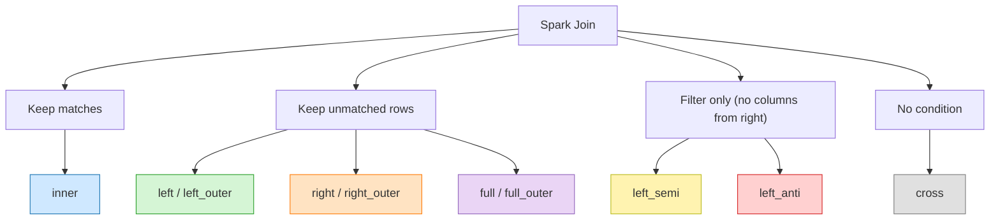
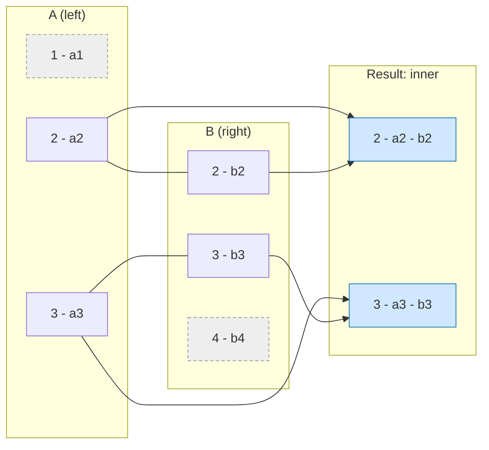
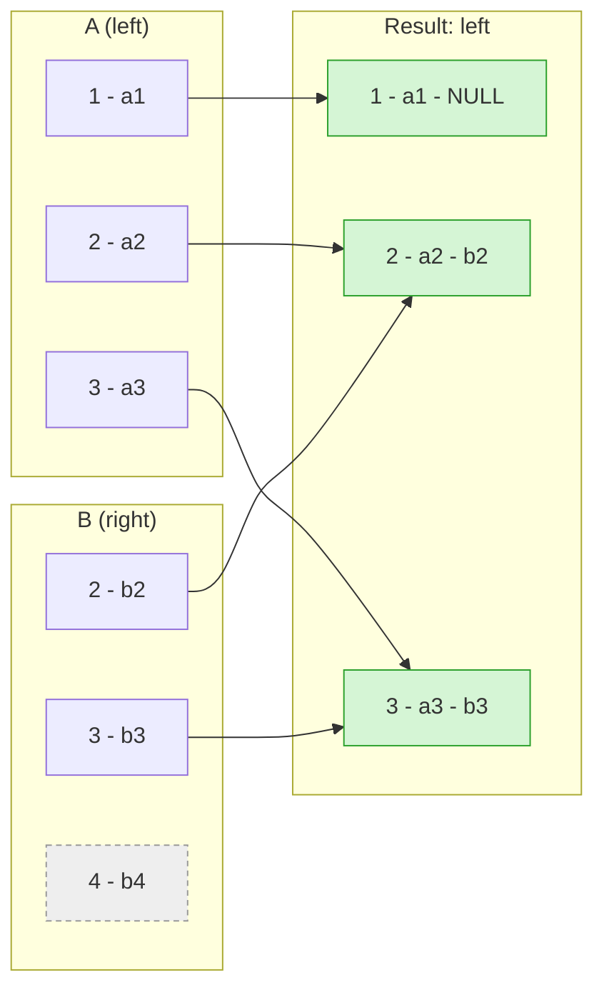
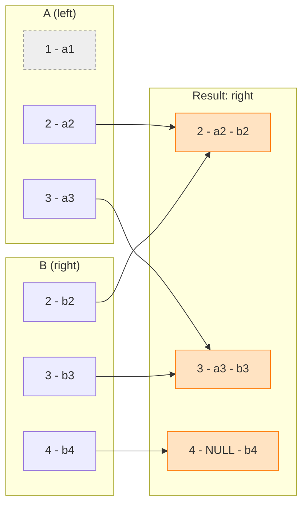
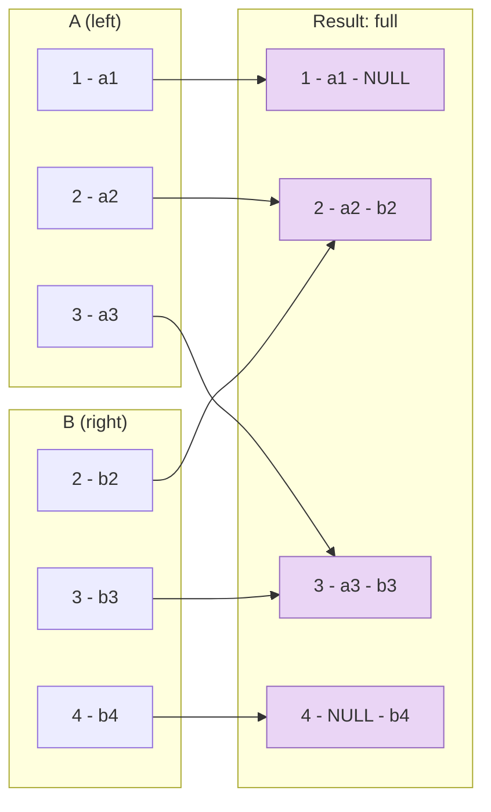
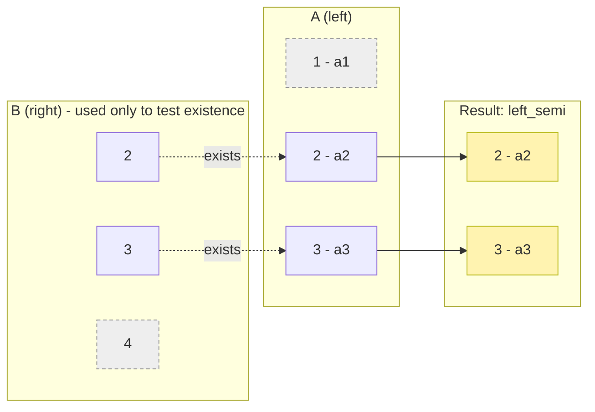
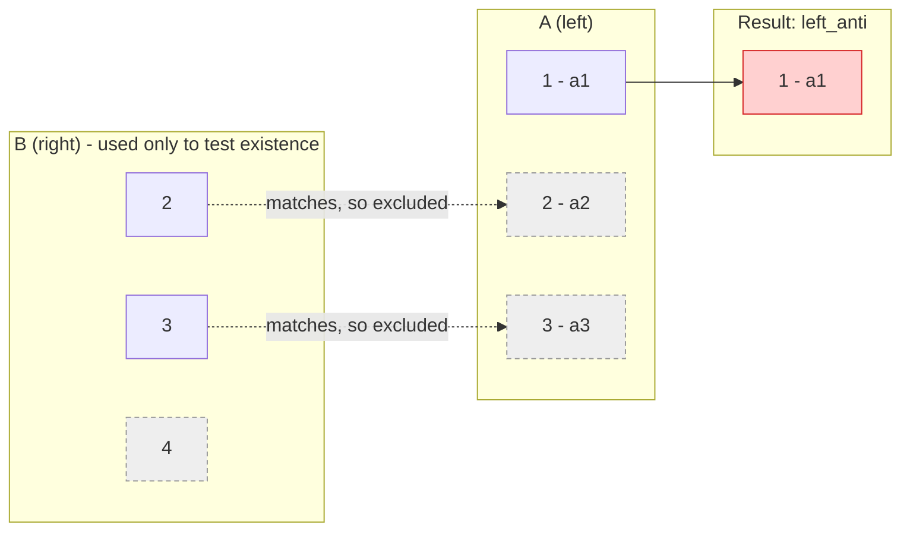
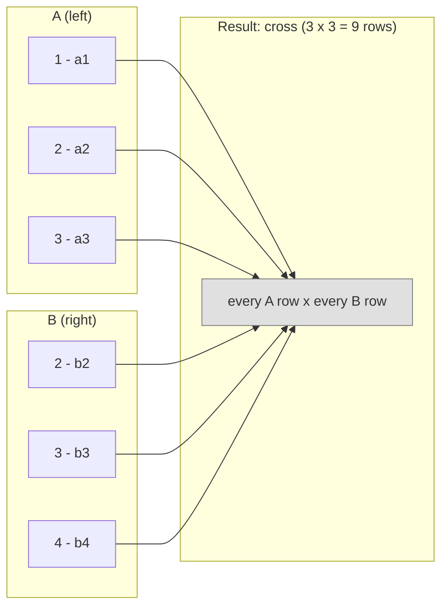
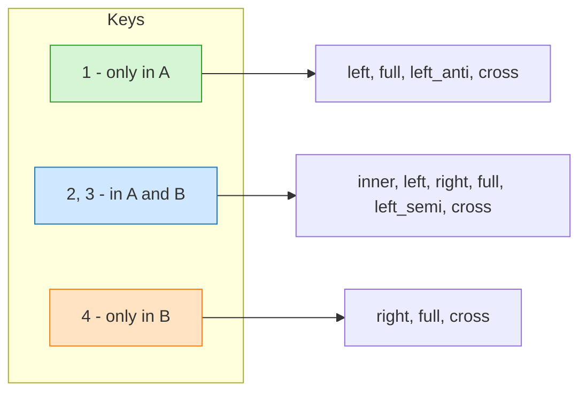
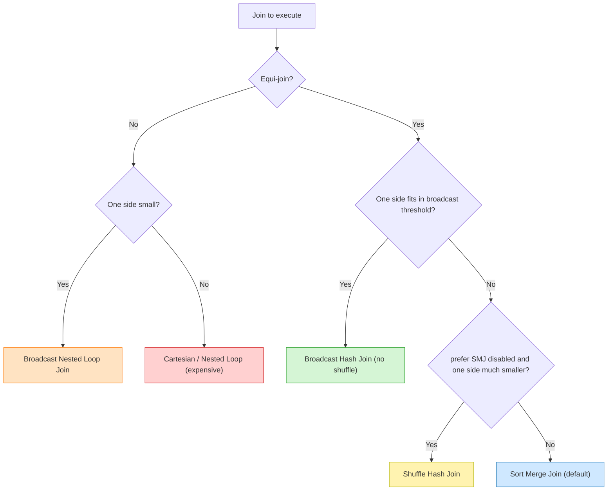

# Spark Joins

A **join** combines rows from two DataFrames (or tables) based on a **join condition** (usually key equality). In Spark, the **join type** decides *which rows are kept* when there is no match, and the **join strategy** decides *how the data is physically moved and compared* across the cluster.

Two separate decisions:

| Decision | Question it answers | Examples |
|---|---|---|
| **Join type** | Which rows appear in the result? | inner, left, right, full, semi, anti, cross |
| **Join strategy** | How does Spark execute it? | broadcast hash, sort merge, shuffle hash, nested loop |

## Join Types Overview



| Join type (`how=`) | Aliases | Rows kept | Columns returned |
|---|---|---|---|
| `inner` | `inner` (default) | Only keys present in **both** sides | Left + Right |
| `left` | `leftouter`, `left_outer` | All left rows; right is `NULL` when no match | Left + Right |
| `right` | `rightouter`, `right_outer` | All right rows; left is `NULL` when no match | Left + Right |
| `full` | `outer`, `fullouter`, `full_outer` | All rows from both sides; `NULL` where no match | Left + Right |
| `left_semi` | `semi`, `leftsemi` | Left rows that **have** a match | Left only |
| `left_anti` | `anti`, `leftanti` | Left rows that have **no** match | Left only |
| `cross` | `cross` | Every left row paired with every right row (Cartesian product) | Left + Right |

> Spark has no `right_semi` / `right_anti`. Swap the DataFrames and use `left_semi` / `left_anti`.

## Sample Data

Used in every example below.

**A (left)**

| key | a_val |
|---|---|
| 1 | a1 |
| 2 | a2 |
| 3 | a3 |

**B (right)**

| key | b_val |
|---|---|
| 2 | b2 |
| 3 | b3 |
| 4 | b4 |

Keys `2` and `3` match. Key `1` exists only in A, key `4` exists only in B.

```python
from pyspark.sql import SparkSession

spark = SparkSession.builder.appName("joins").getOrCreate()

a = spark.createDataFrame([(1, "a1"), (2, "a2"), (3, "a3")], ["key", "a_val"])
b = spark.createDataFrame([(2, "b2"), (3, "b3"), (4, "b4")], ["key", "b_val"])
```

## 1. Inner Join

Returns only rows whose key exists in **both** DataFrames. Rows without a match on either side are dropped.



```python
a.join(b, on="key", how="inner")
```

```sql
SELECT * FROM a INNER JOIN b ON a.key = b.key;
```

| key | a_val | b_val |
|---|---|---|
| 2 | a2 | b2 |
| 3 | a3 | b3 |

## 2. Left (Outer) Join

Keeps **all rows from the left**. When there is no match in the right, right columns are `NULL`.



```python
a.join(b, on="key", how="left")
```

```sql
SELECT * FROM a LEFT JOIN b ON a.key = b.key;
```

| key | a_val | b_val |
|---|---|---|
| 1 | a1 | NULL |
| 2 | a2 | b2 |
| 3 | a3 | b3 |

## 3. Right (Outer) Join

Keeps **all rows from the right**. When there is no match in the left, left columns are `NULL`. It is the mirror of the left join.



```python
a.join(b, on="key", how="right")
```

```sql
SELECT * FROM a RIGHT JOIN b ON a.key = b.key;
```

| key | a_val | b_val |
|---|---|---|
| 2 | a2 | b2 |
| 3 | a3 | b3 |
| 4 | NULL | b4 |

## 4. Full (Outer) Join

Keeps **all rows from both sides**. Unmatched rows get `NULL` for the columns of the other side. It is the union of a left join and a right join.



```python
a.join(b, on="key", how="full")
```

```sql
SELECT * FROM a FULL OUTER JOIN b ON a.key = b.key;
```

| key | a_val | b_val |
|---|---|---|
| 1 | a1 | NULL |
| 2 | a2 | b2 |
| 3 | a3 | b3 |
| 4 | NULL | b4 |

## 5. Left Semi Join

Acts as a **filter**: returns left rows that have **at least one match** in the right, but returns **only left columns**. No duplication even if the right has many matches for a key (equivalent to `WHERE EXISTS` / `IN`).



```python
a.join(b, on="key", how="left_semi")
```

```sql
SELECT * FROM a LEFT SEMI JOIN b ON a.key = b.key;
-- equivalent
SELECT * FROM a WHERE EXISTS (SELECT 1 FROM b WHERE b.key = a.key);
```

| key | a_val |
|---|---|
| 2 | a2 |
| 3 | a3 |

## 6. Left Anti Join

The opposite of semi: returns left rows that have **no match** in the right, with **only left columns** (equivalent to `WHERE NOT EXISTS`). Great for "what is missing?" checks and incremental loads.



```python
a.join(b, on="key", how="left_anti")
```

```sql
SELECT * FROM a LEFT ANTI JOIN b ON a.key = b.key;
-- equivalent
SELECT * FROM a WHERE NOT EXISTS (SELECT 1 FROM b WHERE b.key = a.key);
```

| key | a_val |
|---|---|
| 1 | a1 |

## 7. Cross Join

Cartesian product: **every left row with every right row**, no condition. Result size = `rows(A) x rows(B)` (here 3 x 3 = 9). Dangerous on large data.



```python
a.crossJoin(b)                       # explicit, always allowed
a.join(b, how="cross")               # equivalent
```

```sql
SELECT * FROM a CROSS JOIN b;
```

> Since Spark 3.0, an implicit Cartesian product (a join with no condition) fails unless `spark.sql.crossJoin.enabled=true` or you call `crossJoin()` explicitly.

## All Joins at a Glance

Which rows of the sample data survive in each join type:



| Key group | inner | left | right | full | left_semi | left_anti |
|---|:-:|:-:|:-:|:-:|:-:|:-:|
| Only in A (key 1) | - | yes | - | yes | - | yes |
| In A and B (keys 2, 3) | yes | yes | yes | yes | yes | - |
| Only in B (key 4) | - | - | yes | yes | - | - |

## Writing the Join Condition

```python
# 1. Same column name on both sides -> a single "key" column in the result
a.join(b, on="key")
a.join(b, on=["key", "other_key"])          # composite key

# 2. Different names -> both columns are kept (duplicate-prone)
a.join(b, a.key == b.id, "inner")

# 3. Non-equi join (range / inequality) - slower, no hash/sort-merge
a.join(b, (a.ts >= b.start_ts) & (a.ts < b.end_ts), "inner")
```

```python
# Aliases avoid ambiguous column errors
from pyspark.sql import functions as F

x = a.alias("x")
y = b.alias("y")
x.join(y, F.col("x.key") == F.col("y.key"), "left").select("x.key", "x.a_val", "y.b_val")
```

## Join Strategies (Physical Execution)

Spark's optimizer picks a strategy from the join type, the condition and table size statistics.

| Strategy | When Spark uses it | Shuffle? | Notes |
|---|---|---|---|
| **Broadcast Hash Join (BHJ)** | One side is small (below `spark.sql.autoBroadcastJoinThreshold`, default 10 MB) | No | Fastest. Copies the small table to every executor |
| **Shuffle Hash Join (SHJ)** | Equi-join, one side much smaller per partition | Yes | Builds a hash table per partition; can OOM |
| **Sort Merge Join (SMJ)** | Default for large equi-joins | Yes (both sides, plus sort) | Scales well; needs sortable keys |
| **Broadcast Nested Loop Join** | Non-equi join with one small side | No | Slow, O(n x m) |
| **Cartesian Product** | Cross join / inner join without condition | Yes | Very expensive |



### Join Hints

```python
from pyspark.sql.functions import broadcast

a.join(broadcast(b), "key")                 # force broadcast of b
a.join(b.hint("shuffle_hash"), "key")       # prefer shuffle hash
a.join(b.hint("merge"), "key")              # prefer sort merge
```

```sql
SELECT /*+ BROADCAST(b) */ * FROM a JOIN b ON a.key = b.key;
```

Broadcast is not used for the preserved side of an outer join: a left join can broadcast only the **right** side, a right join only the **left** side, and a full outer join cannot broadcast.

## Performance Tips

- **Filter and select early** (predicate pushdown, column pruning) so less data is shuffled.
- **Broadcast the small side** whenever possible (dimension tables).
- **Enable AQE** (`spark.sql.adaptive.enabled=true`): converts sort merge to broadcast at runtime and splits skewed partitions (`spark.sql.adaptive.skewJoin.enabled=true`).
- **Bucket** both tables on the join key (same bucket count) to avoid shuffle on repeated joins.
- **Handle skew**: hot keys cause straggler tasks; use AQE skew join, salting, or isolate hot keys.
- Prefer **`left_semi` / `left_anti`** over `join` + `distinct` or `NOT IN` when you only need existence checks.

## Common Pitfalls

- **`NULL` keys never match** with `=`, so rows with a `NULL` key are dropped by `inner` and appear unmatched in outer joins. Use the null-safe operator to match them:
  ```python
  a.join(b, a.key.eqNullSafe(b.key), "inner")   # SQL: a.key <=> b.key
  ```
- **Duplicate keys multiply rows**: if key `2` appears 3 times in A and 2 times in B, an inner join produces 3 x 2 = 6 rows for it. Deduplicate first if this is not intended.
- **Duplicate column names** when joining on an expression (`a.key == b.key`) make later `select("key")` ambiguous. Use `on="key"` or aliases.
- **Filtering after an outer join** can silently turn it into an inner join. A `WHERE b.b_val = 'x'` after a left join removes the `NULL` rows. Put right-side filters in the `ON` clause (or filter `b` before joining) to keep the left rows.
- **Cartesian explosions** from a missing or wrong condition: check the physical plan with `df.explain()`.
