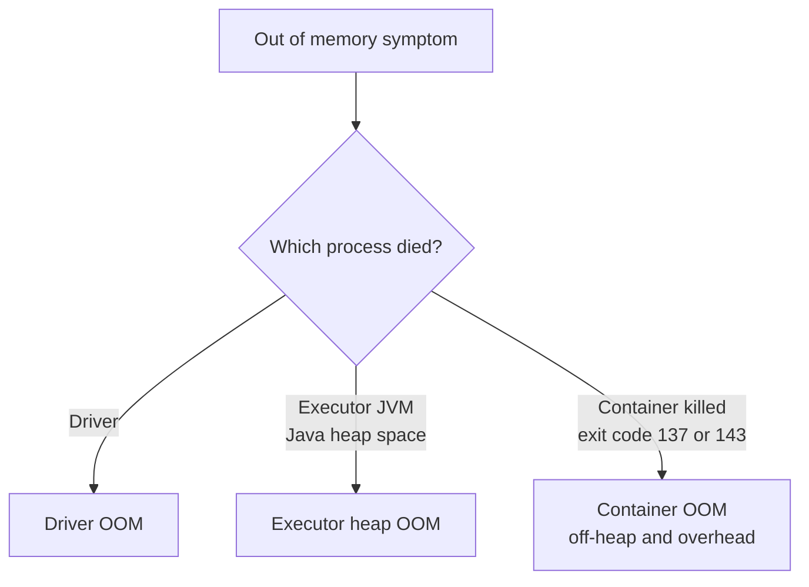

---
aliases:
  - OutOfMemoryError
  - Spark OOM
  - Spark OutOfMemoryError
  - OOM
  - OOMKilled
tags:
  - data-engineering
  - spark
  - troubleshooting
  - memory
description: What an OutOfMemoryError means in Apache Spark, where it can happen (driver, executor heap, container), how to recognize it from the error message, and the first ways to manage it.
---
An **`OutOfMemoryError`** (OOM) in Spark means that a process of the application needed more memory than it was allowed to use. Unlike a [[data architecture/Apache Spark/memory and performance/Spark Spills.md|spill]], where Spark writes data to disk and keeps going, an OOM **kills the task or the process**. Spark retries the task (`spark.task.maxFailures`, 4 by default), and if it keeps failing, the stage and the job fail.

>[!tip] The first question is **where** it happened. Each place has a different cause and fix, so raising `spark.executor.memory` blindly fixes only one of them.

## Where it can happen

| Where | What runs there | Typical trigger |
|---|---|---|
| **Driver** | The plan, the task metadata and any result you bring back | `collect()`, `toPandas()`, a large broadcast, too many tasks or files |
| **Executor heap** | The tasks and their execution memory | Partitions too big for the memory per task, skew, huge `collect_list` or `explode` |
| **Container** | Heap plus overhead, off-heap and Python workers | PySpark workers, off-heap buffers, `memoryOverhead` too small |

## Recognizing it by the message

| Message or signal | Points to |
|---|---|
| `OutOfMemoryError: Java heap space` in the **driver** log | Driver |
| `OutOfMemoryError: Java heap space` in an **executor** log | Executor heap |
| `OutOfMemoryError: GC overhead limit exceeded` | Heap under pressure (driver or executor) |
| `SparkOutOfMemoryError: Unable to acquire N bytes of memory, got 0` | Executor: no execution memory left, even after spilling |
| `Container killed by YARN for exceeding memory limits` (exit code 143) | Container |
| `OOMKilled`, exit code **137** (Kubernetes) | Container |
| `ExecutorLostFailure` with no Java stack trace | Container: the OS killed the process |
| `Total size of serialized results ... is bigger than spark.driver.maxResultSize` | Driver: result too large (same root cause) |

A kill with **no Java stack trace** is usually the container, so read the **cluster manager** log (`kubectl describe pod`, YARN node manager), not only the Spark log.

## Spill vs OOM

| | [[data architecture/Apache Spark/memory and performance/Spark Spills.md\|Spill]] | OutOfMemoryError |
|---|---|---|
| What happens | Data goes to local disk, the task continues | The task or process fails |
| Effect | Slower job | Retries, lost executors, failed job |
| Cause | Partition larger than the memory per task, but spillable | Data that cannot be spilled, or not enough memory even after spilling |

Many OOMs start as heavy spills, so check the spill metrics too.

## How to manage it

| Where | First actions |
|---|---|
| **Driver** | Do not bring big data back: write the result to storage, or aggregate and `limit()` first. Check broadcast sizes. Compact small files to reduce tasks. Raise `spark.driver.memory` only if the load is legitimate |
| **Executor heap** | Make partitions smaller (`spark.sql.shuffle.partitions`, AQE). Lower `spark.executor.cores` or raise `spark.executor.memory`. Fix skew. Avoid `collect_list` on large groups |
| **Container** | Raise `spark.executor.memoryOverhead`, and give PySpark more. Reduce cores per executor. Prefer built-in functions to Python UDFs |

The memory per task is roughly `(executor memory × 0.6) / cores`, so **fewer cores** or **smaller partitions** often help more than more memory.

## Quick diagnosis

1. Read the failure: which process died, and which message or exit code?
2. **Spark UI → Executors:** high **GC time** and failed tasks.
3. **Spark UI → Stages:** a big gap between median and max task size means **skew**.
4. **Spill (Disk)** before the failure means the partitions are too big.
5. Change one setting at a time and compare spill, GC time and runtime.

## Common pitfalls

- Raising the **executor** memory when the **driver** is the one that fails.
- Raising `spark.executor.memory` for a container kill, when the PySpark workers need more **overhead**.
- Keeping many cores per executor, so more memory barely changes the budget per task.
- Reading only the Spark logs for exit code 137 or 143.
- Oversizing the cluster to hide skew.

## Interview questions

- What is the difference between a spill and an `OutOfMemoryError`?
- A job fails with exit code 137 and no Java stack trace. What do you check?
- How do you tell a driver OOM from an executor OOM?
- Why can `collect()` and a broadcast join crash the driver?
- Why does PySpark need more `memoryOverhead`?

## Related

- [[data architecture/Apache Spark/memory and performance/Spark Spills.md|Spark Spills]]
- [[data architecture/Apache Spark/sql and optimization/Spark Joins.md|Spark Joins]]
