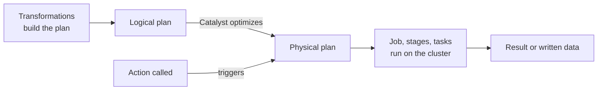

---
aliases:
  - Lazy evaluation
  - Spark Lazy Evaluation
  - Lazy execution
  - Transformations and actions
tags:
  - data-engineering
  - spark
  - execution-model
  - lazy-evaluation
description: What lazy evaluation means in Apache Spark (transformations only build a plan and nothing runs until an action), the difference between transformations and actions, why Spark works this way, and the traps it creates.
---
**Lazy evaluation** means Spark does **not run a transformation when you write it**. Calls such as `filter`, `select`, `join` and `groupBy` only add a step to a **plan**. The work starts only when you call an **action** (`count`, `write`, `show`, `collect`), which asks for a result. Spark then sees the whole plan, optimizes it, and runs it.

>[!tip] Writing a long chain of transformations is **instant**. All the time is spent when the action runs, so a slow or failing line is often the action, not the line that holds the real problem.

## Transformations and actions

| | Transformation | Action |
|---|---|---|
| What it does | Describes a new DataFrame from another | Asks for a result or writes data |
| Runs now? | **No**, it returns a new DataFrame at once | **Yes**, it starts a job |
| Returns | A DataFrame | A value, rows, or nothing (a write) |
| Examples | `select`, `filter`, `withColumn`, `groupBy`, `join`, `orderBy`, `union` | `count`, `collect`, `show`, `take`, `first`, `write`, `foreach`, `toPandas` |

Transformations are further split into [[data architecture/Apache Spark/core concepts/Spark Narrow Transformations.md|narrow]] and [[data architecture/Apache Spark/core concepts/Spark Wide Transformations.md|wide]] ones, depending on whether they need a shuffle.

```python
orders = spark.read.parquet("s3://bucket/raw/orders/")      # lazy: only reads the metadata

paid = orders.filter(F.col("status") == "paid")             # lazy
daily = paid.groupBy("order_date").agg(F.sum("amount"))     # lazy

daily.explain()                                             # shows the plan, runs nothing
daily.write.mode("overwrite").parquet("s3://bucket/gold/")  # action: the job runs now
```

## What happens, step by step



1. Each transformation adds a node to the **logical plan**, a graph of steps (the **lineage**). Nothing is read or computed yet.
2. An **action** is called.
3. Spark's optimizer, [[data architecture/Apache Spark/sql and optimization/Catalyst.md|Catalyst]], rewrites the whole plan and picks a physical plan.
4. Spark cuts the plan into **stages** at each shuffle, and runs one **task** per partition. Each action creates one **job**.

## Why Spark is lazy

- **Whole-plan optimization:** because it sees all the steps first, Spark can push a filter before a join, read only the needed columns and partitions, and merge steps. A step-by-step execution could not.
- **Pipelining:** consecutive narrow steps run together in one pass over the data, without writing intermediate results.
- **Less work:** if you only ask for `limit(10)`, Spark does not process the full dataset.
- **Fault tolerance:** the plan **is** the lineage. A lost partition is recomputed from its parents.
- **Cheap to build and reuse:** a DataFrame is only a recipe, so defining one costs nothing.

## Traps

| Trap | What happens | What to do |
|---|---|---|
| **Recomputation** | Every action reruns the whole plan from the source, so two actions on the same DataFrame read and compute everything twice | `cache()` or `persist()` a DataFrame used by more than one action, and `unpersist()` it after |
| **Late errors** | A wrong path, a bad column type or a failing UDF shows up only at the action, far from the line that caused it | Test with a small `count()` or `limit()`, and read the stack trace to find the real transformation |
| **Hidden actions** | `show()` and `take()` look harmless but start jobs. `count()` in a log line runs a full job | Do not put actions in debug logs of production code |
| **Schema inference** | `inferSchema` on CSV or JSON reads the data at `read` time, so a "lazy" read can start a job | Give an explicit schema |
| **Side effects** | Code with side effects inside a `map` or UDF (a counter, a write, an API call) can run later, more than once, or not at all | Keep transformations pure, do side effects in actions such as `foreach` or in the write |
| **Changing sources** | Data read at action time can differ from data at definition time | Read a fixed snapshot or version |
| **Timing** | Measuring time around a transformation shows nothing, because nothing ran | Measure around the action |
| **Lineage too long** | A loop that adds hundreds of steps makes planning slow, and recomputation after a failure expensive | Break the lineage with a checkpoint or by writing an intermediate table |

>[!note] `cache()` is lazy too. It marks the DataFrame to be stored, but the data is stored only when the first action runs.

## How to see it

- `df.explain()` shows the plan and **runs nothing**, so use it freely.
- **Spark UI → Jobs:** one job per action. If you called two actions, you see two jobs, each recomputing the steps unless the data is cached.
- **Spark UI → SQL tab:** the physical plan of each job.
- **Skipped stages:** the UI shows a stage as skipped when its shuffle output is reused, so it was not recomputed.
- In notebooks, a cell that returns at once and a next cell that takes minutes is the classic sign of lazy evaluation.

## Best practices

- Think in plans: build the full chain, then trigger one action.
- Cache only when you have **two or more actions** on the same data.
- Use `explain()` to check the plan before running a big job.
- Avoid `collect()` and `count()` just for debugging in production pipelines.
- Give explicit schemas, and keep transformations free of side effects.
- Check Spark UI job counts: more jobs than expected means extra actions or recomputation.

## Common pitfalls

- Expecting a transformation to fail or take time when you write it.
- Calling `count()` before a `write` "to check", which doubles the work.
- Reusing a DataFrame in several actions without caching.
- Caching everything, which fills the memory and evicts useful data.
- Putting side effects in a transformation and expecting them to run once.

## Interview questions

- What is lazy evaluation in Spark, and why does Spark use it?
- What is the difference between a transformation and an action?
- What happens when you call an action on a long chain of transformations?
- Why do two actions on the same DataFrame recompute the data, and how do you avoid it?
- Is `cache()` an action? When is the data actually cached?
- Why can an error appear far from the line that caused it?
- How does lazy evaluation relate to lineage and fault tolerance?
- How does lazy evaluation help Catalyst optimize a query?

## Related

- [[data architecture/Apache Spark/core concepts/Spark Narrow Transformations.md|Spark Narrow Transformations]]
- [[data architecture/Apache Spark/core concepts/Spark Wide Transformations.md|Spark Wide Transformations]]
- [[data architecture/Apache Spark/sql and optimization/Catalyst.md|Catalyst]]
