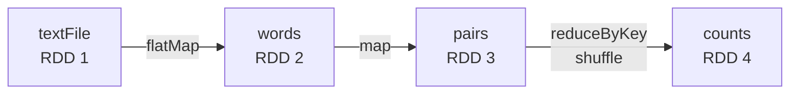

---
aliases:
  - RDD
  - RDDs
  - Spark RDD
  - Resilient Distributed Dataset
tags:
  - data-engineering
  - spark
  - rdd
  - distributed-systems
description: What a Resilient Distributed Dataset (RDD) is in Apache Spark, the low-level distributed collection behind DataFrames, its properties, lineage and fault tolerance, how to use it, and when to choose it over DataFrames.
---
An **RDD** (**Resilient Distributed Dataset**) is Spark's original and lowest-level data abstraction: an **immutable collection of records, split into partitions and processed in parallel** across a cluster. It was introduced in the Spark research paper (2012) and it is the base on which Spark Core, and later DataFrames, are built.

>[!tip] Use **DataFrames and SQL** by default. An RDD gives you **full control**, but Spark cannot optimize it, because it sees your functions as black boxes and the records as opaque objects.

## The name

| Word | Meaning |
|---|---|
| **Resilient** | Fault tolerant: a lost partition is **recomputed** from its lineage, with no replication |
| **Distributed** | The data is split into **partitions** spread over the executors |
| **Dataset** | A collection of records of any type (numbers, strings, objects, tuples) |

## The five properties

Every RDD is defined by:

1. A **list of partitions**.
2. A **function to compute** each partition.
3. A **list of dependencies** on its parent RDDs (the lineage).
4. Optionally a **partitioner** for key-value RDDs (hash or range).
5. Optionally **preferred locations** for each partition (for example where an HDFS block lives), so the task runs near its data.

## Lineage and fault tolerance

An RDD does not store its data. It stores **how it was built** from other RDDs. This graph of dependencies is the **lineage**.



- If a partition is lost (an executor fails), Spark **recomputes only that partition** by replaying the lineage from its parents.
- Dependencies are [[data architecture/Apache Spark/core concepts/Spark Narrow Transformations.md|narrow]] (one parent partition, cheap to recompute) or [[data architecture/Apache Spark/core concepts/Spark Wide Transformations.md|wide]] (many parent partitions, a shuffle).
- A **very long lineage** is slow to plan and costly to recompute, so break it with `checkpoint()` or by writing data out.
- `rdd.toDebugString()` prints the lineage.

## Transformations and actions

RDDs are [[data architecture/Apache Spark/core concepts/Spark Lazy Evaluation.md|lazy]]: transformations build the lineage, and an action runs it.

| Kind | Examples |
|---|---|
| **Narrow transformations** | `map`, `filter`, `flatMap`, `mapPartitions`, `union`, `coalesce` |
| **Wide transformations** | `reduceByKey`, `groupByKey`, `aggregateByKey`, `join`, `distinct`, `sortByKey`, `repartition` |
| **Actions** | `collect`, `count`, `take`, `first`, `reduce`, `foreach`, `saveAsTextFile` |

## Example: word count

```python
sc = spark.sparkContext

counts = (
    sc.textFile("s3://bucket/raw/books/")        # RDD of lines
      .flatMap(lambda line: line.split())        # RDD of words
      .map(lambda word: (word.lower(), 1))       # RDD of (word, 1) pairs
      .reduceByKey(lambda a, b: a + b)           # shuffle and sum per word
)

print(counts.take(10))                           # action: runs the job
print(counts.toDebugString().decode())           # the lineage
```

Prefer **`reduceByKey`** to `groupByKey`: it **combines values inside each partition first** (a map-side combine), so far less data crosses the network.

## Creating RDDs

```python
sc.parallelize([1, 2, 3, 4], numSlices=4)        # from a local collection (tests, small data)
sc.textFile("s3://bucket/path/*.txt")            # from files, one record per line
df.rdd                                           # from a DataFrame (an RDD of Row objects)
spark.createDataFrame(rdd, schema)               # back to a DataFrame, with a schema
```

Going from `df.rdd` back to a DataFrame needs a schema, and the optimizer works only on the DataFrame parts **before and after** the RDD step. See [[data architecture/Apache Spark/sql and optimization/Catalyst.md|Catalyst]].

## Persistence

An RDD used by more than one action is recomputed each time, unless you keep it.

```python
from pyspark import StorageLevel

rdd.cache()                                      # for RDDs this is MEMORY_ONLY
rdd.persist(StorageLevel.MEMORY_AND_DISK)        # spill to disk instead of recomputing
rdd.unpersist()
```

With **`MEMORY_ONLY`**, partitions that do not fit are **not stored** and are recomputed when needed. Use `MEMORY_AND_DISK` when the recomputation is expensive.

## Shared variables

A function runs on the executors, so a variable you change inside it is **not** changed on the driver.

| Type | Use |
|---|---|
| **Broadcast variable** | Send a **read-only** value (a lookup table) to every executor once |
| **Accumulator** | Executors **add** to a value that the driver reads (counters, metrics) |

## RDD vs DataFrame

| | RDD | DataFrame |
|---|---|---|
| **Data** | Records of any type, no schema | Rows with named, typed columns (a schema) |
| **Optimization** | **None**: your code runs as written | **Catalyst** optimizer and Tungsten |
| **Serialization** | Java, Kryo or pickle (Python objects) | Compact binary format |
| **Speed** | Slower, much slower in PySpark | Faster |
| **API level** | Low level, functional (`map`, `reduceByKey`) | High level, SQL and column expressions |
| **Control** | Full: partitioner, per-partition logic | Limited |
| **Best for** | Unstructured data, custom partitioning, low-level control, legacy code | Almost everything else |

In **PySpark**, an RDD holds **Python objects** that are serialized (pickle) between the JVM and Python workers, so it is slow. A DataFrame with built-in functions stays in the JVM.

## When to use an RDD

- Data with **no schema** (raw text, binary, logs) that needs custom parsing.
- A **custom partitioner** or fine control of how data is spread.
- **Per-partition logic** with a one-time setup, with `mapPartitions` (a client, a connection, a model).
- **Legacy code** written for RDDs.
- Algorithms that do not fit relational operations.

Otherwise, use DataFrames and SQL.

## Best practices

- **Default to DataFrames and SQL**, and drop to an RDD for a narrow step.
- Use **`reduceByKey` or `aggregateByKey`**, not `groupByKey`.
- **Persist** an RDD reused by several actions, and `unpersist` it afterwards.
- Pick the **partition count** on purpose (`repartition`, `coalesce`). See [[data architecture/Apache Spark/core concepts/Spark Repartition.md|Spark Repartition]].
- Use **Kryo serialization** for JVM RDDs with custom classes.
- **Checkpoint** or write out data to cut a long lineage.
- Keep functions **small and serializable**, and do not capture large objects in them.

## Common pitfalls

- Using `groupByKey` on a large dataset.
- `collect()` on a big RDD, which brings everything to the driver.
- Expecting a variable changed inside a `map` or `foreach` to change on the driver. Use an accumulator.
- **Closures** that capture a large or non-serializable object, so the task fails or is slow.
- `MEMORY_ONLY` caching with too little memory, so partitions are recomputed again and again.
- Using RDDs in PySpark for work that built-in DataFrame functions do much faster.
- Converting `df.rdd` in the middle of a query and losing the optimizer.
- Assuming the RDD API exists everywhere: **Spark Connect** and some managed or serverless environments do not support it, so check your environment.

## Interview questions

- What is an RDD, and what does each word of the name mean?
- What are the five properties of an RDD?
- How does lineage give fault tolerance?
- What is the difference between narrow and wide dependencies?
- Why is `reduceByKey` better than `groupByKey`?
- What is the difference between an RDD and a DataFrame, and why is a DataFrame faster?
- When would you still use an RDD?
- What do `cache()` and `persist()` do for an RDD, and what is the default level?
- What are broadcast variables and accumulators?

## Related

- [[data architecture/Apache Spark/core concepts/Spark Lazy Evaluation.md|Spark Lazy Evaluation]]
- [[data architecture/Apache Spark/core concepts/Spark Narrow Transformations.md|Spark Narrow Transformations]]
- [[data architecture/Apache Spark/core concepts/Spark Wide Transformations.md|Spark Wide Transformations]]
- [[data architecture/Apache Spark/sql and optimization/Catalyst.md|Catalyst]]
- [[data architecture/Apache Spark/sql and optimization/Spark UDFs.md|Spark UDFs]]
