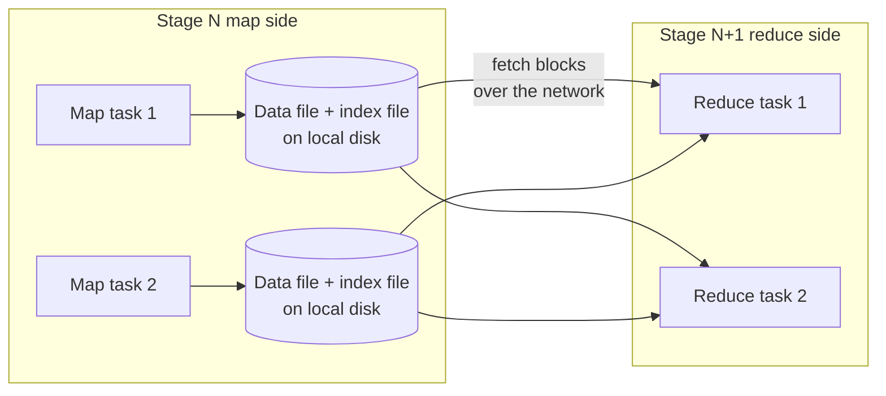

---
aliases:
  - Shuffle
  - Spark Shuffle
  - Shuffle write
  - Shuffle read
  - Exchange
tags:
  - data-engineering
  - spark
  - shuffle
  - performance
description: What the shuffle is in Apache Spark (the mechanism that redistributes data across executors by key between two stages), how shuffle write and read work, the settings that control it, and the failures and metrics to watch.
---
The **shuffle** is the mechanism Spark uses to **redistribute data across the partitions and executors** so that rows with the same key end up together. It runs between two stages: the first stage **writes** its output grouped by target partition, and the next stage **reads** the blocks it needs from every executor. It is triggered by [[data architecture/Apache Spark/core concepts/Spark Wide Transformations.md|wide transformations]] and it is usually the most expensive part of a job.

>[!tip] In a query plan the shuffle appears as **`Exchange`**. In the Spark UI it is the **Shuffle Write** of one stage and the **Shuffle Read** of the next.

## How it works

1. **Shuffle write (map side):** each task decides the target partition of every row (see partitioners below), sorts and buffers the rows by target partition, and writes **one data file and one index file** to the executor local disk. If the buffers are full, it [[data architecture/Apache Spark/memory and performance/Spark Spills.md|spills]] and merges at the end.
2. **Shuffle read (reduce side):** each reduce task asks the **map output tracker** on the driver where its blocks are, then **fetches** them from the executors over the network, and merges, sorts or aggregates them.
3. **The next stage starts** only after all the map tasks of the previous stage finish. This is the barrier that makes a slow task so costly.

The number of reduce tasks is the number of shuffle partitions: `spark.sql.shuffle.partitions` (200 by default), unless AQE coalesces them. Every map task can send data to every reduce task.

## Partitioners: where a row goes

| Partitioner | Used by | Result |
|---|---|---|
| **Hash** | `groupBy`, `join`, `repartition("col")` | Same key, same partition |
| **Range** | `orderBy`, `repartitionByRange` | Ordered ranges, found by sampling |
| **Round-robin** | `repartition(n)` | Even sizes, no key |
| **Single partition** | Global `limit`, some global aggregations | Everything in one partition |

## What the shuffle costs

- **Disk I/O** for the shuffle files, written and read.
- **Network I/O** between executors.
- **Serialization and compression** of every moved record.
- **Memory pressure** in the sort and aggregation buffers.
- **Skew:** one hot key makes one reduce task much larger than the others.
- **Fragility:** the shuffle files live on the executor disk, so losing an executor loses shuffle data (see failures below).

## Settings that matter

| Setting | What it controls |
|---|---|
| `spark.sql.shuffle.partitions` | Number of reduce partitions (default 200) |
| `spark.sql.adaptive.enabled` and `spark.sql.adaptive.coalescePartitions.enabled` | AQE uses real shuffle statistics to coalesce small partitions and split skewed ones |
| `spark.sql.adaptive.advisoryPartitionSizeInBytes` | Target size of a shuffle partition with AQE |
| `spark.shuffle.compress` | Compresses shuffle data (on by default), less I/O for a little CPU |
| `spark.reducer.maxSizeInFlight` | How much data a reduce task fetches at once |
| `spark.shuffle.io.maxRetries` and `spark.shuffle.io.retryWait` | Fetch retries before the task fails |
| `spark.local.dir` | Where shuffle and spill files are written. Use fast local disks |
| `spark.shuffle.service.enabled` | External shuffle service: executors can be removed without losing their shuffle data |
| `spark.dynamicAllocation.shuffleTracking.enabled` | Dynamic allocation without an external service (common on Kubernetes) |

Defaults change between versions, so confirm them in the documentation of the version you run.

## Observing it

- **`df.explain()`:** `Exchange hashpartitioning(...)`, `rangepartitioning(...)`, `RoundRobinPartitioning(...)` or `SinglePartition`.
- **Spark UI → Stages:** **Shuffle Write** (size and records) in the map stage, **Shuffle Read** in the next one, plus **Shuffle Read Blocked Time** and **Fetch Wait Time**, which show waiting for remote data.
- **Spark UI → SQL tab:** the `Exchange` node shows data size, number of partitions and, with AQE, the coalesced and skewed partitions.
- **Skipped stages:** if the same shuffle output is reused (for example a DataFrame used twice), Spark shows the stage as **skipped** and does not recompute it.

## Failures

| Symptom | Meaning | What to do |
|---|---|---|
| `FetchFailedException` | A reduce task could not fetch a block: the executor holding it died or its disk is gone. Spark reruns the map stage that produced it | Find why the executor was lost (memory, spot or preemptible node, disk). Consider the external shuffle service or a fast local disk |
| Long **fetch wait time** | Network or the remote executor is slow or busy | Check skew, executor load and the network |
| Out of disk space | Shuffle and spill files fill `spark.local.dir` | Add disk, reduce shuffled data, clean up |
| One huge reduce task | Skew | AQE skew join, salting, filter the hot key |
| Executor lost during shuffle | Often an [[data architecture/Apache Spark/common errors/Spark OutOfMemoryError.md|out of memory kill]] | Fix the memory problem first |

## How to reduce the shuffle

- **Shuffle less data:** filter and select before the wide operation.
- **Avoid the shuffle:** broadcast joins, and reuse existing partitioning (bucketed tables).
- **Aggregate early:** DataFrame aggregations do a partial aggregation before the shuffle.
- **Avoid needless** `distinct`, `orderBy` and `repartition`.
- **Size the partitions:** about 100 to 200 MB each, with AQE on.
- **Use fast local disks** for shuffle files.

## Best practices

- Count the `Exchange` nodes in the plan, and ask if each one is needed.
- Look at **Shuffle Write** and **Shuffle Read** sizes before tuning.
- Keep AQE on, and review the advisory partition size.
- Use fast local disks and plan for executor loss on spot or preemptible nodes.
- Treat shuffle size and fetch wait time as metrics to monitor between runs.

## Common pitfalls

- Leaving 200 shuffle partitions for every job.
- Confusing **shuffle** with **spill**: shuffle moves data between stages, spill writes data to disk when memory is short inside a task.
- Ignoring skew because the job still finishes.
- Running shuffle-heavy jobs on small or network disks.
- Using spot or preemptible executors with no external shuffle service, and recomputing stages after each loss.

## Interview questions

- What is a shuffle, and when does Spark do one?
- How do shuffle write and shuffle read work?
- Why does a shuffle create a stage boundary?
- How do you find shuffles in a plan and in the Spark UI?
- What causes a `FetchFailedException`, and how do you handle it?
- What does the external shuffle service do?
- What is the difference between a shuffle and a spill?
- How do you choose `spark.sql.shuffle.partitions`, and what does AQE change?

## Related

- [[data architecture/concepts/Data Skew.md|Data Skew]]
- [[data architecture/Apache Spark/memory and performance/Spark Spills.md|Spark Spills]]
- [[data architecture/Apache Spark/core concepts/Spark Narrow Transformations.md|Spark Narrow Transformations]]
