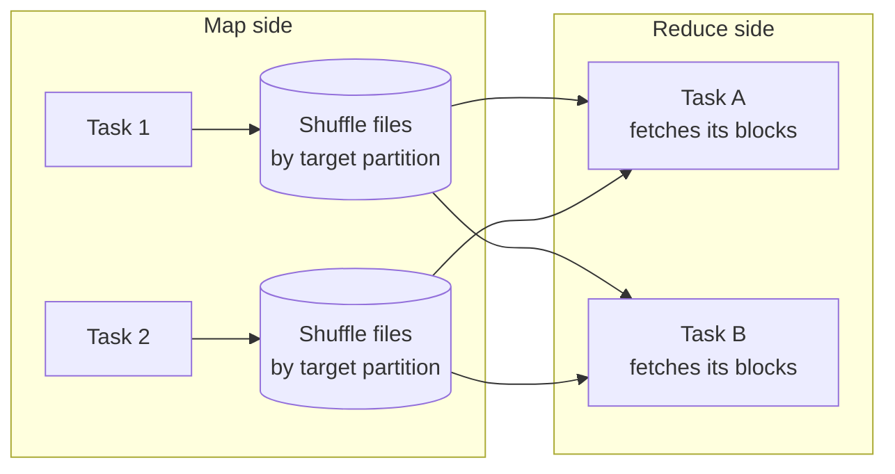

---
aliases:
  - Wide transformation
  - Wide transformations
  - Spark Wide Transformation
  - Shuffle transformation
tags:
  - data-engineering
  - spark
  - transformations
  - shuffle
  - performance
description: What a wide transformation is in Apache Spark (an operation whose output partitions depend on many input partitions and so triggers a shuffle), which operations are wide, why they are expensive, and how to reduce their cost.
---
A **wide transformation** is an operation where each output partition needs data from **many input partitions**. Spark must **shuffle**: it writes the data by key, moves it across the network, and regroups it. A shuffle creates a **stage boundary**, so wide transformations decide where a job is cut into stages. They are the most expensive step of most Spark jobs.

>[!tip] If you see **`Exchange`** in `df.explain()`, or a new stage in the Spark UI, there is a wide transformation (a shuffle) there.

## Narrow vs wide

| | Narrow | Wide |
|---|---|---|
| Input needed per output partition | **One** input partition | **Many** input partitions |
| Data movement | None, runs inside the executor | **Shuffle** across the network |
| Stage | Same stage (pipelined) | **New stage** after the shuffle |
| Cost | Cheap | Disk, network and serialization |
| Failure recovery | Recompute one partition | May recompute many partitions |
| Examples | `filter`, `select`, `withColumn`, `map`, `union`, `coalesce` | `groupBy`, `join`, `distinct`, `orderBy`, `repartition` |

## Common wide operations

| Operation | Why it shuffles |
|---|---|
| `groupBy(...).agg(...)` | Rows of the same key must meet in one partition |
| `join` (sort merge or shuffle hash) | Both sides are shuffled by the join key. A **broadcast join** avoids it |
| `distinct`, `dropDuplicates` | Equal rows must meet to be compared |
| `orderBy`, `sort` | Needs a global order, so data is range-partitioned |
| `repartition`, `repartitionByRange` | Redistributes all rows on purpose. See [[data architecture/Apache Spark/core concepts/Spark Repartition.md|Spark Repartition]] |
| Window functions with `partitionBy` | Rows of the same window partition must meet |
| `intersect`, `except` | Rows from both sides are compared by value |
| RDD: `reduceByKey`, `groupByKey`, `cogroup` | Records are grouped by key |

`union` and `coalesce` are **narrow**. Joins are wide, except a **broadcast join**, which sends the small table to every executor and avoids shuffling the big one. See [[data architecture/Apache Spark/sql and optimization/Spark Joins.md|Spark Joins]].

## How a shuffle works



1. **Map side:** each task of the stage before computes its rows, decides the target partition of each row (usually a hash of the key), and writes **shuffle files** to its local disk.
2. **Reduce side:** each task of the next stage **fetches** its blocks from all map tasks over the network, then merges, sorts or aggregates them.
3. The number of reduce tasks is `spark.sql.shuffle.partitions` (200 by default), unless **AQE** coalesces them.

Every map task talks to every reduce task, so the cost grows with the data volume and the number of partitions.

## Why it is expensive

- **Disk I/O:** shuffle files are written and read.
- **Network I/O:** data moves between executors.
- **Serialization and compression** of every record that moves.
- **Memory pressure:** sort and aggregation buffers can [[data architecture/Apache Spark/memory and performance/Spark Spills.md|spill]] to disk.
- **Skew:** one hot key sends most rows to one reduce task, which becomes the slowest task of the stage.
- **A barrier:** the next stage starts only when the map stage finishes, so a slow task delays everything.

## How to see them

- `df.explain()`: look for `Exchange hashpartitioning(...)`, `Exchange rangepartitioning(...)` or `Exchange RoundRobinPartitioning(...)`.
- **Spark UI → Stages:** each shuffle ends a stage, with **Shuffle Write** in the map stage and **Shuffle Read** in the next.
- **Spark UI → SQL tab:** `Exchange` nodes show the data size shuffled.

```python
orders.groupBy("customer_id").agg(F.sum("amount")).explain()
# ... HashAggregate (final)
# ... +- Exchange hashpartitioning(customer_id, 200)   <- shuffle
# ...    +- HashAggregate (partial)
```

Note the **partial** aggregation before the exchange: Spark combines rows inside each partition first, so less data crosses the network (a map-side combine).

## How to reduce the cost

- **Shuffle less data:** filter and select only the needed columns **before** the wide operation.
- **Aggregate early:** use DataFrame aggregations, which do a partial aggregate first. On RDDs prefer `reduceByKey` over `groupByKey`.
- **Broadcast** the small side of a join.
- **Avoid unnecessary** `distinct`, `orderBy` and `repartition`, and avoid a global sort when a per-partition sort is enough (`sortWithinPartitions`).
- **Reuse the partitioning:** when the data is already partitioned by the key (or bucketed), Spark can skip a shuffle.
- **Size the shuffle partitions:** let **AQE** coalesce small ones and split skewed ones, and aim at about 100 to 200 MB per partition.
- **Fix skew:** AQE skew join, key salting, or isolate the hot key.
- **Chain wide operations on the same key** so one shuffle serves more than one step.

## Pitfalls

- Treating the 200 default shuffle partitions as right for every job.
- Calling `groupByKey`, `distinct` or `orderBy` on large data without need.
- Several wide operations on **different keys** in a row, each with its own shuffle.
- Ignoring skew, because the job "works" but one task runs for hours.
- Reading `Shuffle Read` and `Shuffle Write` as the same as spill. They are different metrics.
- Assuming a join never shuffles. Only a broadcast join (or a join on already co-partitioned data) avoids it.

## Interview questions

- What is the difference between narrow and wide transformations?
- Why is a shuffle expensive, and how does it create a stage?
- Which operations trigger a shuffle, and which do not?
- How do you find shuffles in a query plan and in the Spark UI?
- How does a broadcast join avoid a shuffle?
- What is a map-side combine, and why is `reduceByKey` better than `groupByKey`?
- How do you choose `spark.sql.shuffle.partitions`, and what does AQE change?
- How do skew and shuffles relate?

## Links

- [[data architecture/Apache Spark/core concepts/Spark Shuffle.md|Spark Shuffle]]
- [[data architecture/Apache Spark/sql and optimization/Spark Joins.md|Spark Joins]]
- [[data architecture/Apache Spark/core concepts/Spark Repartition.md|Spark Repartition]]

## Related

- [[data architecture/Apache Spark/core concepts/Spark Narrow Transformations.md|Spark Narrow Transformations]]
- [[data architecture/Apache Spark/memory and performance/Spark Spills.md|Spark Spills]]
