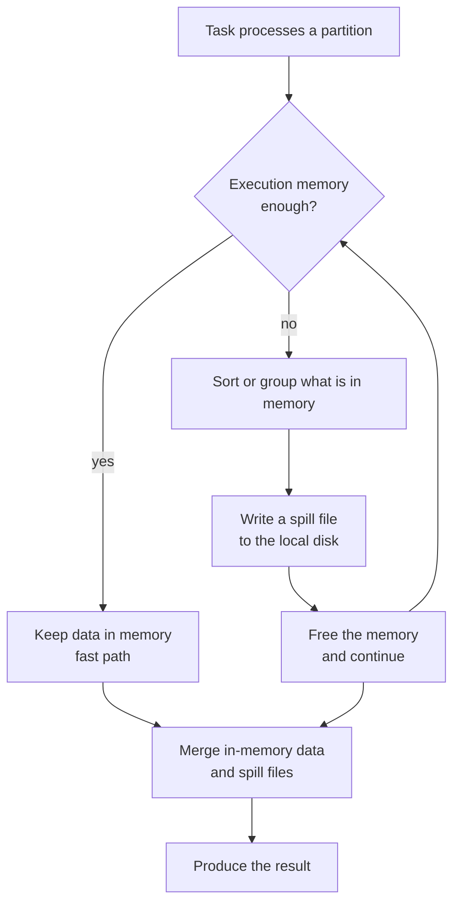
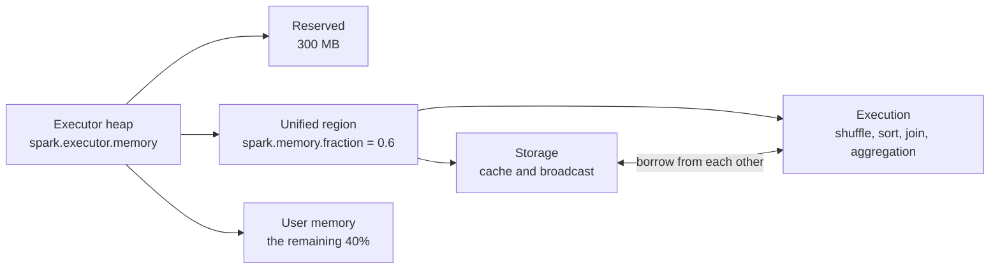

---
aliases:
  - Spark Spill
  - Spark Spills
  - Apache Spark Spills
  - Spill to disk
tags:
  - data-engineering
  - spark
  - performance
  - memory
  - distributed-systems
description: "Apache Spark spill to disk: why a task writes data to the executor local disk when execution memory is not enough, how to read the metrics, and how to reduce it."
---
A **spill** happens when a Spark task does not have enough **execution memory** to hold the data it is working on, so it writes part of that data to the **local disk** of the executor, and reads it back later. It is a safety net: the job keeps running instead of failing with an `OutOfMemoryError`, but it gets slower, because disk is much slower than memory and the data must be serialized, written and read again.

>[!tip] A spill is a **symptom**, not an error. A few small spills are normal. Large spills in a long stage mean the partitions are too big for the memory each task has.

## Where spills come from

Spark spills in the operations that need to keep many rows in memory at the same time:

| Operation | Why it needs memory |
|---|---|
| **Shuffle write** | Sorts and buffers records by target partition before writing the shuffle files |
| **Shuffle read** | Merges and sorts records that arrive from many map tasks |
| **Sort** (`orderBy`, sort before a sort merge join) | Needs the rows sorted before it can output them |
| **Aggregation** (`groupBy`, `agg`) | Keeps a hash map of the groups. If the map does not fit, Spark falls back to sort-based aggregation and spills |
| **Join** (sort merge join, shuffle hash join) | Buffers the rows of the matching keys on both sides |
| **Window functions** | Buffers all the rows of a window partition |
| **`collect_list`, `collect_set`, `explode`** | Build large per-key collections |

A **narrow** transformation such as `filter` or `select` streams the rows one by one and does not spill. Spills belong to the **wide** transformations (shuffle). See [[data architecture/Apache Spark/Apache Spark.md|Apache Spark]] for narrow and wide.

## How a spill works



1. The task fills its memory with records.
2. When it asks for more memory and the executor cannot give it, the task **sorts** the data in memory and writes it to a **spill file** (serialized and compressed) in the executor local directory.
3. The memory is freed and the task continues with the next records. This can happen many times.
4. At the end, the task **merges** the spill files and what is still in memory (a k-way merge of sorted runs) to produce the final output.

Because the data is written, read and merged again, a spilling task does extra **disk I/O**, extra **serialization** and extra **CPU**.

## Spill is not an OOM

| | Spill | OutOfMemoryError |
|---|---|---|
| What happens | Data goes to disk, the task continues | The task or the executor fails |
| Effect | Slower job | Retries, then the stage and the job can fail |
| Typical cause | Partitions too big for the memory per task | Something that cannot be spilled, or no memory left even after spilling |

Things that **cannot be spilled** and cause OOM instead:

- `collect()` or `toPandas()` on the **driver**.
- A **broadcast** table that is too large.
- A **single huge record or key** (for example one `collect_list` with millions of values in one group).
- Cached data when storage and execution compete badly, and the **off-heap and overhead memory** (Python workers, native libraries) on Kubernetes or YARN, where the container is killed.

## Execution memory and memory per task

Spark uses a **unified memory** model inside each executor JVM:



- **Execution** and **storage** share the unified region and can borrow from each other. Execution can evict cached data down to `spark.memory.storageFraction` (default 0.5 of the region), but storage cannot take memory that execution is using.
- The tasks that run at the same time inside one executor **share the execution memory**. With `N` active tasks, each task gets between `1/(2N)` and `1/N` of the pool.

A rough estimate:

```text
memory per task ≈ (executor memory × 0.6) / executor cores
```

Example: 8 GB executor with 4 cores → about `8 × 0.6 / 4 = 1.2 GB` per task (the real value is lower after the reserved memory). If a shuffle partition has 3 GB of data, the task **must** spill.

>[!note] The fractions are defaults of the `spark.memory.*` settings. Confirm them in the documentation of the Spark version you run.

## Spill (Memory) and Spill (Disk)

The Spark UI shows two numbers for a stage or a task:

| Metric | Meaning |
|---|---|
| **Spill (Memory)** | The size of the spilled data **in memory**, deserialized, before it was written. It is the memory the data would have used |
| **Spill (Disk)** | The size of the same data **on disk**, serialized and compressed |

Spill (Memory) is usually **larger** than Spill (Disk), because serialized and compressed data is smaller. The ratio gives a hint about how compressible the data is. Both are shown only when a spill happened. If they are missing, the stage did not spill.

The same values are available in the REST API and in the event log as `memoryBytesSpilled` and `diskBytesSpilled`:

```bash
curl -s http://localhost:4040/api/v1/applications/<app-id>/stages \
  | jq '.[] | {stageId, name, memoryBytesSpilled, diskBytesSpilled}'
```

## How to detect a spill

1. **Stages tab → Summary Metrics:** look for the columns **Spill (Memory)** and **Spill (Disk)**. Compare the median with the max: a large gap means that **skew** is behind it.
2. **Stages tab → task table:** sort by **Spill (Disk)** to find the tasks that spilled the most.
3. **SQL tab:** the sort, aggregate and join nodes show `spill size` in their metrics, so you see which operator spills.
4. **Executors tab:** high **GC time** next to spills means the memory is under pressure.
5. **Executor logs:** messages such as `Spilling data because number of spilledRecords crossed the threshold` or a memory manager message with the spilled size.

A spill of a few MB in a short stage is harmless. Worry when the **spill is about the same size as the input**, or when the **stage is much longer** than the others.

## Common causes

- **Too few shuffle partitions:** with the default `spark.sql.shuffle.partitions = 200` and a large dataset, each partition is too big.
- **Data skew:** one hot key sends most rows to one task, which spills while the others finish.
- **Too many cores per executor:** more concurrent tasks share the same memory, so each gets less.
- **Executors too small** for the partition size.
- **Wide rows** (many columns, large strings, nested data) that make each record heavy.
- **Reading too much:** no column pruning or filter before the shuffle, so more data enters the wide operation.
- **Large `collect_list` or `explode`** that multiplies the data volume.
- **Slow or tiny local disk,** which makes every spill expensive.

## How to reduce spills

### Make partitions smaller
- Increase the partitions: `spark.sql.shuffle.partitions`, or `repartition(n)` before the wide operation.
- Let **AQE** size the partitions: with `spark.sql.adaptive.enabled=true`, it coalesces small partitions and aims at `spark.sql.adaptive.advisoryPartitionSizeInBytes`. Lower it if tasks spill.
- Aim at shuffle partitions of roughly **100 to 200 MB** each, and adjust by looking at the spill.
- For files, use `spark.sql.files.maxPartitionBytes` (default 128 MB) to control the size of the input partitions.

### Give each task more memory
- Increase `spark.executor.memory`.
- **Reduce `spark.executor.cores`**: fewer concurrent tasks, more memory for each one.
- Add `spark.executor.memoryOverhead` (and for PySpark `spark.executor.pyspark.memory`) when containers are killed instead of spilling.
- Consider **off-heap memory** (`spark.memory.offHeap.enabled` and `spark.memory.offHeap.size`) to reduce the garbage collection pressure.

### Shuffle less data
- **Filter and select early.** Read only the columns and partitions you need.
- **Broadcast** the small side of a join, so the big side is not shuffled. See [[data architecture/Apache Spark/sql and optimization/Spark Joins.md|Spark Joins]].
- **Aggregate before the join** to reduce the rows.
- Avoid `collect_list` on large groups. Aggregate with `count`, `sum` or `approx_count_distinct` when possible.

### Fix skew
- Enable `spark.sql.adaptive.skewJoin.enabled=true`.
- **Salt** the hot key, or isolate it and process it separately.
- Filter out `null` keys before the join.

### Make spills cheaper
- Use **fast local disks** (SSD or NVMe) for `spark.local.dir`. On **Kubernetes**, mount a fast volume for the executors, because the default `emptyDir` may sit on the node root disk, and on **EMR** or **Dataproc** pick instance types with local SSDs.
- Keep `spark.shuffle.spill.compress` and `spark.shuffle.compress` enabled (the default), which cuts the disk I/O for a little CPU.

## Example: before and after

A job aggregates 400 GB of transactions per customer and spills heavily.

```python
# Before: default 200 shuffle partitions → about 2 GB per partition,
# executor with 8 cores and 16 GB → about 0.7 GB of execution memory per task.
daily = (
    transactions
    .groupBy("customer_id", "order_date")
    .agg(F.sum("amount").alias("revenue"))
)
```

```python
# After: smaller partitions, fewer cores per executor, AQE on.
spark.conf.set("spark.sql.adaptive.enabled", "true")
spark.conf.set("spark.sql.shuffle.partitions", "2000")        # about 200 MB per partition
spark.conf.set("spark.sql.adaptive.advisoryPartitionSizeInBytes", "128m")

daily = (
    transactions
    .select("customer_id", "order_date", "amount")            # prune columns first
    .groupBy("customer_id", "order_date")
    .agg(F.sum("amount").alias("revenue"))
)
```

```text
spark-submit \
  --executor-cores 4 \
  --executor-memory 16g \
  --conf spark.executor.memoryOverhead=3g \
  ...
```

The executor now has 4 cores instead of 8, so each task has about twice the memory, and the partitions are about ten times smaller. Check the **Spill (Disk)** column again after the change.

>[!note] `spark.executor.cores`, `spark.executor.memory` and the shuffle partition count are **static or startup** settings in many deployments. Set them in `spark-submit` or in the cluster config, not inside the job, when the cluster manager reads them at start.

## When a spill is acceptable

- The spill is **small** compared with the data and the stage is not the bottleneck.
- The job runs on **cheap, smaller** machines and a bit of spill saves money, compared with oversized executors.
- It is a **rare** large partition, caused by a known skew, and a fix would cost more than the extra time.

Always compare the **cost and the runtime** before spending memory to remove every spill.

## Best practices

- Look at **Spill (Memory)** and **Spill (Disk)** in every slow stage, before tuning anything else.
- Fix **skew** first, because adding memory to every task hides a problem in a few.
- Size partitions by data volume (about 100 to 200 MB), not by a fixed number for every job.
- Keep **memory per core** in mind: `executor memory / cores` is what each task really gets.
- Prefer **AQE** and review `advisoryPartitionSizeInBytes`.
- Use fast local disks for the spill directory.
- Reduce the data early: prune columns, filter and aggregate before shuffles.
- Track spill metrics of production jobs, and alert when they grow between runs.

## Common pitfalls

- Treating every spill as a failure, and oversizing the cluster.
- Raising `spark.executor.memory` while leaving 8 or more cores per executor, so the memory per task barely changes.
- Using `spark.sql.shuffle.partitions = 200` for every job, from a 1 GB job to a 10 TB job.
- Ignoring the gap between median and max spill, which points to skew.
- Confusing **Spill (Memory)** with real memory use. It is the deserialized size of the spilled data.
- Using the node root disk, or a network disk, as the spill directory.
- Confusing a spill with an OOM, and raising the heap when the container is killed by missing overhead memory.

## Interview questions

- What is a spill in Spark, and why does it happen?
- What is the difference between **Spill (Memory)** and **Spill (Disk)**?
- Which operations can spill, and which cannot be spilled?
- How do you detect spills in the Spark UI?
- How is the memory per task calculated, and why does `executor.cores` affect spills?
- A stage spills 500 GB. What do you check first, and what do you change?
- How do skew and spills relate to each other?
- How do AQE and `advisoryPartitionSizeInBytes` help to reduce spills?
- What is the difference between a spill and an `OutOfMemoryError`?
- How would you configure the local disks for spills on Kubernetes or EMR?

## Related

- [[data architecture/Apache Spark/common errors/Spark OutOfMemoryError.md|Spark OutOfMemoryError]]
- [[data architecture/Apache Spark/sql and optimization/Spark Joins.md|Spark Joins]]
- [[data architecture/Apache Spark/sql and optimization/Catalyst.md|Catalyst]]
