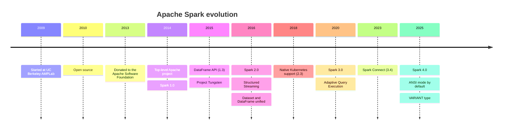
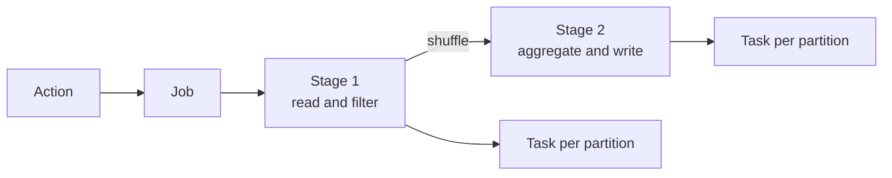
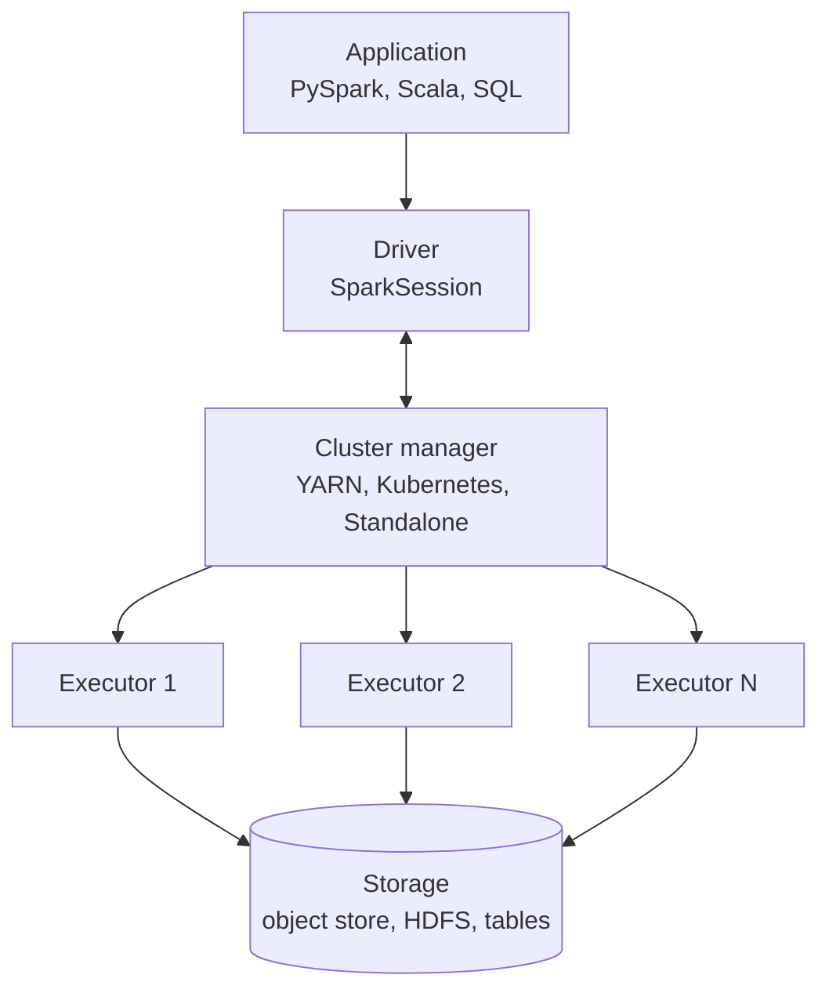
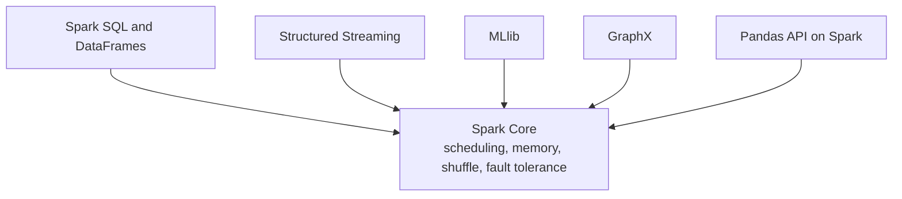
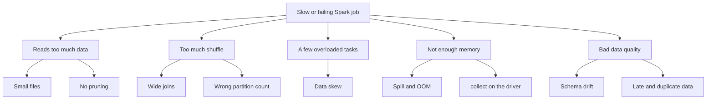

---
aliases:
  - Spark presentation
  - Spark slides
tags:
  - data-engineering
  - spark
  - presentation
description: "Slide deck (Obsidian Slides) introducing Apache Spark: timeline, basic concepts, core components, features and common data problems."
---
# Apache Spark

A distributed engine to process large data

- Basic concepts
- Core components
- Features
- Common data problems

  
---

## Timeline



---

# 1. Basic concepts

---

## What is Spark?

- Open source **distributed data processing engine**
- Splits data into **partitions** and runs them in parallel on a cluster
- Keeps intermediate data **in memory** when it can
- One engine for batch, SQL, streaming and machine learning
- APIs in **Python**, **Scala**, **SQL**, **Java** and **R**

>[!note] Spark is a **compute engine**, not a database. It reads from storage, processes the data and writes the result back. It stores nothing by itself.

---

## Why Spark? Spark vs MapReduce

| | Hadoop MapReduce | Spark |
|---|---|---|
| Intermediate data | Disk between every step | Memory, spill to disk if needed |
| API | Low level map and reduce | DataFrames and SQL |
| Workloads | Batch only | Batch, SQL, streaming, ML |
| Optimization | Manual | Automatic query optimizer |

Multi-step and iterative jobs are much faster, with far less code.

---

## Lazy evaluation

- **Transformation**: only builds a plan (`filter`, `select`, `join`, `groupBy`)
- **Action**: triggers the execution (`count`, `write`, `show`, `collect`)
- Because Spark sees the **whole plan** before it runs, it can optimize it

```python
orders = spark.read.parquet("s3://bucket/raw/orders/")   # lazy

daily = (
    orders
    .filter(F.col("status") == "paid")                   # lazy
    .groupBy("customer_id")                              # lazy
    .agg(F.sum("amount").alias("revenue"))               # lazy
)

daily.write.parquet("s3://bucket/gold/daily/")           # action: runs now
```

---

## Narrow vs wide transformations

| | Narrow | Wide |
|---|---|---|
| Data needed | One input partition | Many input partitions |
| Examples | `filter`, `select`, `map` | `groupBy`, `join`, `distinct`, `orderBy` |
| Data movement | None | **Shuffle** |
| Cost | Cheap | The most expensive step |

A **shuffle** writes data to disk, moves it across the network and regroups it by key.

---

## Job, stage and task



- An **action** creates a **job**
- A job is cut into **stages** at every shuffle
- A stage runs one **task** per partition
- Lost partition? Spark recomputes it from the **lineage**, with no replication

---

# 2. Core components

---

## Architecture



---

## Who does what

| Component | Role |
|---|---|
| **Driver** | Runs your program, builds the plan, schedules stages and tasks. If it dies, the application dies |
| **Executor** | Runs tasks and holds cached data. Many run in parallel |
| **Cluster manager** | Gives resources: Standalone, YARN or Kubernetes |
| **SparkSession** | Entry point of the application |
| **Partition** | A slice of the data. One task processes one partition |

---

## The Spark stack



---

## APIs and the optimizer

| API | Notes |
|---|---|
| **SQL** | Plain SQL over tables and views |
| **DataFrame** | Distributed table. The default choice |
| **Dataset** | Typed DataFrame (Scala and Java) |
| **RDD** | Low level. No automatic optimization |

- **Catalyst**: rewrites the query plan (predicate pushdown, column pruning, join choice). See [[data architecture/Apache Spark/sql and optimization/Catalyst.md|Catalyst]]
- **Tungsten**: compact memory layout and whole-stage code generation
- **AQE**: re-optimizes the plan **while it runs**, using real statistics

---

# 3. Features

---

## Main features

- **Unified engine**: batch, SQL, streaming and ML with one API
- **In-memory processing** with spill to disk
- **Automatic optimization**: Catalyst, Tungsten and AQE
- **Fault tolerance** through lineage
- **Lazy evaluation**, so the whole plan is optimized
- **Many sources**: Parquet, ORC, JSON, JDBC, Kafka and table formats (Delta Lake, Iceberg)
- **Multi-language**: Python, Scala, SQL, Java and R
- **Runs anywhere**: Kubernetes, YARN, Standalone, managed services

---

## Structured Streaming

- Treats a stream as an **unbounded table** that keeps growing
- Processes it in **micro-batches**, with the same DataFrame API as batch
- Reads from Kafka and files
- **Checkpoints** and **watermarks** for state and late data
- **Exactly-once** results for supported sinks

```python
events = (
    spark.readStream.format("kafka")
    .option("kafka.bootstrap.servers", "broker:9092")
    .option("subscribe", "payments")
    .load()
)

query = (
    events.selectExpr("CAST(value AS STRING) AS json")
    .writeStream.format("parquet")
    .option("path", "s3://bucket/silver/payments/")
    .option("checkpointLocation", "s3://bucket/checkpoints/payments/")
    .start()
)
```

---

## Deployment options

| Option | Notes |
|---|---|
| **Standalone** | Spark's own manager. Good for learning |
| **YARN** | Common in Hadoop environments |
| **Kubernetes** | Executors run as pods. Usual choice for new self-managed clusters |
| **AWS EMR** | Managed Spark on AWS |
| [[providers/Google/GCP Dataproc.md\|GCP Dataproc]] | Managed Spark and Hadoop on Google Cloud |
| [[Databricks platform]] | Managed Spark platform |

---

## Spark vs other engines

| Engine | Best at |
|---|---|
| **Spark** | Large batch ETL, ML pipelines, general processing |
| **Flink** | Event-by-event streaming with low latency |
| **Trino** | Fast interactive SQL over many sources |
| **Warehouse** (BigQuery and others) | Serverless SQL, no cluster to manage |
| **pandas** | Small data on one machine |

>[!tip] If the data fits on one machine, use a single-node tool. Use Spark when it does not.

---

# 4. Common data problems

---

## The map of problems



Rule of thumb: **read less, shuffle less, balance the tasks.**

---

## Problem 1: data skew

**Symptom:** one task runs for hours while the others finish in seconds. A hot key (for example `customer_id = null`) holds most rows.

**How to detect:** Spark UI → Stages → task duration and shuffle read are very uneven.

**How to fix:**
- Enable AQE skew join: `spark.sql.adaptive.skewJoin.enabled=true`
- **Broadcast** the small side of the join
- **Salt** the hot key
- Filter or isolate `null` keys before the join

```python
salted = big.withColumn("salt", (F.rand() * 8).cast("int"))
small_exp = small.crossJoin(spark.range(8).withColumnRenamed("id", "salt"))
result = salted.join(small_exp, ["key", "salt"])
```

---

## Problem 2: small files

**Symptom:** thousands of tiny files. The job spends more time opening files than reading data. Common after streaming writes and after partitioning by a high-cardinality column.

**How to fix:**
- Compact files to roughly **128 MB to 1 GB**
- Use `coalesce` or `repartition` before the write
- Use the compaction of your table format (Delta or Iceberg)
- Partition by a **low-cardinality** column such as date, not by user id

---

## Problem 3: heavy shuffle

**Symptom:** long stages with large shuffle read and write, and spill to disk.

**How to fix:**
- **Broadcast join** for small tables. See [[data architecture/Apache Spark/sql and optimization/Spark Joins.md|Spark Joins]]
- Filter and aggregate **before** the join
- Tune `spark.sql.shuffle.partitions`, or let AQE coalesce partitions
- **Bucketing** when the same big tables are joined many times

| `repartition(n)` | `coalesce(n)` |
|---|---|
| Full shuffle | No full shuffle |
| Increase, decrease or balance | Only decrease |

---

## Problem 4: memory pressure

**Symptom:** `OutOfMemoryError`, executors lost, heavy spill, or the driver crashes.

**Common causes and fixes:**
- `collect()` or `toPandas()` on big data → write the result to storage instead
- Too few, too large partitions → increase the partition count
- Executors too small for the data per task → tune `spark.executor.memory` and cores
- Caching everything → `cache()` only what is reused, and `unpersist()` it
- Python UDFs → built-in functions, then pandas UDFs

---

## Problem 5: data quality and schema

| Problem | Example | Fix |
|---|---|---|
| **Schema drift** | A source adds or renames a column | Explicit schemas, schema evolution rules, contracts |
| **Nulls and bad types** | `"N/A"` in a numeric column | Validate and cast, send bad rows to a quarantine table |
| **Duplicates** | A retry writes the same record twice | `dropDuplicates` on a key, **idempotent** writes |
| **Late data** (streaming) | An event arrives minutes late | **Watermark** and a clear late-data policy |
| **Reprocessing** | A bug fix needs a backfill | Overwrite one partition, never blind append |

Validate between layers with [[data quality]] checks.

---

## Debugging with the Spark UI

1. **Stages tab**: find the longest stage and uneven task times (skew)
2. **SQL tab**: read the physical plan and the data size at each step
3. **Shuffle read, write and spill**: large values mean shuffle or memory trouble
4. **Storage tab**: what is cached and how much memory it uses
5. `df.explain()`: confirm pushdown, pruning, join strategy and `Exchange` nodes

>[!tip] Always check the plan before changing a setting.

---

## Best practices

- Prefer DataFrames and SQL over RDDs
- Use columnar formats (Parquet) and partition by columns you filter on
- Use built-in functions instead of UDFs
- Turn on AQE and check `explain()` before tuning
- Right-size partitions: tasks of seconds to a few minutes
- Avoid `collect()` on large data
- Write **idempotent** jobs
- Track runtime and cost of every job

---

## Recap

- **Concept:** distributed engine, lazy evaluation, shuffle is the cost
- **Components:** driver, executors, cluster manager, partitions
- **Features:** unified engine, Catalyst, Tungsten, AQE, streaming
- **Problems:** skew, small files, shuffle, memory and data quality
- **Method:** read less, shuffle less, balance tasks, check the Spark UI

## Links

- [[data architecture/Apache Spark/sql and optimization/Catalyst.md|Catalyst]]
- [[data architecture/Apache Spark/sql and optimization/Spark Joins.md|Spark Joins]]
