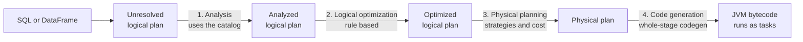

---
aliases:
  - Catalyst
  - Catalyst optimizer
  - Spark Catalyst
tags:
  - data-engineering
  - spark
  - query-optimization
  - distributed-systems
---
**Catalyst** is the **query optimizer** of Spark SQL. It takes a SQL query or a DataFrame operation, turns it into a tree, rewrites that tree with a set of rules to make it cheaper, and chooses the physical plan that will run on the cluster. It runs for SQL, DataFrames and Datasets, and it does **not** run for plain RDDs. It was introduced with Spark SQL (paper "Spark SQL: Relational Data Processing in Spark", SIGMOD 2015) and is written in Scala.

>[!tip] You write **what** you want (filter, join, aggregate). Catalyst decides **how** to do it: which filters to push down, which columns to read, which join strategy to use.

## The four phases



| Phase | What happens |
|---|---|
| **1. Analysis** | Resolves table names, column names and data types against the **catalog**. `SELECT amount FROM orders` becomes a plan where `orders` and `amount` are real, typed references. A missing column fails here, with an `AnalysisException` |
| **2. Logical optimization** | Applies **rule-based** rewrites that do not depend on the cluster: predicate pushdown, column pruning, constant folding and others (see below) |
| **3. Physical planning** | Generates one or more physical plans for the logical plan (for example, broadcast hash join or sort merge join), then picks one using a **cost model** |
| **4. Code generation** | Compiles the chosen plan into JVM bytecode (**whole-stage code generation**, part of Tungsten), so a stage runs as tight loops instead of one function call per row |

## Trees and rules

Catalyst represents every plan and every expression as a **tree** of nodes (`TreeNode`). An optimization is a **rule**: a function that takes a tree and returns an equivalent, better tree. Rules use **pattern matching** on the shape of the tree.

- Rules are grouped into **batches**.
- A `RuleExecutor` runs each batch **until a fixed point**: it repeats the rules until the tree stops changing, because one rewrite often enables another.
- Each rewrite must keep the result of the query identical. Only the cost changes.

Example: constant folding. The expression `amount * (1 + 1)` has the subtree `1 + 1`, which a rule replaces by the literal `2`, so Spark computes it once at planning time, not for every row.

## Main logical optimizations

| Rule | Effect |
|---|---|
| **Predicate pushdown** | Moves a `filter` as close as possible to the data source (even into the Parquet reader), so less data is read |
| **Column pruning** | Reads only the columns the query needs. This is why `select *` is a bad habit on columnar files |
| **Constant folding** | Computes constant expressions once at planning time |
| **Boolean simplification** | Simplifies conditions, for example `true AND x` becomes `x` |
| **Combine and reorder filters** | Merges adjacent filters and `select`s into one |
| **Null propagation** | Replaces expressions that are always null by a null literal |
| **Limit pushdown** | Pushes `limit` below operators such as `union` and some joins |
| **Join reordering** | Chooses the join order that creates smaller intermediate results (needs the cost-based optimizer) |

## Rule-based and cost-based

- **Rule-based optimization (RBO):** the rules above. They are always valid, so they always run.
- **Cost-based optimization (CBO):** uses **statistics** (row count, distinct values, min, max, size) to estimate the cost of each option. It is used for join reordering and for choosing the join strategy.
  - Controlled by `spark.sql.cbo.enabled` (off by default in open source Spark).
  - Needs statistics collected with `ANALYZE TABLE orders COMPUTE STATISTICS FOR ALL COLUMNS`.
  - Without statistics, Catalyst falls back to the file size estimate, which is often wrong after a filter or a join.

>[!note] Catalyst plans **before** the query runs, so it only has estimates. **Adaptive Query Execution** (AQE) complements it: it re-plans **while** the query runs, using real statistics from finished shuffle stages.

## Seeing the plans with `explain`

```python
orders = spark.read.parquet("s3://bucket/raw/orders/")
customers = spark.read.parquet("s3://bucket/raw/customers/")

result = (
    orders.join(customers, "customer_id")
    .filter("status = 'paid'")
    .select("customer_id", "country", "amount")
)

result.explain(mode="extended")
```

| Mode | Shows |
|---|---|
| `simple` | Only the physical plan (default) |
| `extended` | Parsed, analyzed, optimized and physical plans |
| `formatted` | Physical plan as a readable outline, with details per node |
| `cost` | Logical plan with the statistics Catalyst used |
| `codegen` | The generated Java code |

What to look for in the physical plan:

- `PushedFilters: [...]` on the scan: the predicate was pushed to the source.
- `ReadSchema: struct<...>` with only the needed columns: column pruning worked.
- `PartitionFilters: [...]`: partition pruning worked.
- `BroadcastHashJoin` or `SortMergeJoin`: the join strategy chosen. See [[data architecture/Apache Spark/sql and optimization/Spark Joins.md|Spark Joins]].
- `Exchange`: a shuffle.
- `*(1)`, `*(2)`: operators inside whole-stage code generation, grouped by stage.

In the example, the `status = 'paid'` filter is written **after** the join, but Catalyst moves it below the join, next to the `orders` scan, and reads only the four columns used.

## What blocks the optimizer

Catalyst only optimizes what it can **understand**. These break it:

- **Python and Scala UDFs:** a black box. Catalyst cannot push a filter through it, cannot prune columns inside it and cannot generate code for it. Prefer built-in functions.
- **RDD operations:** `df.rdd.map(...)` leaves the optimized world. Catalyst plans only the part before and after.
- **Casting a filtered column:** `filter(F.col("order_date").cast("string") == "2026-01-01")` can disable partition pruning. Compare with the column in its original type.
- **Missing or stale statistics:** CBO decisions and join strategy are wrong.
- **Non-deterministic expressions** such as `rand()`: they limit how far Catalyst can move filters.
- **Deep plans in loops:** building a DataFrame in a loop with hundreds of `withColumn` calls makes planning slow, because the analyzer runs again on each step. Use one `select` with many columns.

## Extending Catalyst

Catalyst is **extensible**. You can add your own rules or strategies:

- `SparkSessionExtensions` (set with `spark.sql.extensions`) injects custom analyzer rules, optimizer rules, parsers and planner strategies. Delta Lake and Apache Iceberg use this to add their own SQL commands and optimizations.
- Data source **V2** connectors implement pushdown interfaces (filters, columns, aggregates, limits), so Catalyst can delegate work to the source, such as a JDBC database.

## Best practices

- Run `explain()` before tuning. Check what Catalyst already did.
- Use DataFrames and SQL, not RDDs, so the optimizer sees the whole query.
- Use built-in functions instead of UDFs.
- Use columnar formats such as Parquet, so pushdown and pruning work.
- Collect table statistics and consider enabling CBO for jobs with many joins.
- Filter and select early, and write the query clearly. Catalyst reorders, but it cannot fix a wrong logic.

## Common pitfalls

- Believing Catalyst fixes every query. It does not, if a UDF or a cast hides the intent.
- Enabling CBO without collecting statistics.
- Trusting the default broadcast threshold for tables whose size estimate is wrong.
- Reading only the logical plan. The physical plan shows the real cost (shuffles, join strategy).
- Building very long chains of transformations in a loop.

## Interview questions

- What is the Catalyst optimizer, and what are its four phases?
- What is the difference between the logical plan and the physical plan?
- What do predicate pushdown and column pruning do, and how do you confirm them in `explain()`?
- What is the difference between rule-based and cost-based optimization in Spark?
- Why does a Python UDF stop Catalyst from optimizing a query?
- How do Catalyst and Adaptive Query Execution differ?
- How does Catalyst represent plans, and how are rules applied?
- How can you extend Catalyst with custom rules?
