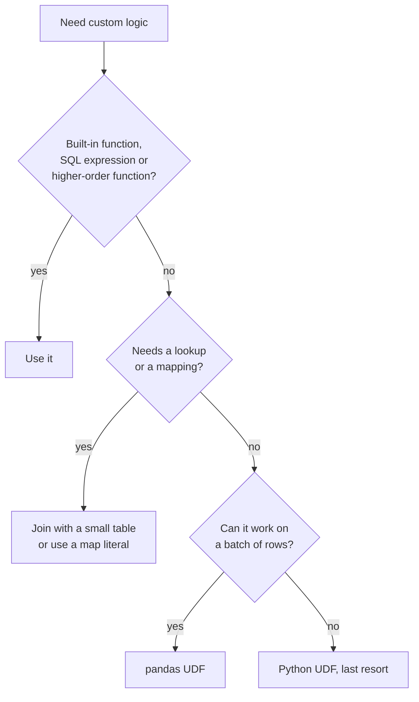

---
aliases:
  - UDF
  - UDFs
  - Spark UDF
  - User Defined Function
  - pandas UDF
tags:
  - data-engineering
  - spark
  - udf
  - performance
description: What user-defined functions (UDFs) are in Apache Spark, the main types (Python, pandas, Scala), and the tradeoffs between flexibility and performance, with guidance on when to use a UDF and what to use instead.
---
A **UDF** (user-defined function) is a function you write yourself, in Python, Scala or Java, and call from a DataFrame or SQL query when the built-in functions in `pyspark.sql.functions` do not cover your logic. It gives you **flexibility**, but Spark treats it as a **black box**, so you pay in performance and optimization.

>[!tip] Rule of thumb: **built-in function first**, then a **pandas UDF**, and a plain Python UDF last. Each step down gives more freedom and costs more speed.

## Types of UDFs

| Type | How it runs | Speed | Notes |
|---|---|---|---|
| **Built-in function** (not a UDF) | Inside the JVM, optimized by Catalyst | Fastest | Always check first, including higher-order functions |
| **Scala or Java UDF** | Inside the JVM | Fast, but still opaque to Catalyst | No Python overhead. Needs a JAR when used from PySpark |
| **pandas UDF** (vectorized) | Python, on **batches** of rows through **Apache Arrow** | Good | Works on a `pandas.Series` per batch |
| **Python UDF** (row-at-a-time) | Python, **one row at a time**, serialized between the JVM and Python | Slowest | Easy to write, easy to abuse |
| **UDAF** and **UDTF** | Custom aggregate (many rows to one) and table functions (one row to many) | Varies | Use pandas versions (`applyInPandas`, `mapInPandas`) when you can |

```python
from pyspark.sql import functions as F
from pyspark.sql.functions import udf, pandas_udf
from pyspark.sql.types import StringType
import pandas as pd

# Python UDF: one row at a time
@udf(returnType=StringType())
def mask_py(value):
    return None if value is None else value[:2] + "***"

# pandas UDF: a batch of rows at once, through Arrow
@pandas_udf(StringType())
def mask_pandas(values: pd.Series) -> pd.Series:
    return values.str[:2] + "***"

# Built-in: stays in the JVM, optimized by Catalyst
masked = F.concat(F.substring("email", 1, 2), F.lit("***"))

df.select(mask_py("email"), mask_pandas("email"), masked)
```

## Why UDFs are slow


- **Serialization:** a Python UDF sends rows from the JVM to a separate **Python process** and back, row by row (pickle). A pandas UDF sends **Arrow batches**, which is much cheaper, but the data still crosses the boundary.
- **Black box for Catalyst:** it cannot push a filter through the UDF, prune columns inside it, reorder it or generate code for it. See [[data architecture/Apache Spark/sql and optimization/Catalyst.md|Catalyst]].
- **No whole-stage code generation** across the UDF, so the tight JVM loop is broken.
- **Python interpreter speed** for the logic itself.
- **Extra memory:** Python workers run **outside the JVM heap**, so they need more `memoryOverhead`. See [[data architecture/Apache Spark/common errors/Spark OutOfMemoryError.md|Spark OutOfMemoryError]].

A UDF is a [[data architecture/Apache Spark/core concepts/Spark Narrow Transformations.md|narrow transformation]] (no shuffle), but narrow does not mean cheap.

## Tradeoffs

| Advantage | Cost |
|---|---|
| **Any logic** (libraries, custom rules, ML model scoring) | Slower than a built-in function, often by a lot |
| **Reuse** of existing Python or Scala code | Catalyst cannot optimize through it |
| **Readable** for complex rules | **Harder to test and debug** in a distributed run, and errors come from Python workers |
| **Fast to write** | Extra **memory** and **serialization** overhead |
| Pandas UDFs process **batches** | Batch size and Arrow add tuning work |
| Scala UDFs avoid Python overhead | Needs a **JVM build and deployment** (JAR), less common in Python teams |
| Can call **external services** or models | Network calls per row are slow, hard to retry and can break **idempotency** |

Other points to watch:

- **Nulls:** your function must handle `None`, or the task fails.
- **Determinism:** Spark may re-run a UDF (retries, recomputation). Mark non-deterministic ones with `.asNondeterministic()`, and avoid side effects.
- **Return type:** declare it explicitly, and make the function really return it.
- **Dependencies:** libraries used inside the UDF must be installed on **every executor**.
- **Versions:** options such as Arrow-optimized Python UDFs (`spark.sql.execution.pythonUDF.arrow.enabled`) and SQL UDFs depend on the Spark version. Confirm in the documentation of the version you run.

## When to use a UDF

Use a UDF when **all** of these hold:

1. No built-in function, SQL expression or higher-order function can express the logic.
2. The logic needs a **Python or JVM library**, or is too complex for SQL.
3. You tried to reduce the data first (filter and select early).



## What to use instead

| Instead of a UDF for... | Use |
|---|---|
| String, date, math and null logic | Built-in functions (`F.regexp_extract`, `F.to_date`, `F.coalesce`, `F.when`) |
| Conditions | `F.when(...).otherwise(...)` or `CASE WHEN` |
| Logic on array columns | Higher-order functions: `F.transform`, `F.filter`, `F.aggregate`, `F.exists` |
| Value mapping or lookup | A **join** with a small (broadcast) table, or `F.create_map` |
| Complex per-group logic | `groupBy().applyInPandas(...)` |
| Per-partition work (setup once) | `mapInPandas` or RDD `mapPartitions` |
| Custom logic that must be fast | A **Scala UDF** or a native Spark expression |

```python
# Instead of a UDF that maps a code to a label
labels = F.create_map(
    F.lit("A"), F.lit("Active"),
    F.lit("C"), F.lit("Cancelled"),
)
df.withColumn("status_label", labels[F.col("status_code")])

# Instead of a UDF that works on every item of an array
df.withColumn("prices_usd", F.transform("prices", lambda p: p * F.lit(0.2)))
```

## How to check the cost

- `df.explain()`: a Python UDF appears as `BatchEvalPython` (or `ArrowEvalPython` for pandas UDFs).
- Check that **filters were not blocked**: with a UDF in the filter condition, no `PushedFilters` appear on the scan.
- **Spark UI → Executors:** high GC time and memory use on Python-heavy jobs.
- Compare the runtime with and without the UDF, on the same data sample.

## Best practices

- Check for a built-in function or higher-order function **before** writing a UDF.
- Prefer **pandas UDFs** to plain Python UDFs, and **filter and select first** to reduce the rows that reach the UDF.
- Keep UDFs **pure**: no side effects, handle nulls, declare the return type.
- Put the **business rule in one tested function**, and unit test it outside Spark.
- Do **not call external services per row.** Batch the calls, or load the reference data and join.
- Give PySpark jobs enough `memoryOverhead`, and track UDF stages in monitoring.

## Common pitfalls

- A UDF for something a built-in function does, such as splitting strings or formatting dates.
- Using a UDF inside a `filter`, which blocks predicate pushdown and partition pruning.
- Forgetting to handle `None`, so one bad row fails the whole stage.
- Loading a large model or file **inside** the function for every row, instead of once per executor or per batch.
- Returning a different type than declared, which gives `null` or an error.
- Assuming a UDF runs exactly once per row.
- Expecting a Python UDF to be as fast as the rest of the plan.

## Interview questions

- What is a UDF in Spark, and why can it hurt performance?
- What is the difference between a Python UDF and a pandas UDF?
- Why can Catalyst not optimize a UDF?
- What are the alternatives to a UDF?
- How do you handle nulls and determinism in a UDF?
- Why do PySpark jobs with UDFs often need more `memoryOverhead`?
- When is a UDF the right choice?

## Related

- [[data architecture/Apache Spark/sql and optimization/Catalyst.md|Catalyst]]
- [[data architecture/Apache Spark/core concepts/Spark Narrow Transformations.md|Spark Narrow Transformations]]
- [[data architecture/Apache Spark/common errors/Spark OutOfMemoryError.md|Spark OutOfMemoryError]]
