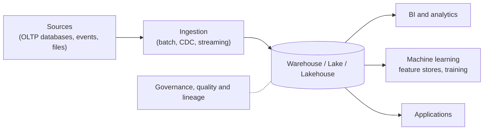

# Data architecture

Index of the notes about how data is stored, moved, processed, served and governed. Each subject has its own note, and many folders have their own README.

Quick comparison of the three storage options:

| Aspect            | [[data architecture/Data Warehouse/Data Warehouse.md\|Data Warehouse]] Modeled, structured data for BI. Schema on write | [[data architecture/Data Lake/README.md\|Data Lake]] Raw data of any kind on cheap object storage. Schema on read | [[data architecture/Data Lakehouse/Data Lakehouse.md\|Data Lakehouse]] Lake storage with warehouse features (ACID, schema, time travel) from a table format |
| ----------------- | --------------------------------------------------------------------------------------------------------------- | ----------------------------------------------------------------------------------------------------------------- | --------------------------------------------------------------------------------------------------------------------------------------------------- |
| Data              | Structured                                                                                                      | Any                                                                                                               | Any                                                                                                                                                 |
| Schema            | On write                                                                                                        | On read                                                                                                           | On write, with evolution                                                                                                                            |
| Storage           | Managed columnar                                                                                                | Object storage                                                                                                    | Object storage, open formats                                                                                                                        |
| ACID transactions | Yes                                                                                                             | No                                                                                                                | Yes                                                                                                                                                 |
| Best for          | BI and reporting                                                                                                | Raw data, data science                                                                                            | BI and ML on one copy                                                                                                                               |
| Main risk         | Rigidity and cost                                                                                               | Data swamp                                                                                                        | More components to operate                                                                                                                          |

The full comparison, with a decision guide and the machine learning view, is in [[data architecture/Data Lake vs Data Warehouse vs Data Lakehouse.md|Data Lake vs Data Warehouse vs Data Lakehouse]]. The layers inside a lake or lakehouse (Medallion architecture) and the table format (Apache Iceberg) are covered from the Data Lakehouse note.

## Links

### Storage

- [[data architecture/Data Warehouse/Data Warehouse.md|Data Warehouse]]
- [[data architecture/Data Lake/README.md|Data Lake]]
- [[data architecture/Data Lakehouse/Data Lakehouse.md|Data Lakehouse]]
- [[data architecture/Data Lake vs Data Warehouse vs Data Lakehouse.md|Data Lake vs Data Warehouse vs Data Lakehouse]]
- [[data architecture/file formats/README.md|File formats]]

### Databases

| Type | Notes |
|---|---|
| Relational and transactional | [[data architecture/Relational database.md\|Relational database]], [[data architecture/OLTP Database.md\|OLTP Database]], [[data architecture/database trasactional/InfluxDB.md\|InfluxDB]], [[data architecture/database trasactional/Full-text Search.md\|Full-text Search]] |
| Analytical | [[data architecture/OLAP Database.md\|OLAP Database]] |
| NoSQL | [[data architecture/database NoSQL/AWS DynamoDB.md\|AWS DynamoDB]] |
| Vector | [[data architecture/database vetorial/vector database.md\|vector database]] |

### Ingestion, streaming and processing

| Area | Notes |
|---|---|
| Messaging and streaming | [[data architecture/concepts/PubSub.md\|PubSub]] |
| Batch processing | [[data architecture/Apache Hadoop/Apache Hadoop.md\|Apache Hadoop]], [[data architecture/Apache Spark/Apache Spark.md\|Apache Spark]], [[data architecture/Pandas.md\|Pandas]] |
| Distributed processing concepts | [[data architecture/concepts/Data Skew.md\|Data Skew]] |
| Query engines | [[data architecture/Trino/Apache Trino.md\|Apache Trino]] |
| Orchestration | [[data architecture/Apache Airflow.md\|Apache Airflow]] |
| Data integration | [[data architecture/data engineering/Data Integration Platform.md\|Data Integration Platform]] |
| Change and reprocessing | [[data architecture/CDC.md\|CDC]], [[data architecture/data engineering/backfill.md\|backfill]], [[data architecture/data engineering/Schema Evolution.md\|Schema Evolution]] |

### Machine learning data

| Note | Role |
|---|---|
| [[data architecture/Offline Feature Store.md\|Offline Feature Store]] | Feature history for training, on S3 and Iceberg |
| [[data architecture/Online Feature Store.md\|Online Feature Store]] | Latest feature values served in milliseconds |

### Quality and governance

| Note | Role |
|---|---|
| [[data architecture/data quality.md\|data quality]] | Checks that the data is complete, valid, unique and fresh |
| [[data architecture/data drift.md\|data drift]] | Detects changes in the data distribution |
| [[data architecture/Data Lineage.md\|Data Lineage]] | Tracks where data comes from and where it is used |
| [[data architecture/data governance/Data Privacy (PII, LGPD, GDPR).md\|Data Privacy (PII, LGPD, GDPR)]] | Personal data and privacy rules |
| [[data architecture/data governance/SSOT - Single Source Of Truth.md\|SSOT - Single Source Of Truth]] | One authoritative source for each piece of data (stub, to expand) |

## Suggested reading order

1. [[data architecture/Data Lake vs Data Warehouse vs Data Lakehouse.md|Data Lake vs Data Warehouse vs Data Lakehouse]] to understand the three storage options
2. The notes of [[data architecture/Data Warehouse/Data Warehouse.md|Data Warehouse]], [[data architecture/Data Lake/README.md|Data Lake]] and [[data architecture/Data Lakehouse/Data Lakehouse.md|Data Lakehouse]]
3. From Data Lakehouse, go on to Medallion architecture and Apache Iceberg
4. [[data architecture/Offline Feature Store.md|Offline Feature Store]] and, from it, point-in-time for the machine learning side

## Related

- [[machine learning/Machine Learning.md|Machine learning]]
