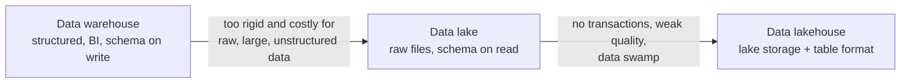

---
aliases:
  - Lake vs Warehouse vs Lakehouse
  - Data Lake vs Data Warehouse
---
#data-architecture #comparison #data-platform

# Data Lake vs Data Warehouse vs Data Lakehouse

Three ways to store and serve analytical data. The [[Data Warehouse|data warehouse]] stores **modeled, structured data** for BI. The [[data architecture/Data Lake/README|data lake]] stores **raw data of any kind** cheaply. The [[Data Lakehouse|data lakehouse]] puts **warehouse features on top of lake storage**, so one copy of the data serves both.

>[!tip] Warehouse: organized first, then stored. Lake: stored first, organized later. Lakehouse: stored in the lake, organized by a table format.

## How they evolved

Many companies ran **both** a lake (for data science) and a warehouse (for BI), copying data between them. The lakehouse tries to remove that copy and the pipelines that keep it in sync.

## Side-by-side comparison

| Aspect | Data warehouse | Data lake | Data lakehouse |
|---|---|---|---|
| **Main purpose** | BI, reporting, governed analytics | Cheap storage of raw data, data science | BI, data engineering, ML and streaming on one copy |
| **Data types** | Structured | Structured, semi-structured, unstructured | All of them |
| **Schema** | **On write**: modeled before loading | **On read**: structure applied when reading | On write for tables, with controlled evolution |
| **Storage** | Proprietary or managed columnar storage | Object storage (for example S3) | Object storage with open file formats |
| **File and table formats** | Internal formats | Parquet, ORC, Avro, JSON, CSV (plain files) | Parquet plus a table format ([[Apache Iceberg]], Delta Lake, Hudi) |
| **ACID transactions** | Yes | No | Yes |
| **Updates and deletes** | Yes | Hard, files are rewritten by hand | Yes (`MERGE`, `UPDATE`, `DELETE`) |
| **Time travel and history** | Limited, often through dimension design | Only if files are kept | Built in (snapshots) |
| **Query performance** | Very high, optimized for SQL | Lower, depends on formats and partitions | High, close to a warehouse with good tables |
| **Cost** | Higher (storage and compute together, in many products) | Lowest storage cost | Low storage cost, separate compute |
| **Compute and storage** | Often coupled (cloud warehouses separate them) | Separate | Separate |
| **Data quality and governance** | Strong and centralized | Weak unless added | Good, through the table format and catalog |
| **Flexibility for new data** | Low (modeling work first) | High | High |
| **Machine learning** | Structured data only, weaker for training at scale | Good for raw and unstructured data | Good for both. See [[Offline Feature Store]] |
| **Vendor lock-in** | Higher | Low (open files) | Low to medium (open formats, catalog choice matters) |
| **Typical users** | Analysts, business users | Data engineers and scientists | All of them |
| **Main risk** | Rigidity, cost, data copies | **Data swamp** | More components to operate |
| **Examples** | [[Redshift]], [[Snowflake]], BigQuery | S3 with Parquet files, queried by [[AWS Athena]] or [[Apache Spark]] | Iceberg or Delta tables on S3 with Athena, Trino or Spark |

## Strengths and weaknesses

| | Strengths | Weaknesses |
|---|---|---|
| **Warehouse** | Fast SQL, one governed truth, mature BI tools, ACID | Structured data only, modeling effort, cost, lock-in |
| **Lake** | Cheap, any data, flexible, open formats, good for ML | No ACID, hard updates, swamp risk, slower queries |
| **Lakehouse** | One copy, open formats, ACID, ML and BI together | Newer, more moving parts, needs table maintenance |

## Choosing

| Situation | Good choice |
|---|---|
| Mostly structured data, BI and reporting, a small data team | **Warehouse** |
| Large volumes of raw, semi-structured or unstructured data for data science and ML | **Lake** (add a table format if you need reliability) |
| BI **and** ML on the same data, history and audit, open formats | **Lakehouse** |
| Small data that fits in one database | Neither: use a [[Relational database]] |
| Real-time transactions | Neither: use an [[OLTP Database]] |

Common patterns:

- **Lake plus warehouse (two tiers):** the lake collects raw data, and a curated part is loaded into a warehouse for BI. It works, but there are two copies and two sets of pipelines.
- **Lakehouse:** the lake storage plus a table format serves all uses. A warehouse engine can still sit on top for BI.
- **Lakehouse with layers:** organize the data as bronze, silver and gold. See [[Medallion architecture]].
- **Start simple:** many teams begin with a warehouse for BI, and add a lake or move to a lakehouse when ML, unstructured data or costs require it.

## Machine learning view

| Need | Warehouse | Lake | Lakehouse |
|---|---|---|---|
| Features and labels with history | Good with dated facts and slowly changing dimensions (SCD Type 2) | Possible if files are appended and never overwritten | Good: snapshots and full history |
| [[point-in-time]] training sets and avoiding [[Data Leakage]] | Yes, with dated tables | Hard without table versions | Yes. Time travel reproduces a dataset, and a per-row point-in-time join builds it |
| Unstructured data (text, images) | No | Yes | Yes |
| Training at scale | Awkward | Good | Good |
| [[Backtest]] and prediction vs outcome comparison | Good for structured data | Possible | Good |

## Common mistakes

- Choosing by fashion: the lakehouse is not automatically better for every team
- Building a lake without a catalog, ownership and quality checks, which ends as a swamp
- Using a lake as a warehouse for BI without a table format
- Copying the same data into a lake and a warehouse, and keeping them in sync by hand
- Ignoring cost: storage is cheap, but scans and many small files are not
- Underestimating the operating work of a lakehouse (compaction, snapshot expiry, catalog)

## Related

- [[Data Warehouse|Data Warehouse]]
- [[data architecture/Data Lake/README|Data Lake]]
- [[Data Lakehouse|Data Lakehouse]]
- [[Medallion architecture]]
- [[Apache Iceberg]]
- [[Offline Feature Store]]
- [[point-in-time]]
- [[Data Architecture|Data architecture]]
