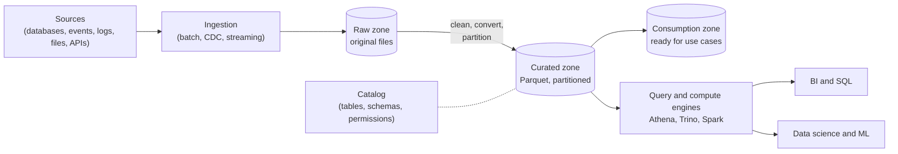

---
aliases:
  - data lake
  - Data Lake
  - lake
---
#data-architecture #data-lake #storage

# Data Lake

A **data lake** is a central repository that stores **large amounts of data in its raw, original form** ([[structured]], [[semi-structured]] and [[unstructured]]) on cheap object storage, such as Amazon S3. Data is saved first and given a structure **when it is read**, not before.

>[!tip] A warehouse is organized before the data goes in. A lake accepts everything first and organizes it later.

It uses **schema on read**: the same raw files can be read with different structures for different purposes. This makes it flexible and cheap, and it is well suited for data science and machine learning, but it needs discipline to avoid a **data swamp**. For a lake with table features see the [[Data Lakehouse|data lakehouse]], and for the structured, modeled alternative see the [[Data Warehouse|data warehouse]].

## What it stores

| Data type           | Examples                         |
| ------------------- | -------------------------------- |
| [[Structured]]      | Database exports, CSV, tables    |
| [[Semi-structured]] | JSON, XML, logs, event streams   |
| [[Unstructured]]    | Text, images, audio, video, PDFs |

## Architecture



| Part | Role | Examples |
|---|---|---|
| **Object storage** | Cheap, durable, practically unlimited storage of files | Amazon S3, other cloud object storage |
| **File formats** | How the data is stored. Columnar formats are faster and smaller | Parquet, ORC (columnar), Avro, JSON, CSV (row-based) |
| **Zones (layers)** | Separate raw data from cleaned and ready data. A common form is [[Medallion architecture]] (bronze, silver, gold) | Raw, curated, consumption |
| **Catalog** | Records what datasets exist, their schema and location, and who can read them | AWS Glue Data Catalog, Hive metastore |
| **Engines** | Process and query the files, separated from storage | [[AWS Athena]], [[Apache Trino\|Trino]], [[Apache Spark]] |
| **Governance** | Access control, [[Data Lineage]] and [[data quality]] | Permissions, tags, audit logs |

### Folder layout and partitions

Files are organized in folders, and **partitioned** by the columns used in common filters, so that a query reads only the folders it needs (partition pruning).

```text
s3://my-bucket/raw/events/dt=2024-03-01/events.json
s3://my-bucket/curated/events/year=2024/month=3/data_0.parquet
s3://my-bucket/curated/events/year=2024/month=4/data_0.parquet
```

## Schema on read: example

The same raw JSON lines, where each event has different fields, can be read directly. The query tool infers the structure when it reads. Checked in DuckDB:

```sql
SELECT * FROM read_json_auto('raw/events/events.json');
-- user, event, ts, props = {page, amount, coupon}
-- Each record has only some props. Missing ones are read as NULL.
```

Writing the cleaned data as **partitioned Parquet** (one folder per `year` and `month`) lets the query engine prune the folders it does not need:

```sql
SELECT user, event, month
FROM read_parquet('curated/events/*/*/*.parquet', hive_partitioning = true)
WHERE month = 3;
-- reads only the month=3 folder
```

## Data lake and machine learning

- **Raw history:** the lake keeps every version of the data, which is useful to rebuild features and to recover from mistakes.
- **Unstructured data:** text, images and audio for deep learning and LLMs are stored here, not in a warehouse.
- **Large-scale training:** frameworks read Parquet and other files straight from object storage.
- **Careful with history:** if files are overwritten, the old values are lost and [[point-in-time]] training sets cannot be rebuilt, which leads to [[Data Leakage]]. Append data with timestamps instead.
- **Feature data:** an [[Offline Feature Store]] is often built on top of the lake or lakehouse.

## Strengths and weaknesses

| Strengths | Weaknesses |
|---|---|
| Very cheap storage at any scale | No ACID transactions: readers can see half-written data |
| Stores any kind of data, in its original form | Updates and deletes are hard (files must be rewritten by hand) |
| Flexible: schema on read, many uses of the same data | Without governance it becomes a data swamp |
| Open formats, many engines can read them | Many small files and bad partitioning slow down queries |
| Good fit for data science and ML | Lower query performance and weaker consistency than a warehouse |
| Storage and compute scale independently | Schema changes can silently break downstream consumers |

The weaknesses in the second column (no transactions, hard updates, no schema control) are what **table formats** such as [[Apache Iceberg]] solve, and this is how a lake becomes a [[Data Lakehouse|lakehouse]].

## Lake, warehouse and lakehouse

| Aspect | Data lake | [[Data Warehouse\|Data warehouse]] | [[Data Lakehouse\|Data lakehouse]] |
|---|---|---|---|
| Data | Raw, any type | Structured, modeled | Both, with tables on top of files |
| Schema | On read | On write | On write, with controlled evolution |
| Storage | Cheap object storage | Proprietary, more expensive | Cheap object storage, open formats |
| ACID transactions | No | Yes | Yes |
| Main users | Data scientists, engineers | Analysts, BI | All of them |

## Avoiding the data swamp

- **Catalog everything:** every dataset has an owner, a description, a schema and a location.
- **Use zones:** raw, curated and consumption, with clear rules for each.
- **Apply [[data quality]] checks** when data moves between zones.
- **Keep [[Data Lineage]]** to know where data comes from and who uses it.
- **Control access** with permissions and masking for sensitive data, and follow privacy rules for personal data.
- **Choose good file formats and partitions,** and compact small files regularly.
- **Define retention:** delete data that is no longer needed.

## Common pitfalls

- Dumping data without a catalog, owner or documentation (a **data swamp**)
- Keeping everything in raw CSV or JSON, which is slow and expensive to query
- Too many small files, or partitions that do not match how the data is queried
- Overwriting files and losing the history needed for ML and audits
- No access control on sensitive or personal data
- Changing a file schema without telling the consumers
- Using the lake as a warehouse (BI with strict consistency) without a table format

## Related

- [[Data Warehouse|Data Warehouse]]
- [[Data Lakehouse|Data Lakehouse]]
- [[Data Lake vs Data Warehouse vs Data Lakehouse]]
- [[Medallion architecture]]
- [[Apache Iceberg]]
- [[AWS Athena]]
- [[Apache Spark]]
- [[Offline Feature Store]]
- [[data quality]]
- [[Data Lineage]]
- [[data architecture/Data Architecture|Data Architecture]]
