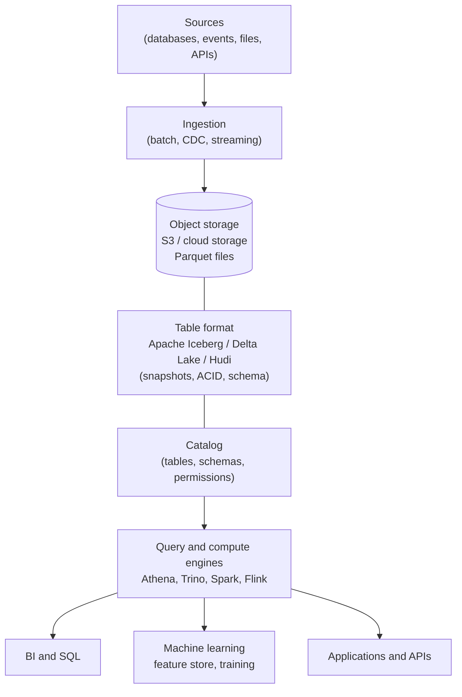

---
aliases:
  - Lakehouse
---
#data-architecture #lakehouse #data-platform

# Data Lakehouse

A **data lakehouse** is a data architecture that combines the **cheap, flexible storage of a [[data architecture/Data Lake/README|data lake]]** with the **reliability and SQL performance of a [[Data Warehouse|data warehouse]]**. The data stays in open files on object storage, and a **table format** on top adds transactions, schemas and versioning, so the same data serves BI, data engineering and machine learning.

>[!tip] A lakehouse is a data lake with warehouse features: files on cheap storage, plus tables that behave like a database.

## Lake, warehouse and lakehouse

| Aspect              | [[data architecture/Data Lake/README\|Data Lake]]                 | [[Data Warehouse\|Data Warehouse]] | Data lakehouse                             |
| ------------------- | ----------------------------------------------------------------- | ----------------------------------------------------------- | ------------------------------------------ |
| Data                | Raw files of any type (structured, semi-structured, unstructured) | Structured, modeled tables                                  | Both, with tables on top of files          |
| Storage             | Object storage (cheap)                                            | Proprietary storage (more expensive)                        | Object storage (cheap), open formats       |
| Schema              | On read (flexible, often messy)                                   | On write (strict)                                           | On write, with controlled schema evolution |
| Transactions (ACID) | No                                                                | Yes                                                         | Yes, through the table format              |
| Updates and deletes | Hard (rewrite files by hand)                                      | Yes                                                         | Yes (`MERGE`, `UPDATE`, `DELETE`)          |
| Workloads           | Data science, raw storage                                         | BI and reporting                                            | BI, ML, streaming and batch                |
| Risk                | Becomes a "data swamp"                                            | Data copies and vendor lock-in                              | More components to operate                 |

## Frameworks
[[Apache Iceberg]]
[[ACID transactions]]
[[Time travel]]
[[Data versioning]]
[[Schema evolution]]
[[Data partition]]


A lakehouse avoids having **two copies** of the data (one in a lake for ML, another in a warehouse for BI) and the pipelines that keep them in sync.

## Architecture



| Layer | What it does | Examples |
|---|---|---|
| **Storage** | Keeps the data files cheaply and durably | Amazon S3, cloud object storage |
| **File format** | Columnar, compressed files | Parquet, ORC |
| **Table format** | Turns files into **tables** with snapshots, ACID transactions, schema evolution and time travel | [[Apache Iceberg]], Delta Lake, Apache Hudi |
| **Catalog** | Stores the table definitions, schemas and access rules, and tells engines where a table is | AWS Glue Data Catalog, Hive metastore, Iceberg REST catalogs |
| **Compute and query engines** | Process and query the tables. Storage and compute are separate, so each scales alone | [[AWS Athena]], [[Apache Trino\|Trino]], [[Apache Spark]], Flink |
| **Consumers** | Dashboards, notebooks, ML pipelines, applications | BI tools, [[Offline Feature Store]], model training |

## Key capabilities

| Capability | What it gives you |
|---|---|
| **ACID transactions** | Readers never see half-written data, and concurrent writers do not corrupt tables |
| **Schema enforcement and evolution** | Bad data is rejected, and columns can be added or renamed safely |
| **Time travel** | Query a table **as it was** at a past snapshot or time, for audit and reproducibility |
| **Upserts and deletes** | `MERGE INTO`, `UPDATE` and `DELETE` on files, including row-level deletes for privacy requests |
| **Hidden partitioning and partition evolution** | The table format manages partitions, and they can change without rewriting all the data |
| **Batch and streaming together** | The same table can be written by streams and read by batch queries |
| **Open formats** | Many engines read the same data, which reduces vendor lock-in |
| **Fine-grained governance** | Access control, [[Data Lineage]] and [[data quality]] checks on the tables |

### Time travel and snapshots

Every commit to a table creates a **snapshot**. Reading an old snapshot gives the exact data the table held at that time. This is the base of reproducible training sets, audits and rollbacks. For machine learning it must be combined with a **per-row** [[point-in-time]] join, because time travel returns the commit time of a version, not the moment each fact was valid. See [[Offline Feature Store]].

```sql
-- Iceberg table on Athena (SQL syntax, check the one of your engine and version)
CREATE TABLE sales.orders (
  order_id bigint,
  customer_id bigint,
  amount double,
  order_ts timestamp)
PARTITIONED BY (day(order_ts))
LOCATION 's3://my-bucket/lakehouse/sales/orders/'
TBLPROPERTIES ('table_type' = 'ICEBERG');

-- Upsert changes from a staging table
MERGE INTO sales.orders t
USING sales.orders_updates s ON t.order_id = s.order_id
WHEN MATCHED THEN UPDATE SET amount = s.amount
WHEN NOT MATCHED THEN INSERT (order_id, customer_id, amount, order_ts)
  VALUES (s.order_id, s.customer_id, s.amount, s.order_ts);

-- Read the table as it was at a point in time
SELECT * FROM sales.orders FOR TIMESTAMP AS OF TIMESTAMP '2024-03-20 00:00:00 UTC';
```

This SQL comes from general knowledge of the Iceberg and Athena syntax, and it was not run against a real account here.

## Organizing the data: medallion architecture

A common way to organize a lakehouse is in layers of increasing quality: **bronze** (raw), **silver** (cleaned) and **gold** (business-ready). See [[Medallion architecture]].

## Lakehouse and machine learning

A lakehouse is a natural home for ML data:

- **Training data at scale:** large historical datasets on cheap storage, read by Spark or any engine
- **[[Offline Feature Store]]:** feature history stored as Iceberg tables on S3, queried with SQL, with snapshots for reproducibility
- **[[point-in-time]] correctness and [[Data Leakage]] prevention:** the full history and the timestamps are kept, so each training row can see only what was known at its time
- **[[Backtest]]:** model predictions and the real labels are stored together, so a model can be replayed over the past and compared
- **Lineage and quality gates:** [[Data Lineage]] shows where each feature and training set came from, and [[data quality]] checks block bad data
- **Unstructured data:** files such as text, images and logs live next to the tables

## When to use it

| A lakehouse fits when | Consider something else when |
|---|---|
| You have large volumes and many kinds of data | The data is small and fits in one database ([[Relational database]]) |
| BI, data engineering and ML all need the same data | There is only classic BI on well-modeled data, and a managed [[Data Warehouse\|Data Warehouse]] is enough |
| You want open formats and the freedom to change engines | The team cannot operate a catalog, table maintenance and several engines |
| You need history, audit and reproducibility | Very low latency transactions are needed ([[OLTP Database]]) |

## Operating a lakehouse

- **Table maintenance:** many small files slow queries. Compact them regularly, and expire old snapshots to control storage cost (which also limits how far time travel can go).
- **Partitioning and file sizes:** choose partitions that match the common filters, and avoid too many tiny partitions.
- **Catalog and permissions:** one catalog as the source of truth, with access control and column or row-level rules for sensitive data.
- **Data quality and lineage:** validate data at each layer, and keep [[Data Lineage]].
- **Cost:** storage is cheap, but scans are not. Columnar formats, partition pruning and good file sizes reduce the cost per query.
- **Streaming ingestion:** many small commits create many small files, so plan compaction.

## Common pitfalls

- Treating the lake as a dumping ground without a catalog, schemas or ownership (a **data swamp**)
- No table maintenance: small files and old snapshots pile up
- Overwriting tables in place and losing the history that ML needs
- Confusing time travel with [[point-in-time]] correctness
- Using different engines and formats without a common catalog
- No access control on sensitive columns
- Moving everything to a lakehouse when a simple warehouse or database would do

## Related

- [[Data Warehouse|Data Warehouse]]
- [[Apache Iceberg]]
- [[Data Lake vs Data Warehouse vs Data Lakehouse]]
- [[Medallion architecture]]
- [[AWS Athena]]
- [[Apache Trino|Trino]]
- [[Apache Spark]]
- [[Offline Feature Store]]
- [[point-in-time]]
- [[Data Lineage]]
- [[data quality]]
- [[data architecture/Data Architecture|Data Architecture]]
