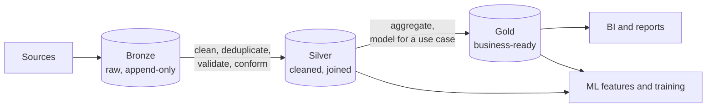

---
aliases:
  - Medallion
  - Bronze Silver Gold
  - Multi-hop architecture
---
#data-architecture #lakehouse #data-engineering #data-quality

# Medallion architecture

The **medallion architecture** organizes the data of a [[Data Lakehouse|Data Lakehouse]] in **layers of increasing quality**: **bronze** (raw), **silver** (cleaned and conformed) and **gold** (business-ready). Data moves from one layer to the next through pipelines, and each step improves its structure and quality.

>[!tip] Bronze keeps everything as it arrived, silver makes it trustworthy, and gold makes it useful for a specific purpose.

## The layers

| Layer | Content | Typical work | Consumers |
|---|---|---|---|
| **Bronze** | Raw data **as received**, with metadata (source, load time). Append-only | Ingest only. Keep the original, so anything can be reprocessed | Data engineers |
| **Silver** | Cleaned, deduplicated and validated data, with consistent types and keys, joined across sources | Clean, validate, conform, deduplicate, handle late data, apply [[data quality]] checks | Data scientists, analysts, [[Offline Feature Store]] |
| **Gold** | Aggregated and modeled data for a business purpose (for example daily sales by region, or a customer 360 table) | Aggregations, business logic, dimensional models | BI dashboards, reports, applications |

## Why use it

- **Reprocessing:** because bronze keeps the raw data, a bug in a transformation is fixed by rerunning the pipeline from the raw layer.
- **Quality improves step by step,** and each layer has clear checks and a clear owner.
- **Separation of concerns:** engineers work on ingestion, and analysts and scientists on trusted, ready data.
- **Auditability:** with [[Data Lineage]] and table snapshots, you can trace every gold number to its raw data.
- **Reuse:** many gold tables and ML features share the same silver data.

## Medallion and machine learning

- **Silver** is the usual source of **features** and training data, because it has clean entities and full history.
- **Keep the history** in bronze and silver (append new values with timestamps instead of overwriting), so that [[point-in-time]] joins and [[Backtest]] runs are possible and [[Data Leakage]] is avoided.
- **Gold** holds the business views and can also store **model outputs** (predictions, scores) next to the real outcomes, to evaluate and monitor models.
- **Quality gates** between layers block bad data before it reaches a model. See [[data quality]] and [[data drift]].

## Practical notes

- The layers are a **convention**, not a product. Some teams use different names or more layers.
- Each layer is usually a set of tables (for example [[Apache Iceberg]] on S3), often in separate schemas or storage paths with their own access rules.
- Do not copy everything to gold. Build gold tables only for defined use cases.
- Keep transformations **idempotent** (rerunning gives the same result), so that backfills and retries are safe.

## Common pitfalls

- Cleaning data in bronze, which destroys the original
- Overwriting history in silver, which breaks point-in-time training sets
- Too many layers or tables with no owner
- Business logic hidden in several layers, with no [[Data Lineage]]
- No quality checks between layers
- Treating gold as the only source for ML, which loses detail and history

## Related

- [[Data Lakehouse|Data Lakehouse]]
- [[Apache Iceberg]]
- [[Offline Feature Store]]
- [[point-in-time]]
- [[Data Lineage]]
- [[data quality]]
