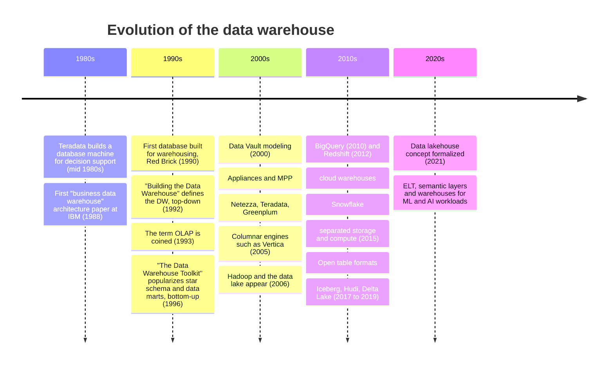
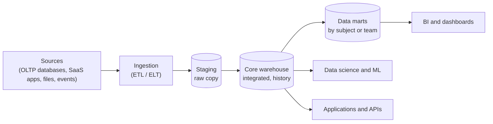
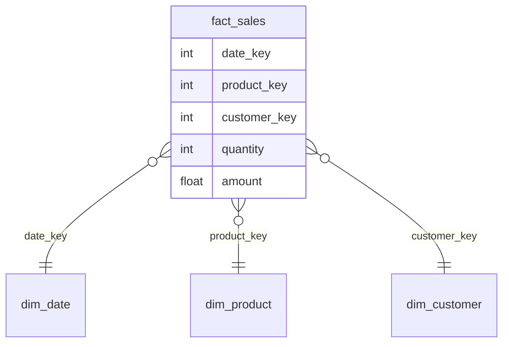

---
aliases:
  - data warehouse
  - warehouse
  - DW
  - analytics
  - database
---
#data-architecture #data-warehouse #analytics #olap

# Data Warehouse

A **data warehouse** is a central store of **cleaned, structured and modeled data**, built for **analytics and reporting** rather than for running the business. It collects data from many source systems, integrates it into one consistent model, and keeps its history, so that analysts and BI tools can ask questions across the whole company with SQL.

>[!tip] An operational database ([[OLTP Database]]) answers "what is happening now?" one record at a time. A warehouse ([[OLAP Database]]) answers "what happened, and why?" over millions of records.

It uses **schema on write**: the structure is defined first, and the data is cleaned and conformed **before** it is loaded. This is the opposite of a [[data architecture/Data Lake/README|data lake]], and the difference is the reason the [[Data Lakehouse|data lakehouse]] exists.

## Strengths
- Purpose-built for BI and reporting
- Meant to unify disparate systems
- Houses structured, clean data with a standardized schema

## Downsides
- Low support for semi or unstructured data
- Poor support for data science, AI and streaming use cases
- Expensive to scale
- Often uses closed and proprietary formats
## Evolution timeline


| Era                | Main idea                                                                                     |
| ------------------ | --------------------------------------------------------------------------------------------- |
| **1980s to 1990s** | Separate analytics from operational systems. Define the warehouse and its modeling approaches |
| **2000s**          | Speed through MPP, appliances and columnar storage. The lake appears next to the warehouse    |
| **2010s**          | Cloud, elasticity, and storage separated from compute                                         |
| **2020s**          | Warehouse and lake converge into the [[Data Lakehouse\|lakehouse]]   |

## Classic characteristics

| Characteristic | Meaning |
|---|---|
| **Subject-oriented** | Organized around business subjects (sales, customers, products), not around applications |
| **Integrated** | Data from different sources is made consistent: same keys, units, formats and definitions |
| **Time-variant** | Keeps history, so trends can be analyzed over time |
| **Non-volatile** | Data is loaded and read, and normally not changed or deleted. History is preserved |

## OLTP vs OLAP

| Aspect | Operational database ([[OLTP Database]]) | Data warehouse ([[OLAP Database]]) |
|---|---|---|
| Purpose | Run transactions (orders, payments) | Analyze and report |
| Operations | Many small reads and writes | Large scans and aggregations |
| Data model | Normalized, many tables | Dimensional (star schema), denormalized |
| Storage | Row-oriented | Column-oriented |
| Data | Current state | Full history |
| Users | Applications, customers | Analysts, BI tools, data scientists |

## Architecture



| Layer | Role |
|---|---|
| **Staging** | Temporary or raw copy of the source data, before transformation |
| **Core (integrated) layer** | Cleaned, conformed data with history. The single version of the truth |
| **Data marts** | Smaller, focused subsets for one subject or team (finance, marketing), usually modeled for fast queries |
| **Semantic layer** | Shared business definitions of metrics (revenue, active customer), so every report agrees |

### ETL and ELT

| Approach | Order | Notes |
|---|---|---|
| **ETL** | Extract, **transform**, then load | The transformation runs outside the warehouse. Classic approach, when the warehouse was expensive and limited |
| **ELT** | Extract, **load**, then transform | The raw data is loaded first and transformed **inside** the warehouse with SQL. Common with modern cloud warehouses that scale compute cheaply |

## Dimensional modeling

Warehouses are usually modeled as a **star schema**: a central **fact table** of measurable events, surrounded by **dimension tables** that describe them.

| Table type | Content | Example |
|---|---|---|
| **Fact** | Measures (numbers) and keys to the dimensions. One row per event, at a stated **grain** | `fact_sales`: quantity and amount per product, date and customer |
| **Dimension** | Descriptive attributes used to filter and group | `dim_product`, `dim_date`, `dim_customer` |



A **snowflake schema** normalizes the dimensions further (for example category in its own table), which saves space but needs more joins. A star schema is usually preferred for simplicity and speed.

A small example with a fact table and two dimensions, checked in DuckDB:

```sql
SELECT d.year, d.month, p.category,
       SUM(f.amount)   AS revenue,
       SUM(f.quantity) AS units
FROM fact_sales f
JOIN dim_date d    USING (date_key)
JOIN dim_product p USING (product_key)
GROUP BY d.year, d.month, p.category
ORDER BY d.month, p.category;
```

| year | month | category | revenue | units |
|---|---|---|---|---|
| 2024 | 1 | Electronics | 2000 | 2 |
| 2024 | 1 | Furniture | 300 | 1 |
| 2024 | 2 | Electronics | 2500 | 4 |
| 2024 | 2 | Furniture | 600 | 2 |

### Slowly changing dimensions (SCD)

Attributes change over time (a customer moves, a product changes category). The dimension must decide what to do with the old value:

| Type | Behavior | Keeps history? |
|---|---|---|
| **Type 1** | Overwrite the old value | No |
| **Type 2** | Add a new row with validity dates (`valid_from`, `valid_to`) | **Yes** |
| **Type 3** | Keep the previous value in an extra column | Only one step |

Type 2 is the one that supports correct analysis of the past, and it is the same idea behind [[point-in-time]] correctness in machine learning.

## Why it is fast

- **Columnar storage:** a query reads only the columns it needs, and the data compresses well.
- **MPP (massively parallel processing):** the work is split across many nodes.
- **Partitioning, sort keys and statistics** help the engine skip data.
- **Materialized views and aggregates** precompute common results.
- In modern cloud warehouses, **storage and compute are separated**, so each scales alone.

## Platforms

| Platform                          | Notes                                                         |
| --------------------------------- | ------------------------------------------------------------- |
| [[Redshift]]                      | Amazon's managed warehouse                                    |
| [[Snowflake]]                     | Cloud warehouse with separated storage and compute            |
| [[Google BigQuery]]               | Serverless warehouse on Google Cloud                          |
| Azure Synapse, [[Databricks SQL]] | Other managed options, some built over a lakehouse            |
| [[ClickHouse]], [[DuckDB]]        | Fast columnar engines, for self-managed or embedded analytics |

## Data warehouse and machine learning

- **Training data:** curated tables with history and consistent definitions are a good source of features and labels.
- **Feature and label history:** a Type 2 dimension and dated fact tables allow [[point-in-time]] joins and help avoid [[Data Leakage]]. See [[Offline Feature Store]].
- **Limits for ML:** a warehouse handles structured data well, but it is a weaker fit for unstructured data (text, images) and for large-scale training jobs that read raw files. That is a reason to add a lake or a lakehouse.
- **Scores back to the warehouse:** model predictions are often written back to the warehouse, next to the real outcomes, for BI and monitoring (see [[Backtest]]).

## Strengths and weaknesses

| Strengths | Weaknesses |
|---|---|
| Fast, reliable SQL analytics | Mostly structured data only |
| One governed version of the truth | Schema on write: a lot of modeling work before the data is usable |
| Mature tools, BI integration, security | Storage and compute can be expensive at scale |
| ACID transactions and strong consistency | Proprietary storage formats can mean vendor lock-in |
| Good for history and audits | Slow to adapt to new data sources and raw data exploration |

## When to use it

| A warehouse fits when | Consider something else when |
|---|---|
| The main use is BI and reporting on structured, modeled data | You need cheap storage of raw, semi-structured and unstructured data ([[data architecture/Data Lake/README\|data lake]]) |
| Business users need consistent, governed metrics | BI and ML must share the same open data ([[Data Lakehouse\|data lakehouse]]) |
| The data volume is manageable and the sources are known | The data is small and one database is enough ([[Relational database]]) |

## Common pitfalls

- Loading raw, unmodeled data and calling it a warehouse
- No defined **grain** for the fact table, which causes wrong sums and double counting
- Overwriting dimension history ([[SCD Type 1 - Overwrite]]) when the past must be analyzed
- Several conflicting definitions of the same metric, with no semantic layer
- Many data marts built by different teams with different logic
- No [[data quality]] checks or [[Data Lineage]]
- Copying the same data to a lake for ML and to a warehouse for BI, then keeping both in sync by hand

## Links

- [[data architecture/Data Warehouse/Google Dataform.md|Google Dataform]]
