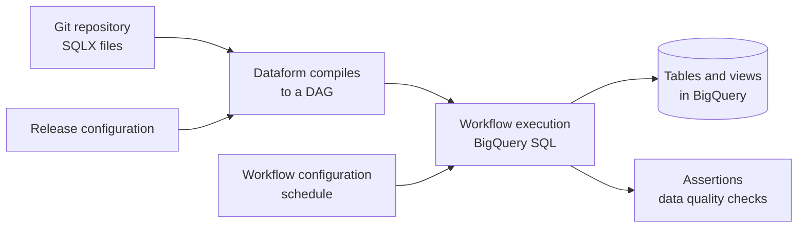
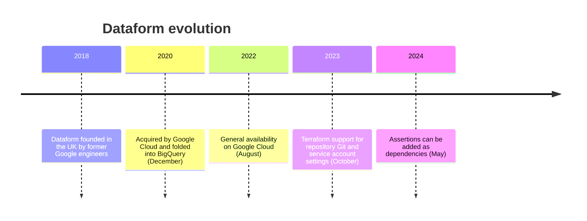

---
aliases:
  - Dataform
  - Google Dataform
tags:
  - data-engineering
  - data-warehouse
  - bigquery
  - elt
  - gcp
---
**Dataform** is a Google Cloud service and open source framework for the **T of ELT**: it lets you build, test, document and schedule **SQL transformations inside BigQuery**. You write `SELECT` statements, declare how they depend on each other, and Dataform creates the tables and views in the right order. It is Google's native answer to [[framework/DBT.md|DBT]].

>[!tip] Mental model: Dataform turns a folder of SQL files into a **dependency graph (DAG)** of tables, and runs that graph in BigQuery. The data never leaves the warehouse, only SQL is sent.

## Why it exists

In ELT the raw data is already loaded in the warehouse, and the transformation runs there. Without a tool, that logic ends up as scheduled queries and copy-pasted SQL, with no versioning, no tests and no clear order. Dataform brings software engineering practices to SQL:

- **Version control** (Git) and code review
- **Dependency management** with `ref()`, so the order of execution is inferred
- **Data quality tests** (assertions) that run with the pipeline
- **Incremental loads**, so you do not rebuild huge tables every run
- **Reusable code** (JavaScript) and documentation of tables and columns
- **Environments** (dev, staging, prod) with the same code

## How it works



1. **Compilation:** Dataform reads the project, resolves `ref()` calls and builds the graph. Errors such as cycles or a missing table show up here, **before** anything runs.
2. **Execution:** the compiled graph runs in BigQuery, in dependency order, with parallelism where the graph allows it.
3. **Assertions** run as part of the same workflow and report failures.

## SQLX file

The main file type is **SQLX**: SQL with a `config` block on top and a few helper functions.

```sql
config {
  type: "table",
  schema: "analytics",
  description: "Daily revenue per customer",
  columns: {
    customer_id: "Customer identifier",
    revenue: "Sum of paid orders"
  },
  assertions: {
    uniqueKey: ["customer_id", "order_date"],
    nonNull: ["customer_id"]
  }
}

SELECT
  customer_id,
  DATE(created_at) AS order_date,
  SUM(amount) AS revenue
FROM ${ref("orders")}
WHERE status = "paid"
GROUP BY 1, 2
```

`${ref("orders")}` points to another Dataform table or a declared source. It is what builds the DAG, and it also resolves the real project and dataset name per environment.

## Table types

| `type` | What it creates | Use it when |
|---|---|---|
| `table` | A table, fully rebuilt every run | Small and medium transformations |
| `view` | A view | Logic that must always read fresh data |
| `incremental` | A table that only receives new or changed rows | Large event or fact tables |
| `operations` | Free SQL (DDL, `MERGE`, grants) | Anything that is not a table |
| `declaration` | Registers an existing table as a source | Raw tables loaded by other tools |
| `assertion` | A data quality query | Custom tests |

### Incremental tables

```sql
config {
  type: "incremental",
  uniqueKey: ["event_id"],
  bigquery: {
    partitionBy: "DATE(event_ts)",
    clusterBy: ["customer_id"]
  }
}

SELECT event_id, customer_id, event_ts, payload
FROM ${ref("raw_events")}
${when(incremental(), `WHERE event_ts > (SELECT MAX(event_ts) FROM ${self()})`)}
```

- `incremental()` is false on the first run (full build) and true on the next ones.
- `uniqueKey` makes Dataform do a `MERGE` instead of an append, so reprocessed rows do not duplicate.
- `partitionBy` and `clusterBy` are BigQuery options set in the same file, which is where **query cost and performance** are controlled.
- After a bug or schema change, run with **full refresh** to rebuild the table. See [[backfill]].

## Assertions (data quality)

An assertion is a query that returns the **bad rows**: if it returns any row, it fails.

- **Built-in:** `nonNull`, `uniqueKey`, `uniqueKeys`, `rowConditions` in the `config` block.
- **Manual:** a `type: "assertion"` file with your own query.
- An assertion can be set as a **dependency** of a downstream table, so a bad upstream table stops the run before it spreads.

See [[data quality]] for the general concepts.

## JavaScript

Dataform files accept JavaScript, in `js` blocks or in `includes/` files, to avoid repetition:

```sql
js {
  const metrics = ["revenue", "orders", "refunds"];
}

SELECT
  customer_id,
  ${metrics.map(m => `SUM(${m}) AS total_${m}`).join(",\n  ")}
FROM ${ref("daily_metrics")}
GROUP BY 1
```

## Project structure

```
dataform-project/
├── workflow_settings.yaml   # default project, location, dataset, core version
├── definitions/
│   ├── sources/             # declarations of raw tables
│   ├── staging/             # clean and rename
│   └── marts/               # business-facing tables
└── includes/                # shared JavaScript
```

`workflow_settings.yaml` is the current settings file. Older projects use `dataform.json`.

A common layout is **staging → intermediate → marts**, or **bronze → silver → gold** when it follows the medallion architecture.

## Repositories, workspaces and execution

| Concept | Meaning |
|---|---|
| **Repository** | The Dataform project, backed by Git (a remote such as GitHub or GitLab) |
| **Workspace** | A personal development branch inside the repository |
| **Release configuration** | Which Git commit or branch is compiled and with which variables (for example `dev` or `prod`) |
| **Workflow configuration** | A schedule that runs a compiled release, selecting actions by tag |
| **Workflow invocation** | One execution of the graph, with the status of each action |

Execution options: the BigQuery Studio UI, the **Dataform CLI** (`dataform compile`, `dataform run`), **Cloud Scheduler**, or an orchestrator such as [[Apache Airflow]] (Cloud Composer) calling the Dataform API.

## Infrastructure as code

The repository and its configurations are Google Cloud resources, so they can be managed with **Terraform**: the Terraform Google provider has a `google_dataform_repository` resource (with Git remote settings and a service account), and the same repository can be wired to release and workflow configurations. This is how teams keep dev and prod identical and reviewed.

Permissions matter here: Dataform runs BigQuery jobs with a **service account**, which needs the BigQuery roles for the datasets it reads and writes.

## Dataform vs DBT

| | Dataform | [[framework/DBT.md\|DBT]] |
|---|---|---|
| Warehouses | BigQuery (managed service) | Many (Snowflake, BigQuery, Redshift, Databricks, Postgres...) |
| Language | SQLX + JavaScript | SQL + Jinja |
| Dependencies | `ref()` | `ref()` |
| Tests | Assertions | Tests |
| Running it | Managed in Google Cloud, no server to run | DBT Core (self-run) or DBT Cloud |
| Cost of the tool | The service itself is free, you pay BigQuery and related services | Core is free, Cloud is paid |
| Ecosystem | Smaller | Large (packages, community, semantic layer) |
| Best for | Teams already all-in on BigQuery | Multi-warehouse or portable setups |

The concepts transfer almost one to one, so experience with DBT is a fast path into Dataform.

## Evolution



The dates come from public sources of different quality. Check the official [release notes](https://cloud.google.com/dataform/docs/release-notes) before citing one.

## Best practices

- Declare every raw table with `declaration`, so lineage starts at the source.
- Put **assertions on every key and non-null column**, and on the output of every mart.
- Use `incremental` with `partitionBy` and `clusterBy` for big tables, to cut scanned bytes and cost.
- Keep SQL in `definitions/` and shared logic in `includes/`. Avoid JavaScript that hides what the SQL does.
- Use **tags** to run subsets (for example `daily` and `hourly`) instead of one giant workflow.
- Separate dev and prod by **dataset suffix or project** through release configuration variables.
- Manage the repository, service account and schedules with Terraform, not by hand.
- Review changes with pull requests, and compile in CI to catch broken `ref()` calls early.

## Common pitfalls

- Using `table` for a huge table that should be `incremental`, which rebuilds and pays for the full scan every run.
- Incremental logic without `uniqueKey`, which duplicates rows when data is reprocessed.
- No assertions, so bad data reaches the marts and dashboards silently.
- The service account lacks access to a source dataset, so the run fails at execution, not at compile time.
- Hard-coded project and dataset names instead of `ref()`, which breaks dev and prod separation.
- Dependency cycles between files.

## Related

- [[framework/DBT.md|DBT]]
- [[Apache Airflow]]
- [[dimensional modeling]]
- [[data quality]]
- [[backfill]]

## Interview questions

- What problem does Dataform solve, and how is it different from scheduled queries?
- What is an assertion, and how can it block downstream tables?
- How does an incremental table work, and why is `uniqueKey` important?
- What is the difference between a release configuration and a workflow configuration?
- How would you manage a Dataform repository and its schedules with Terraform?
- When would you pick DBT instead of Dataform?
- How do you control cost and performance of Dataform tables in BigQuery?
