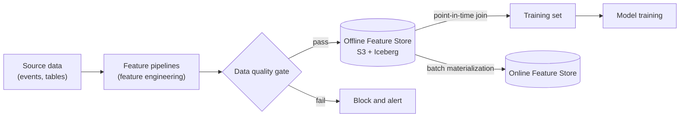

---
aliases:
  - Feature Store
  - feature store
---
#feature-store #mlops #training #data-architecture

# Offline Feature Store

The **offline feature store** keeps the **full history of every feature**, so that models can be **trained, backfilled and batch-scored** with the right data. It is the **source of truth** for features: the [[Online Feature Store]] is only a fast copy of the latest values, and it can always be rebuilt from here.

Its main job is to make sure that every training example sees **only what was known at that moment**. That property is called [[point-in-time]] correctness, and without it the model is trained with information from the future, which is [[Data Leakage]].

## Offline vs online

| Aspect | Offline Feature Store | [[Online Feature Store]] |
|---|---|---|
| Purpose | Training, backfill, batch scoring | Real-time inference |
| Data | **Full history** | Latest value per entity |
| Latency | Seconds to minutes | Milliseconds |
| Access pattern | Large scans, SQL, point-in-time joins | Key lookup by entity ID |
| Typical storage | S3 + [[Apache Iceberg]] | Postgres, Redis, DynamoDB |

Features are computed once and published to both stores, so the definitions are identical in training and in serving. See [[Training-Serving Skew]].

## Stack

| Layer | Choice | Role |
|---|---|---|
| Files | AWS S3 | Cheap, durable storage of the feature data |
| Table format | [[Apache Iceberg]] | Versioned tables with **snapshots** and time travel |
| Query | SQL on [[AWS Athena]] | Build training sets and inspect features |
| Quality | Data quality gate | Block bad data before it is published |
| Governance | [[Data Lineage]] | Know where every feature came from |



## Point-in-time and time travel

Two ideas are related, but they are **not the same**:

| Idea | What it gives you | Question it answers |
|---|---|---|
| **Time travel** (Iceberg snapshots) | The **whole table** as it was at a past snapshot or commit time | "What did the feature table contain on that date?" Reproducibility and audit |
| **[[point-in-time]] join** (as-of join) | For **each training row**, the latest feature value **not later than that row's label time** | "What would the system have known at the moment of this prediction?" Correct training data |

Time travel makes a dataset **reproducible**. The point-in-time join makes it **leak-free**. A good offline store uses both: the join builds the training set, and the snapshot ID records exactly which version of the data was used.

### Feature snapshot ID

Every Iceberg commit creates a **snapshot** with an ID. Saving the **feature snapshot ID** together with the trained model means that the same training set can be rebuilt later, even if the feature tables changed afterward. It is also useful for debugging ("which data was this model trained on?"). See [[model registry]].

```sql
-- Read the table as it was at a given snapshot or time (Athena, Iceberg)
SELECT * FROM user_features FOR VERSION AS OF 949530903748831860;
SELECT * FROM user_features FOR TIMESTAMP AS OF TIMESTAMP '2024-03-20 00:00:00 UTC';

-- List the snapshots of a table
SELECT * FROM "user_features$history";
```

>[!warning] Time travel uses the **commit time** (when the data was written), not the **event time** (when the fact happened). It is the right tool to reproduce a dataset, but it does not replace the per-row point-in-time join.

### Building a training set with a point-in-time join

The label table has one row per prediction (entity, label time, label). For each row, take the latest feature value that is not later than the label time. This SQL runs on Athena and other engines with window functions. The tables and the result below were checked on the small example from the [[point-in-time]] note.

```sql
WITH joined AS (
  SELECT l.user_id, l.label_time, l.label, f.balance,
         ROW_NUMBER() OVER (PARTITION BY l.user_id, l.label_time
                            ORDER BY f.feature_time DESC) AS rn
  FROM labels l
  JOIN user_features f
    ON f.user_id = l.user_id
   AND f.feature_time <= l.label_time          -- never use the future
)
SELECT user_id, label_time, label, balance
FROM joined
WHERE rn = 1;
```

| user_id | label_time | label | balance (point-in-time) | balance (naive "latest") |
|---|---|---|---|---|
| 1 | 2024-03-10 | 1 | **100** | 400 (from the future) |
| 1 | 2024-03-20 | 0 | **250** | 400 (from the future) |

The naive join on the entity key alone takes the latest balance (400, written on 2024-03-25) for both labels. It leaks the future into the training data, and the model looks better offline than it is in production.

## Data quality gate

Features are checked **before** they are published to the offline store, and again before they are synced to the online store. A failing check blocks the load. See [[data quality]].

| Check | Examples |
|---|---|
| **Fixed data checks** | Nulls and completeness, data types and ranges, uniqueness of the entity key and timestamp, freshness |
| **Distribution checks** | [[Population Stability Index (PSI)]] against a reference distribution. Roughly, above 0.15 is a warning and above 0.25 means the feature changed a lot. See [[data drift]] |

A gate that blocks bad data protects every model that uses the feature. It also stops a broken pipeline from silently overwriting a good history.

## Data lineage

[[Data Lineage]] records where each feature comes from (source tables, transformations, pipeline version) and which models and training sets use it. It answers:

- **Impact:** if a source table changes, which features and models are affected?
- **Debugging:** why did the feature change value?
- **Audit and compliance:** which data was used to train a model, together with the snapshot ID?

## Rules for a correct offline store

- **Keep the history:** append new feature values with a timestamp. Do not overwrite rows in place, because point-in-time joins need the old values.
- **Two timestamps:** store the **event time** (when the value was valid) and the **created or ingestion time** (when it became available). Use the availability time to handle late-arriving data. See [[point-in-time]].
- **Entity key plus timestamp** identify a feature row, and the pair must be unique.
- **Same definitions as online:** compute once, publish to both stores.
- **Snapshot everything used for training,** and save the snapshot ID with the model.
- **Split by time** when evaluating the model, and keep the joins point-in-time. See [[train dataset and test dataset]].

## Common pitfalls

- Joining features to labels on the entity key only, which takes the latest value and causes [[Data Leakage]]
- Overwriting feature tables, which destroys the history
- Using event time when data arrives late, so the training set contains values the production system did not have yet
- Confusing time travel with point-in-time correctness
- Time zones or timestamp precision that differ between the label and feature tables
- Windowed aggregations (for example "purchases in the last 30 days") that include events after the label time
- Publishing features without a quality gate
- Features defined differently offline and online, which creates [[Training-Serving Skew]]
- Not recording the snapshot ID, so a model cannot be reproduced

## Related

- [[Online Feature Store]]
- [[point-in-time]]
- [[Data Leakage]]
- [[Training-Serving Skew]]
- [[Feature Engineering]]
- [[Apache Iceberg]]
- [[AWS Athena]]
- [[data quality]]
- [[Data Lineage]]
- [[Population Stability Index (PSI)]]
