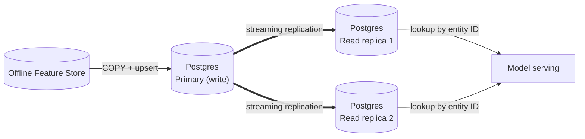
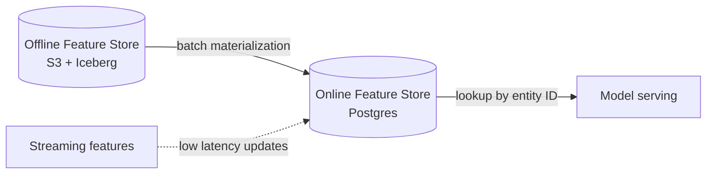

#feature-store #mlops #serving

A low-latency store that serves the **latest feature values** to models at inference time. It is a fast copy of the features computed and kept in the [[Offline Feature Store]].
[[OLAP Database]]

## Offline vs Online

| Aspect | [[Offline Feature Store]] | Online Feature Store |
| --- | --- | --- |
| Purpose | Training, backfill, batch scoring | Real-time inference |
| Data | Full history | Latest value per entity |
| Latency | Seconds to minutes | Milliseconds |
| Access pattern | Large scans, SQL, point-in-time joins | Key lookup by entity ID |
| Typical storage | [[AWS S3]] + [[Apache Iceberg]] | [[Postgres]], Redis, DynamoDB |

## Storage options

| Option | When to use | Trade-off |
| --- | --- | --- |
| [[Postgres]] | Moderate traffic, relational features, simple stack | Needs separate write (primary) and read (replica) instances, plus tuning |
| Redis | Very low latency, high throughput | Memory cost, durability needs care |
| DynamoDB | Managed, serverless scaling on AWS | Key-based access only, cost at scale |

## Why Postgres is a good option

[[Postgres]] is a good fit for an online feature store, mainly because of how fast it can bulk load the data synced from the [[Offline Feature Store]] with `COPY`.

- **Fast bulk loading:** `COPY` is much faster than row-by-row `INSERT`, so each materialization run loads quickly.
- **Simple stack:** no new infrastructure if Postgres is already in use.
- **Primary key lookups:** an index on the entity ID gives millisecond reads.
- **Upserts:** `INSERT ... ON CONFLICT DO UPDATE` keeps only the latest value per entity.
- **Transactions:** a new snapshot becomes visible all at once, never half loaded.
- **Replication:** built-in streaming replication makes it easy to scale reads with separate instances.

> [!important] Use separate instances for write and read
> Postgres is a good option **only if the write and read workloads run on separate instances**. Bulk loads (`COPY`, upserts) are heavy and would compete with the real-time lookups for CPU, I/O and locks, increasing the serving latency.

### Separate write and read instances

| Instance | Role | Used by | Workload |
| --- | --- | --- | --- |
| **Primary (write)** | Receives the materialization | Sync job from the [[Offline Feature Store]] | `COPY`, staging tables, upserts |
| **Read replica(s)** | Serve the lookups | Model serving / applications | Primary key reads, millisecond latency |



- **Writes only on the primary:** the sync job connects to the write instance. Replicas are read-only.
- **Reads only on replicas:** serving never touches the primary, so a heavy `COPY` does not slow down inference.
- **Scale reads horizontally:** add replicas (behind a load balancer or pooler such as PgBouncer) as traffic grows.
- **Replication lag:** replicas can be slightly behind the primary. Count it in the freshness SLA and monitor it.
- **Failover:** a replica can be promoted to primary if the write instance fails.

### Bulk load with COPY

```sql
COPY sample_table_name
FROM '/data/sample_data.csv'
DELIMITER ','
CSV HEADER;
```

- `DELIMITER ','` sets the column separator.
- `CSV HEADER` tells Postgres the first line is a header row and skips it.
- `COPY ... FROM '<path>'` reads the file on the **database server**. To load a file from the client machine, use `\copy` in `psql`.

### Load pattern: staging table + upsert

`COPY` only inserts, so load into a staging table and then merge into the serving table:

```sql
CREATE TEMP TABLE features_stage (LIKE user_features INCLUDING DEFAULTS);

COPY features_stage
FROM '/data/user_features.csv'
DELIMITER ','
CSV HEADER;

INSERT INTO user_features
SELECT * FROM features_stage
ON CONFLICT (user_id) DO UPDATE
SET feature_a = EXCLUDED.feature_a,
    feature_b = EXCLUDED.feature_b,
    event_ts  = EXCLUDED.event_ts;
```

## Data model

- **Key:** entity ID (for example `user_id`, `item_id`).
- **Value:** latest feature values plus an event timestamp.
- **TTL:** expire stale entities or features that are no longer fresh enough to use.

## Sync from the offline store (materialization)



- **Batch:** a scheduled job copies the latest snapshot from the offline store.
- **Streaming (optional):** updates features within seconds when freshness matters.
- **Freshness SLA:** define the maximum acceptable age of a feature value.
- **Source of truth:** the offline store. The online store can always be rebuilt from it.

## Serving flow

1. The application receives a request with an entity ID.
2. It reads the features from the online store by key.
3. It combines them with request-time features and calls the model.

## Consistency and skew

Features must be computed with the same definitions offline and online, otherwise [[Training-Serving Skew]] appears. Compute once, then publish to both stores.

## Monitoring

- **Latency:** p50, p95 and p99 of the lookup.
- **Freshness:** age of the latest value per feature.
- **Replication lag:** delay between the primary (write) and the read replicas.
- **Missing keys:** hit rate and default-value usage.
- **Drift:** compare serving distributions with training, using [[Population Stability Index (PSI)]].
- **Quality gates:** null and type checks before publishing (see [[data quality]]).

## Where it fits

Owned mainly by the **Machine Learning Engineer** (serving), fed by pipelines built by the **Data Engineer**, with feature definitions from the **Data Scientist**. See [[ML Lifecycle]].
