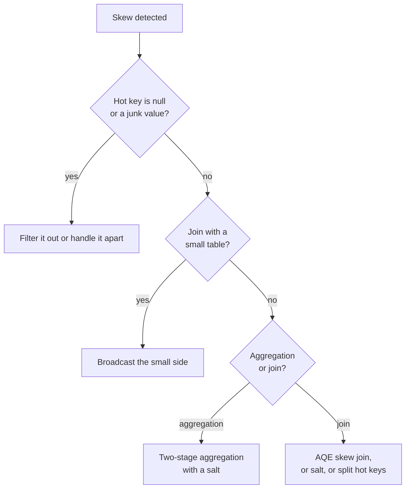

---
aliases:
  - Data Skew
  - Data skew
  - Key skew
  - Skewed data
  - Hot key
  - Hot partition
tags:
  - data-engineering
  - distributed-systems
  - performance
  - data-skew
  - spark
description: What data skew is in distributed data processing (data or work unevenly spread across partitions, so a few hot keys slow the whole job), its causes, how to detect it, and the main ways to fix it, with Spark examples.
---
**Data skew** is an **uneven distribution of data (and so of work) across the partitions or nodes** of a distributed system. When a few keys hold most of the rows, the partitions that receive them become much larger than the others. The job finishes only when the **slowest** partition finishes, so one overloaded task or node controls the total time, while the rest of the cluster waits.

>[!note] This note is about **key and partition skew** in processing and storage systems. It is not the statistical *skewness* of a distribution, and not [[machine learning/concepts/Training-Serving Skew.md|Training-Serving Skew]] in machine learning.

## Why it hurts

```text
Partition sizes after a shuffle by "country":

BR  ████████████████████████████████████  (hot key, 70% of the rows)
US  ███
DE  ██
FR  █
...

Time of the stage = time of the BR task. The other tasks finish early and the cores sit idle.
```

- **Stragglers:** one task runs for minutes or hours while the others take seconds.
- **Wasted resources:** idle executors, paid for and doing nothing.
- **Memory pressure:** the hot partition does not fit in memory, so it [[data architecture/Apache Spark/memory and performance/Spark Spills.md|spills]] or fails with an [[data architecture/Apache Spark/common errors/Spark OutOfMemoryError.md|out of memory error]].
- **Adding machines does not help:** the hot key still goes to one task.

## Common causes

- **Naturally popular values:** a big customer, a popular product, a large country, a viral item.
- **Null or default keys:** `null`, `-1`, `"unknown"` or an empty string, grouped into one huge key.
- **Low-cardinality keys:** a few distinct values (for example `status` or `country`) spread over many rows.
- **Time-based keys:** today's date or the current hour gets all the new data.
- **Bad partition or shard key:** a key that does not spread the data, or a hash that collides.
- **Join on a skewed key:** one side has a hot key that the other side matches many times.
- **Data model:** an entity with a huge number of related rows (a "celebrity" account).

## Where it shows up

| System                                                  | How skew appears                                                                                                                                           |
| ------------------------------------------------------- | ---------------------------------------------------------------------------------------------------------------------------------------------------------- |
| **Spark and MapReduce**                                 | One reduce task after a [[data architecture/Apache Spark/core concepts/Spark Shuffle.md\|shuffle]] (join, `groupBy`, window) is far larger than the others |
| **Kafka**                                               | A hot message key sends most records to one partition, so one consumer lags                                                                                |
| **Databases and key-value stores** (sharding, DynamoDB) | A **hot partition or shard** gets most of the traffic and throttles                                                                                        |
| **Stream processing** (Flink keyed state)               | One key has a huge state or a high event rate, so one subtask is the bottleneck                                                                            |
| **Warehouses and query engines**                        | A join or an aggregation on a skewed key slows one worker                                                                                                  |

## Symptoms

- A stage "stuck" near the end, for example 199 of 200 tasks done.
- In the Spark UI: **max task duration much larger than the median**, and a huge **Shuffle Read** or **Spill** in one task.
- One executor with high memory, GC time or lost-executor errors, while the others are idle.
- One Kafka consumer or partition with growing lag, or one database shard throttled.
- A job that works on a sample and gets slower than expected on full data.

## How to detect it

1. **Look at the key distribution** before the wide operation:

```python
(
    df.groupBy("customer_id").count()
      .orderBy(F.desc("count"))
      .show(20)
)

# Share of rows held by the top keys, and the null count
total = df.count()
df.groupBy("customer_id").count().orderBy(F.desc("count")).limit(10) \
  .withColumn("share", F.col("count") / total).show()
df.filter(F.col("customer_id").isNull()).count()
```

2. **Spark UI → Stages:** compare **median and max** task duration, shuffle read and spill. A large gap means skew.
3. **Skew ratio:** `max partition size / median partition size`. A value above about 5 deserves attention.
4. **Check the partition sizes:** `df.groupBy(F.spark_partition_id()).count()`.
5. **Other systems:** per-partition lag in Kafka, per-shard metrics and throttling in a database.

## How to fix it



| Technique | How it works | Use when |
|---|---|---|
| **Handle null and junk keys** | Filter them, or process them in a separate path | A default key holds most rows |
| **Broadcast join** | Send the small table to every executor, so the big table is not shuffled | One side is small. See [[data architecture/Apache Spark/sql and optimization/Spark Joins.md\|Spark Joins]] |
| **AQE skew join** | Spark splits an oversized partition of a sort merge join into smaller ones at run time | Skewed join, recent Spark versions |
| **Salting** | Add a random suffix to the hot key, so its rows spread over several partitions | Aggregations and joins on a few hot keys |
| **Two-stage aggregation** | Aggregate by `(key, salt)` first, then by `key` | Additive aggregates (sum, count, min, max) |
| **Isolate hot keys** | Process the hot keys with a broadcast or a special path, and the rest normally | A few known hot keys |
| **Pre-aggregate** | Reduce the data before the join or shuffle | The same key repeats many times |
| **Better or composite key** | Add a second column to the key to spread the data | You control the partition or shard key |
| **Repartition** | Even out sizes with round-robin `repartition(n)` | Skew comes from an uneven input, not a key. See [[data architecture/Apache Spark/core concepts/Spark Repartition.md\|Spark Repartition]] |

**Salting an aggregation (Spark):**

```python
N = 16  # number of salt buckets

partial = (
    df.withColumn("salt", (F.rand() * N).cast("int"))
      .groupBy("customer_id", "salt")
      .agg(F.sum("amount").alias("partial_sum"))
)

result = partial.groupBy("customer_id").agg(F.sum("partial_sum").alias("total"))
```

**Salting a join (Spark):** add the salt to the big skewed side, and replicate each row of the small side once for every salt value.

```python
big_salted = big.withColumn("salt", (F.rand() * N).cast("int"))
small_exp = small.crossJoin(spark.range(N).withColumnRenamed("id", "salt"))

joined = big_salted.join(small_exp, ["customer_id", "salt"]).drop("salt")
```

**AQE skew join settings (Spark):**

| Setting | Meaning |
|---|---|
| `spark.sql.adaptive.enabled` | Turns AQE on |
| `spark.sql.adaptive.skewJoin.enabled` | Splits skewed partitions in joins |
| `spark.sql.adaptive.skewJoin.skewedPartitionFactor` | A partition is skewed if it is larger than this factor times the median |
| `spark.sql.adaptive.skewJoin.skewedPartitionThresholdInBytes` | and larger than this size |

Defaults change between versions, so confirm them in the documentation of the version you run.

## Limits and pitfalls

- **More partitions do not fix a hot key.** All rows of one key still go to one partition.
- **AQE skew join handles joins, not aggregations.** A skewed `groupBy` needs salting or pre-aggregation.
- **Salting changes the query.** It works for **additive** aggregates (sum, count, min, max). For `count distinct`, median or percentiles you need a different approach.
- **Salting the small side** multiplies its rows by `N`, so keep it small.
- **A random salt is not deterministic** on retries. Use a stable salt, such as a hash of another column, when exactness matters.
- Ignoring **null keys**, which are the most common hidden hot key.
- **Fixing the symptom with memory:** bigger executors hide the skew and cost more.
- **Skew moves:** after fixing one key, another can become the new hot key as the data grows. Monitor it.

## Best practices

- **Know your keys:** profile the distribution of join and group keys, including null and default values.
- Choose **high-cardinality, evenly distributed** keys for partitions, shards and joins.
- **Filter and aggregate early**, to reduce the volume that reaches the shuffle.
- Prefer a **broadcast join** when one side is small.
- Keep **AQE** on, and review the skew settings.
- **Monitor** max-to-median task time, per-partition lag and per-shard load, and alert when the ratio grows.
- Treat a growing hot key as a **data model** question, not only a tuning one.

## Interview questions

- What is data skew, and why does it slow down a distributed job?
- How do you detect skew in a Spark job?
- Why does adding more partitions or executors not fix a hot key?
- Explain salting, and when it does not work.
- How does AQE handle skewed joins, and what can it not handle?
- How would you deal with skewed null keys?
- How can skew appear in Kafka or in a key-value store?
- What is the difference between skew in a join and skew in an aggregation, and how do you fix each?

## Related

- [[data architecture/Apache Spark/core concepts/Spark Shuffle.md|Spark Shuffle]]
- [[data architecture/Apache Spark/core concepts/Spark Wide Transformations.md|Spark Wide Transformations]]
- [[data architecture/Apache Spark/sql and optimization/Spark Joins.md|Spark Joins]]
- [[data architecture/Apache Spark/core concepts/Spark Repartition.md|Spark Repartition]]
- [[data architecture/Apache Spark/memory and performance/Spark Spills.md|Spark Spills]]
- [[data architecture/Apache Kafka/Kafka.md|Kafka]]
