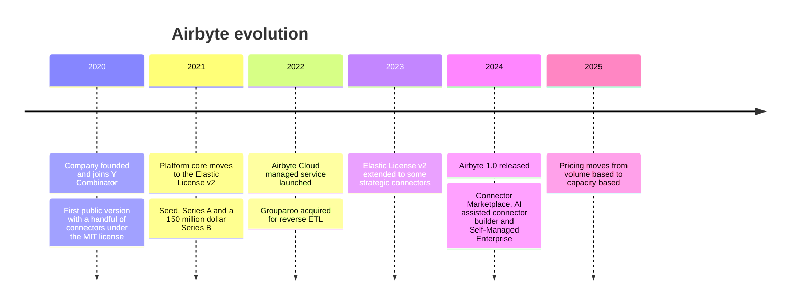

---
aliases:
  - Airbyte
  - airbyte
tags:
  - data-engineering
  - elt
---
Airbyte is a [[Data Integration Platform]] that moves data from sources (databases, APIs, files, SaaS tools) to destinations (data warehouses, lakes, databases) with ready-made connectors. It follows the **ELT** approach: it extracts and loads the raw data, and the transformation happens later in the destination, for example with dbt.

The platform core is source-available (Elastic License v2), and a large part of the connectors are open source. It runs self-hosted or as a managed service (Airbyte Cloud).

## Evolution



The dates come from public sources of different quality. Check the official blog and changelog before citing one.

## Core concepts

| Concept | Meaning |
| --- | --- |
| **Source** | The system the data is read from, configured with a source connector |
| **Destination** | Where the data is written, configured with a destination connector |
| **Connection** | A source linked to a destination, with the streams to copy, the sync mode and the schedule |
| **Stream** | One unit of data inside a source, such as a table, an API endpoint or a file |
| **Sync** | One run of a connection, which reads the streams and loads them |
| **State** | The saved position of the last sync (a cursor value or a log position), so the next sync only reads what changed |

### Sync modes

| Mode | Behavior |
| --- | --- |
| Full refresh, overwrite | Reads everything and replaces the destination table |
| Full refresh, append | Reads everything and adds it to the destination table |
| Incremental, append | Reads only new or changed rows (by a cursor column) and appends them |
| Incremental, append and deduped | Same as above, and keeps one row per primary key in the final table |

## Architecture

- **Platform:** an API server, a scheduler and workers that run the syncs, plus a workflow engine and a database for the metadata. The UI, the API and the Terraform provider all talk to the same server.
- **Connectors:** each connector is a Docker image. A sync starts a source container and a destination container, and the platform passes the records from one to the other.
- **Airbyte protocol:** connectors speak a simple protocol with the commands `spec`, `check`, `discover`, `read` and `write`. They exchange messages (records, state, logs) as JSON lines, so a connector can be written in any language.
- **Building connectors:** the Connector Builder (a low-code UI) and the Connector Development Kit (CDK) create new connectors without starting from scratch.

## Deployment options

| Option | Use |
| --- | --- |
| **Open source, self-hosted** | You run the platform, locally with `abctl` or on Kubernetes with the Helm chart |
| **Airbyte Cloud** | Managed service, billed by usage |
| **Self-Managed Enterprise** | Self-hosted with enterprise features such as SSO and access control |
| **PyAirbyte** | A Python library that runs Airbyte connectors inside your own code or pipeline |

Airbyte also integrates with orchestrators such as Airflow, Dagster and Prefect, which can trigger and monitor syncs.

## Quick start (local)

```bash
curl -LsfS https://get.airbyte.com | bash -
abctl local install
```

The UI is then available at `http://localhost:8000`. The command `abctl local credentials` prints the login. Then create a source, a destination and a connection, and run the first sync.

## CDC

For databases such as PostgreSQL, MySQL and SQL Server, Airbyte can read the transaction log instead of querying tables. This is based on the Debezium engine. It captures inserts, updates and deletes, and needs the same source setup as Debezium (for example `wal_level=logical` and a replication slot on PostgreSQL).

The difference: Airbyte CDC runs as **scheduled syncs** that read the log since the last state. It is not a continuous stream of events to Kafka.

## Compared with other tools

| | Airbyte | Debezium | StreamSets |
| --- | --- | --- | --- |
| Main goal | Move data from many sources to a warehouse or lake | Stream database changes | Build pipelines with transformations |
| Mode | Scheduled syncs (batch and micro-batch) | Continuous stream | Batch and streaming |
| Connectors | Hundreds of sources and destinations | Mostly databases | Many origins and destinations |
| Typical output | Warehouse, lake, database | Kafka topics | Any supported destination |
| Interface | UI, API, Terraform | Configuration and REST API | Visual designer |
| Licensing | Core source-available, many connectors open source | Open source | Commercial |

## When to use it

- **Good fit:** loading SaaS tools, APIs and databases into a warehouse or lake with little code, and keeping them in sync on a schedule.
- **Not the best fit:** low-latency event streaming, which suits Debezium with Kafka. Heavy business-rule transformation also doesn't fit, so do it in the destination with dbt or in a processing engine.

## Pitfalls

- **Schema changes:** a column added or changed at the source needs the connection's catalog to be refreshed, and a type change can break the load.
- **Incremental sync needs a good cursor:** a column that is not updated on every change, such as a missing `updated_at`, makes the sync miss rows.
- **Deletes:** a cursor-based incremental sync does not see deleted rows. Use CDC where the source supports it.
- **Resources:** each sync runs connector containers, so size the workers for the number of syncs that run at the same time.
- **Licensing:** the Elastic License v2 allows free use, but not offering Airbyte itself as a managed service to third parties.

## Related

- [[data architecture/Apache Kafka/Debezium.md|Debezium]]
- [[Streamsets]]
