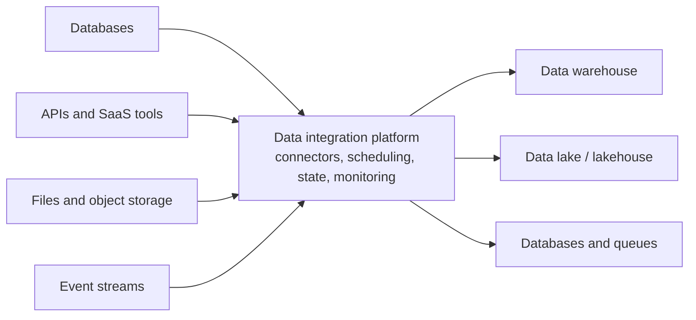

---
aliases:
  - Data Integration Platform
  - Data integration
  - Data integration tool
tags:
  - data-engineering
---
A data integration platform is a tool that **moves data between systems**: it connects to sources (databases, APIs, files, SaaS tools, event streams), copies the data to destinations (a warehouse, a lake, a database, a queue), and handles the scheduling, state, retries and monitoring around that work. It replaces custom scripts for each integration with a set of reusable connectors.

## What it does

| Capability | Meaning |
| --- | --- |
| **Connectors** | Ready-made readers and writers for each system, so no code per integration |
| **Extract and load** | Copies full tables or only the changes (incremental or CDC) |
| **Transformation** | Light changes in flight (ETL), or none, leaving the work to the destination (ELT) |
| **Scheduling and state** | Runs on a schedule or continuously, and remembers the position of the last run |
| **Schema handling** | Detects new or changed columns and propagates them to the destination |
| **Reliability** | Retries, error handling and alerts when a run fails |
| **Observability** | Run history, volumes, latency and logs |

## ETL and ELT

| | ETL | ELT |
| --- | --- | --- |
| Order | Extract, transform, then load | Extract, load, then transform |
| Where the transformation runs | In the integration tool | In the destination (warehouse or lakehouse), often with SQL or dbt |
| Raw data kept | Usually not | Yes, in the destination |
| Fits | Strict cleaning before loading, limited destination compute | Cloud warehouses and lakes with cheap, scalable compute |

Most modern platforms lean on ELT and keep the transformation light.

## Types of platforms

| Type | Focus | Examples |
| --- | --- | --- |
| **Connector-based ELT** | Large catalog of connectors, loading into a warehouse or lake with little code | [[data architecture/data engineering/Airbyte.md\|Airbyte]] |
| **Pipeline builder** | Design dataflows visually, with processors and transformations between origin and destination | [[Streamsets.md\|StreamSets]] |
| **Streaming and CDC** | Continuous movement of changes, with Kafka as the backbone | Kafka Connect, Debezium |
| **Enterprise integration (iPaaS)** | Application and API integration across a company, beyond analytics data | Commercial suites |

The categories overlap. Some tools cover more than one, and the same company can sell several of these products.

## Choosing one

| Question | Why it matters |
| --- | --- |
| Which sources and destinations are needed? | The connector catalog decides how much you must build yourself |
| Batch, micro-batch or continuous? | Streaming needs a log-based or Kafka-based approach |
| Does the data need transformation before it lands? | Decides between a pipeline builder and a plain ELT tool |
| Is CDC required? | Not every tool reads transaction logs, and deletes are lost without it |
| Self-hosted or managed? | Trade-off between control, cost and operations effort |
| License and cost model | Open source, source-available or commercial, billed by volume, capacity or seat |
| Team skills | UI-driven tools suit analysts, code-first tools suit engineers |

## Common pitfalls

- **Schema drift:** an unannounced change at the source breaks the load or silently drops a column.
- **Missing deletes:** cursor-based incremental syncs do not see deleted rows. Use CDC where it is available.
- **No idempotency:** a retry that appends the same rows again creates duplicates. Prefer overwrite or upsert by key.
- **Hidden cost:** volume-based pricing grows quickly with high-churn tables. Select only the streams and columns you need.
- **Personal data:** moving it into a warehouse spreads it to more systems, so mask or exclude sensitive fields at the source.
- **Coupling to the tool:** keep transformations in SQL or dbt, not inside proprietary pipeline stages, so a migration is easier.

## Links

- [[data architecture/data engineering/Airbyte.md|Airbyte]]
- [[Streamsets.md|Streamsets]]

## Related

- [[data architecture/CDC.md|CDC]]
- [[data architecture/Apache Kafka/Connect.md|Kafka Connect]]
- [[data architecture/Apache Kafka/Debezium.md|Debezium]]
