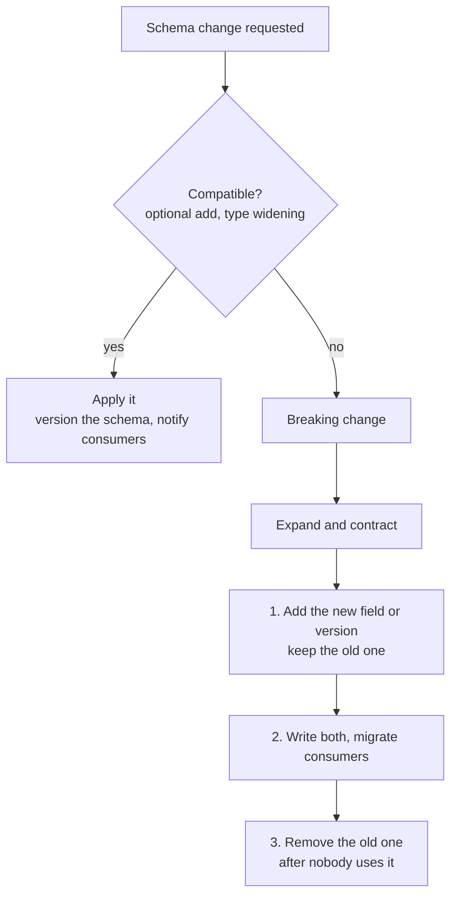

---
aliases:
  - Schema evolution
  - Schema Evolution
  - Schema change
  - Schema compatibility
tags:
  - data-engineering
  - schema
  - data-pipelines
  - data-quality
description: What schema evolution is in data pipelines (changing the structure of data over time without breaking producers, consumers or stored data), the kinds of changes and their risk, compatibility types, and how formats and table formats handle it.
---
**Schema evolution** is the ability to **change the structure of a dataset over time** (add, remove or rename a field, change a type) **without breaking** the pipelines that write it, the consumers that read it, or the data already stored. It matters because every source changes: new features add columns, teams rename fields, and old data stays in storage with the old shape.

>[!note] **Schema evolution** is a change you plan and control. **Schema drift** is a change that arrives unplanned from a source, so the pipeline finds out when it breaks. The goal is to turn drift into evolution. See [[data architecture/data drift.md|data drift]] for drift in the data values.

## Kinds of changes and their risk

| Change | Usually safe? | Notes |
|---|---|---|
| **Add an optional column** (nullable, or with a default) | **Yes** | Old data returns `null` or the default |
| **Add a required column** (no default) | **No** | Old data and old writers have no value for it |
| **Remove a column** | Depends | Safe for readers that select by name. Breaks consumers that still use it |
| **Rename a column** | **Risky** | Looks like a remove plus an add, unless the format tracks column identity |
| **Widen a type** (`int` to `long`, `float` to `double`) | Usually yes | Check that the engine supports the promotion |
| **Narrow or change a type** (`string` to `int`) | **No** | Values can fail or be truncated |
| **Make a nullable column required** | **No** | Old data can hold nulls |
| **Reorder columns** | Depends | Safe when matched by name, breaks formats matched by position (CSV) |
| **Change the meaning** (units, currency, definition) | **Silent break** | The schema is the same, the data means something else |

The last one is the most dangerous, because no tool detects it. It needs a **contract and communication**, not only a schema check.

## Compatibility types

Compatibility says who can read what, between a **new** schema and **old** data or readers. These are the same modes used by a Schema Registry.

| Type | Guarantee | Safe changes |
|---|---|---|
| **Backward** | Readers on the **new** schema can read **old** data | Add an optional field, remove a field |
| **Forward** | Readers on the **old** schema can read **new** data | Add a field, remove an optional field |
| **Full** | Both directions | Add or remove only optional fields |
| **None** | No guarantee | Any change, at your own risk |

Pick the type from **who upgrades first**: if consumers upgrade before producers, you need forward compatibility, and if producers upgrade first, you need backward compatibility. The "transitive" variants check against **all** previous versions, not only the last one.

## How to handle a change



- **Expand and contract** (parallel change): for a breaking change, first **add** the new field next to the old one, migrate the consumers, and only then **remove** the old one.
- **Versioning:** keep a version of each schema, or publish a new versioned dataset or topic for a breaking change.
- **Defaults and optional fields:** make new fields optional, with a default.
- **Tolerant readers:** read only the fields you need, and ignore the unknown ones.
- **Rescue or quarantine:** send records that do not match the schema to a separate place for review, and do not drop them silently.
- **Contracts and checks:** agree on a **data contract** with the producer, and check the schema in CI or at ingestion.

## How formats and tables handle it

| Format or system | Support |
|---|---|
| **[[data architecture/file formats/Apache Avro.md\|Apache Avro]]** | **Strong.** The writer and reader schemas are resolved by field name, with defaults and aliases. Used with a Schema Registry and compatibility modes |
| **[[data architecture/file formats/Apache Parquet.md\|Apache Parquet]]** | **Limited.** Adding columns works, matched by name. Rename and type changes are problematic. Spark needs `mergeSchema` when files differ |
| **Protobuf** | Fields are matched by **field number**, so renaming is safe and numbers must never be reused |
| **JSON** | No enforced schema, so any change goes through. Readers must be tolerant |
| **CSV** | Matched by position or header, so reordering and renaming break it |
| **Delta Lake** | Schema is tracked in the table log. `mergeSchema` can add columns on write, and column mapping can allow rename and drop (check your version) |
| **Apache Iceberg** | Tracks columns by **unique id**, so add, drop, rename and reorder are safe and do not rewrite data |
| **Warehouses** (BigQuery, Snowflake and others) | Add column is easy, other changes depend on the engine |

Table formats make evolution **safe and cheap**, which is one reason for the [[data architecture/Data Lakehouse/Data Lakehouse.md|Data Lakehouse]] approach.

## Example in Spark

```python
# Parquet files written before and after a new column was added
df = (
    spark.read
    .option("mergeSchema", "true")          # merge the schemas of all files
    .parquet("s3://bucket/curated/orders/")
)
df.printSchema()                            # old rows have null in the new column
```

```python
# Delta table: allow a new column in this write
(
    new_batch.write.format("delta")
    .mode("append")
    .option("mergeSchema", "true")
    .save("s3://bucket/curated/orders_delta/")
)
```

Without `mergeSchema`, a write with an unexpected column **fails** on a Delta table, which is useful: the failure shows the change instead of hiding it. Options and defaults change between versions, so confirm them in the documentation of the version you run.

## Best practices

- Treat the schema as a **contract**: version it, review changes and store it in source control or a registry.
- **Add, do not change:** prefer new optional fields to changes of existing ones.
- Always give new fields a **default** or make them nullable.
- Never **reuse** a field name or number for a different meaning.
- Use **expand and contract** for breaking changes, with a deprecation period.
- Pick a **compatibility mode** on purpose, and enforce it in CI.
- Use a **table format** for lake data, so rename and drop are safe.
- **Detect drift** at ingestion, and quarantine the bad records.
- Document **semantic changes** (units, definitions) and tell the consumers.

## Common pitfalls

- Renaming a column and breaking every consumer and old file.
- Adding a required field with no default.
- Changing a type to an incompatible one, so old files fail to read.
- Letting `mergeSchema` or auto-merge accept every change silently.
- Reusing a name or number for a different meaning.
- Changing the meaning of a field and keeping the same schema.
- Relying on column position (CSV) when the order changes.
- Having no plan for **old data** after the change, so a [[data architecture/data engineering/backfill.md|backfill]] is needed.

## Interview questions

- What is schema evolution, and how is it different from schema drift?
- Which schema changes are safe, and which break consumers?
- What are backward, forward and full compatibility?
- How would you roll out a breaking change, for example a rename?
- How does Avro handle schema evolution, and how does Parquet?
- Why can Iceberg rename a column safely?
- What does `mergeSchema` do in Spark, and what is the risk of enabling it everywhere?
- How do you detect and handle schema drift in an ingestion pipeline?

## Related

- [[data architecture/file formats/Apache Avro.md|Apache Avro]]
- [[data architecture/file formats/Apache Parquet.md|Apache Parquet]]
- [[data architecture/Data Lakehouse/Data Lakehouse.md|Data Lakehouse]]
- [[data architecture/data quality.md|data quality]]
- [[data architecture/data drift.md|data drift]]
- [[data architecture/data engineering/backfill.md|backfill]]
