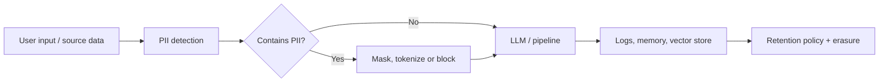

---
aliases:
  - personal data
  - PII
  - LGPD
  - GDPR
---
#privacy #governance #compliance #pii #lgpd #gdpr

**Data privacy** is about how personal data is collected, used, stored, shared and deleted. **PII** is the kind of data being protected, and **LGPD** (Brazil) and **GDPR** (European Union) are the laws that define the rules. The US uses a mix of sector and state laws (see below).

> "GPPR" is usually a typo for **GDPR** (General Data Protection Regulation).

## PII - Personally Identifiable Information

Any information that identifies a person, directly or when combined with other data.

| Type                             | What it is                                              | Examples                                                        |
| -------------------------------- | ------------------------------------------------------- | --------------------------------------------------------------- |
| **Direct identifier**            | Identifies a person on its own                          | Full name, national ID (CPF), passport, email, phone, face      |
| **Indirect / quasi-identifier**  | Identifies a person only when combined with other data  | Birth date + ZIP code + gender, IP address, device ID, cookie ID, location |
| **Sensitive / special category** | Higher risk of discrimination or harm if exposed        | Health, biometrics, genetics, race or ethnicity, religion, political opinion, union membership, sex life |
| **Not PII (by itself)**          | Cannot be linked back to a person                       | Truly anonymized, aggregated statistics                         |

> **PII is a US-style term.** LGPD and GDPR use **personal data** (*dado pessoal*), which is broader: any information relating to an identified or identifiable person, including online identifiers.

## LGPD - Lei Geral de Proteção de Dados

Brazilian law **13.709/2018**, in force since September 2020 and enforced by the **ANPD** (National Data Protection Authority).

- **Scope:** processing done in Brazil, offering goods or services to people in Brazil, or data collected in Brazil. It applies to companies abroad too.
- **Legal bases (Art. 7):** consent, legal obligation, public policy, research, contract, legal proceedings, protection of life, health protection, **legitimate interest**, credit protection.
- **Sensitive data (Art. 11):** stricter bases, with specific consent in most cases.
- **Roles:** *controlador* (controller), *operador* (processor) and *encarregado* (DPO).
- **Rights (Art. 18):** confirmation of processing, access, correction, anonymization or deletion, portability, information about sharing, and revoking consent.
- **Penalties:** up to **2% of revenue in Brazil**, capped at **R$ 50 million per infraction**, plus warnings, publicization of the violation and blocking or deletion of the data.

## GDPR - General Data Protection Regulation

European Union regulation **2016/679**, applicable since May 2018.

- **Scope:** controllers and processors in the EU, and any company outside the EU that offers services to, or monitors, people in the EU.
- **Principles (Art. 5):** lawfulness, fairness and transparency; purpose limitation; **data minimization**; accuracy; **storage limitation**; integrity and confidentiality; accountability.
- **Legal bases (Art. 6):** consent, contract, legal obligation, vital interests, public task, legitimate interests.
- **Special categories (Art. 9):** sensitive data, prohibited by default unless an exception applies.
- **Rights:** access, rectification, **erasure ("right to be forgotten")**, restriction, portability, objection, and not being subject to purely automated decisions with legal effects (Art. 22).
- **Obligations:** *privacy by design* (Art. 25), **DPIA** for high-risk processing (Art. 35), a DPO in some cases (Art. 37), records of processing, and a **72-hour breach notification** to the authority.
- **International transfers:** need an adequacy decision, Standard Contractual Clauses (SCCs) or another safeguard.
- **Penalties:** up to **EUR 20 million or 4% of global annual turnover**, whichever is higher.

## United States - sector-specific and state laws

The US has **no single federal privacy law** like GDPR or LGPD. It combines federal laws per sector with state laws.

**Federal laws (by sector)**

| Law | Full name | Scope |
| --- | --------- | ----- |
| **HIPAA** | Health Insurance Portability and Accountability Act | Health data |
| **GLBA** | Gramm-Leach-Bliley Act | Financial data |
| **COPPA** | Children's Online Privacy Protection Act | Data of children under 13 |
| **FERPA** | Family Educational Rights and Privacy Act | Student education records |
| **FCRA** | Fair Credit Reporting Act | Credit reports |
| **CAN-SPAM** | Controlling the Assault of Non-Solicited Pornography And Marketing Act | Commercial email |

**State laws (closest to GDPR/LGPD)**

- **CCPA** (California Consumer Privacy Act), amended by **CPRA** (California Privacy Rights Act). It is the best known and the most similar to GDPR: rights to know, delete, correct and opt out of the sale or sharing of data.
- Other states have their own comprehensive laws, for example Virginia (**VCDPA**), Colorado (**CPA**), Connecticut (**CTDPA**) and Texas (**TDPSA**). The list keeps growing, so check the current one.

> Quick view: `US → CCPA/CPRA (California), HIPAA (health), GLBA (finance), COPPA (children)`.

## LGPD vs GDPR

| Aspect              | LGPD                                                      | GDPR                                       |
| ------------------- | --------------------------------------------------------- | ------------------------------------------ |
| Region              | Brazil                                                    | European Union                             |
| Authority           | ANPD                                                      | One supervisory authority per member state |
| Legal bases         | 10                                                        | 6                                          |
| DPO                 | *Encarregado*, required in general                        | Required only in some cases (Art. 37)      |
| Breach notification | "Reasonable time" (ANPD regulation sets a short deadline) | 72 hours                                   |
| Max fine            | 2% of revenue in Brazil, R$ 50 million per infraction     | 4% of global turnover or EUR 20 million    |
| Automated decisions | Right to review                                           | Right not to be subject to them (Art. 22)  |

## Anonymization vs pseudonymization

| Technique             | Reversible?                       | Still personal data? | Examples                          |
| --------------------- | --------------------------------- | -------------------- | --------------------------------- |
| **Anonymization**     | No (not by reasonable means)      | No, out of scope     | Aggregation, generalization, noise |
| **Pseudonymization**  | Yes, with a separate key or table | **Yes**              | Tokenization, hashing with a secret, ID mapping |
| **Masking / redaction** | Depends                         | Depends              | `***-**-1234`, `[PERSON]`          |

Hashing an email without a secret is **not** anonymization: it can be reversed by hashing a list of candidate emails.

## Impact on data and AI systems

- **Data minimization:** collect and send only the fields that the use case needs.
- **PII detection:** scan inputs and outputs with tools such as Microsoft Presidio, AWS Comprehend or Macie, or Google Cloud Sensitive Data Protection. In agents this is a [[Guardrails]] step before the model call.
- **Third-party LLM providers:** sending personal data to an external API is a data transfer. It needs a legal basis, a processing agreement and a check of the provider's retention and training policy.
- **Memory and logs:** apply a TTL and avoid persisting PII (see [[Agent Memory]]). Prompts, traces and evaluation datasets are personal data stores too.
- **Right to erasure:** deletion must reach **every copy**: databases, data lake, backups, caches, logs, **vector stores and embeddings** derived from the data. Keep an ID-to-record mapping so you can find them.
- **Training and fine-tuning:** personal data used in training is hard to remove from the model afterwards. Filter it before training.
- **Lineage:** [[Data Lineage]] shows where personal data flows and which assets must be deleted or audited.
- **Quality:** the accuracy principle means [[data quality]] also covers keeping personal data correct and up to date.
- **Local models:** running an open model locally keeps data inside the environment (see [[Embeddings models and frameworks]]).
