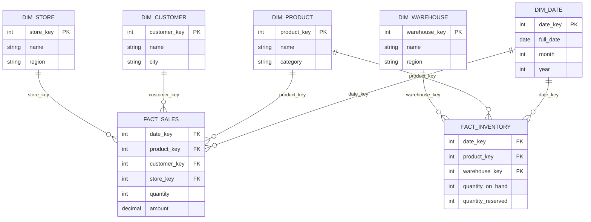

---
aliases:
  - Galaxy Schema
  - Fact Constellation
  - Fact constellation schema
tags:
  - dimensional-modeling-technique
---
A **galaxy schema** (also called a **fact constellation**) is a dimensional modeling technique in which **several fact tables share the same dimension tables**. It can be seen as multiple [[data architecture/dimensional modeling/Star schema.md|Star schemas]] that overlap on common dimensions, forming a "galaxy" of stars.

It is used in [[Data Warehouse|data warehouses]] that cover more than one business process, such as sales, inventory and shipments, each with its own fact table.

## Key components

- **Fact tables:** one per business process, each with its own grain (for example one row per sale line, or one row per product per warehouse per day).
- **Shared dimensions:** dimension tables used by more than one fact table, such as `DIM_DATE` and `DIM_PRODUCT`. To be safely shared they must be **conformed**: same keys, same attributes, same meaning in every fact table.
- **Specific dimensions:** dimensions used by only one fact table, such as `DIM_CUSTOMER` for sales or `DIM_WAREHOUSE` for inventory.

## Diagram



`DIM_DATE` and `DIM_PRODUCT` are the shared (conformed) dimensions. They connect the two facts. `DIM_CUSTOMER`, `DIM_STORE` and `DIM_WAREHOUSE` belong to only one star each.

## Drill-across

The main benefit of conformed dimensions is the ability to compare facts from **different processes** in one report, such as sales against stock level per product and month. This is called **drill-across**.

Do not join the two fact tables directly. Their grains differ, so a direct join multiplies rows and inflates the measures. Aggregate each fact to the **common grain** first, then join the results on the shared dimension attributes:

```sql
WITH sales AS (
  SELECT p.product_key, d.year, d.month, SUM(f.amount) AS revenue
  FROM fact_sales f
  JOIN dim_product p ON p.product_key = f.product_key
  JOIN dim_date d    ON d.date_key    = f.date_key
  GROUP BY p.product_key, d.year, d.month
),
stock AS (
  SELECT p.product_key, d.year, d.month, AVG(f.quantity_on_hand) AS avg_stock
  FROM fact_inventory f
  JOIN dim_product p ON p.product_key = f.product_key
  JOIN dim_date d    ON d.date_key    = f.date_key
  GROUP BY p.product_key, d.year, d.month
)
SELECT s.product_key, s.year, s.month, s.revenue, i.avg_stock
FROM sales s
JOIN stock i USING (product_key, year, month);
```

Inventory is a snapshot measure, so it is averaged (or taken at month end) and never summed over time.

## Bus matrix

A **bus matrix** is the planning tool for a galaxy schema. Rows are business processes (facts), columns are dimensions, and a mark says which dimension each process uses. A column with many marks is a dimension that must be conformed.

| Business process | Date | Product | Customer | Store | Warehouse |
|---|---|---|---|---|---|
| Sales | X | X | X | X | |
| Inventory | X | X | | | X |

## Compared with star and snowflake

|              | Star schema              | Snowflake schema           | Galaxy schema                                     |
| ------------ | ------------------------ | -------------------------- | ------------------------------------------------- |
| Fact tables  | One                      | One                        | Several                                           |
| Dimensions   | Denormalized             | Normalized into sub-tables | Shared between facts (normalized or not)          |
| Scope        | One business process     | One business process       | Multiple business processes                       |
| Main benefit | Simple, fast queries     | Less redundancy            | Cross-process analysis with consistent dimensions |
| Main cost    | Redundant dimension data | More joins                 | Needs conformed dimensions and governance         |

A galaxy schema is about how many facts there are, so it can use star-style or snowflake-style dimensions.

## When to use it

- A warehouse covers several related processes that share business entities such as date, product or customer.
- Users compare measures across processes, for example sales against stock or returns.
- You want one definition of each shared dimension, so reports from different teams agree.

## Pros and cons

| Pros | Cons |
| --- | --- |
| Cross-process analysis with consistent dimensions | More complex than a single star |
| Shared dimensions are built and maintained once | A change to a shared dimension affects every fact that uses it |
| Each fact keeps its own natural grain | Needs strong governance to keep dimensions conformed |
| Grows incrementally, one process at a time | Drill-across queries need care to avoid inflated totals |

## Design notes

- **Conform the dimensions first.** If `DIM_PRODUCT` means different things in sales and inventory, drill-across gives wrong answers.
- **Keep the grain explicit** for each fact table, and never mix grains in one table.
- **Handle history consistently.** If a shared dimension is a [[SCD Type 2 - Add New Row|Type 2 SCD]] , every fact must use the same keying approach.
- **Build incrementally.** Add one business process at a time, reusing dimensions that already exist.

## Related

- [[data architecture/dimensional modeling/Star schema.md|Star schema]]
- [[data architecture/dimensional modeling/Snowflake schema.md|Snowflake schema]]
