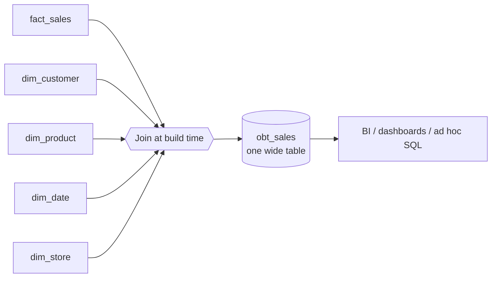

---
tags:
  - dimensional-modeling-technique
---
**OBT (One Big Table)** is a data modeling technique in which facts and all their dimension attributes are pre-joined and stored in **a single wide, fully denormalized table**. Queries read that table directly, with no `JOIN`s.

It is the extreme end of denormalization: where a [[data architecture/dimensional modeling/Star schema.md|Star schema]] keeps a fact table plus separate dimension tables, an OBT flattens them all into one.

## How it works

The fact table (e.g. sales) is joined once, at build time, with every dimension (customer, product, date, store...). The result is persisted as one table with hundreds of columns, one row per fact at the chosen grain.

Example (one row = one order line):

| order_id | order_date | year | customer_name | customer_city | product_name | category | store_name | quantity | amount |
|---|---|---|---|---|---|---|---|---|---|
| 1001 | 2026-03-01 | 2026 | Ana | São Paulo | Notebook | Electronics | Store 12 | 1 | 4500.00 |
| 1002 | 2026-03-01 | 2026 | Ana | São Paulo | Mouse | Accessories | Store 12 | 2 | 120.00 |

Note how customer and product attributes repeat on every row. That redundancy is the trade-off.

## Why use it

- **Fast reads:** no `JOIN`s, so scans and aggregations are simpler and cheaper.
- **Simple for consumers:** analysts and BI tools query one table, with no need to understand keys or the schema.
- **Fits columnar engines:** BigQuery, Snowflake, ClickHouse, Redshift and Parquet-based lakehouses compress repeated values well and read only the columns a query needs, so width costs little.
- **Good for dashboards and ML features:** a flat table is a natural input for BI tools and feature sets.

## Drawbacks

- **Redundancy and storage:** repeated attribute values (mitigated by columnar compression).
- **Rigid and hard to evolve:** adding or changing an attribute means rebuilding the table.
- **Update anomalies:** a changed dimension value (e.g. a customer's city) must be fixed on many rows. [[data architecture/dimensional modeling/SCD - Slowly Changing Dimensions.md|Slowly changing dimensions (SCD)]] are hard to model.
- **Granularity lock-in:** the table serves one grain; other grains or subjects need other tables.
- **Loss of reusability:** conformed dimensions shared across facts disappear, so each OBT may duplicate logic and risk inconsistent definitions.
- **Not for OLTP:** writes and updates are costly on a denormalized table.

## OBT vs Star schema

| Aspect | Star schema | OBT |
|---|---|---|
| Structure | Fact + dimensions | Single flat table |
| `JOIN`s at query time | Yes | No |
| Redundancy | Low in dimensions | High |
| Query speed | Good | Best |
| Flexibility / change | Better | Worse |
| Best for | Reusable enterprise model | Consumption layer, dashboards, simple analytics |

## When to use

- As a **consumption layer** built on top of a Star schema, Data Vault or 3NF core, usually materialized by a transformation tool such as dbt.
- For a **specific dashboard or data product** with a stable, well-defined grain.
- In **columnar cloud warehouses**, where storage is cheap and compression is strong.

Avoid it as the only, central model of an enterprise warehouse: keep a dimensional or normalized core and derive OBTs from it.

## Related

- [[data architecture/dimensional modeling/Star schema.md|Star schema]]
- [[data architecture/dimensional modeling/Snowflake schema.md|Snowflake schema]]
