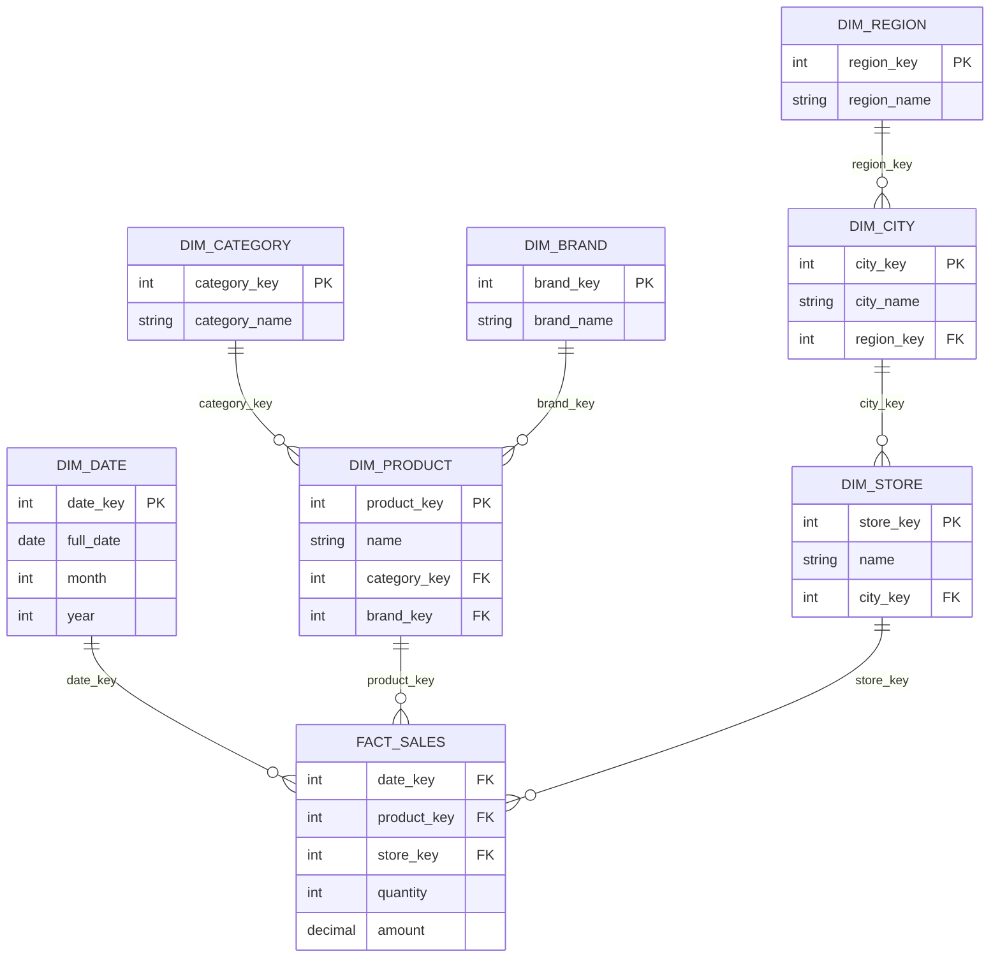

---
tags:
  - dimensional-modeling-technique
---
A **snowflake schema** is a dimensional modeling technique in which the dimension tables of a [[data architecture/dimensional modeling/Star schema.md|Star schema]] are **normalized** into several related sub-tables. The central fact table stays the same, but each dimension branches out into a hierarchy of smaller tables, and the diagram looks like a snowflake.

It is used in [[Data Warehouse|data warehouses]] and [[OLAP Database|OLAP]] workloads. The name is unrelated to the Snowflake cloud data platform.

## Key components

- **Fact table:** numeric measures at the lowest grain, plus foreign keys to the dimensions (same role as in a star schema).
- **Primary dimension tables:** the dimensions the fact table points to directly (e.g. `DIM_PRODUCT`).
- **Sub-dimension tables (outriggers):** tables split out of a dimension to hold one level of its hierarchy (e.g. `DIM_CATEGORY`, `DIM_BRAND`). They are reached only through the primary dimension, never from the fact table.

## Diagram

Compared with the star version, `category` and `brand` are no longer text columns in `DIM_PRODUCT`: they are keys to their own tables, and `store → city → region` becomes a chain of three tables.

## Star vs snowflake

| Aspect | Star schema | Snowflake schema |
|---|---|---|
| Dimensions | Denormalized (one table per dimension) | Normalized (split into sub-tables) |
| `JOIN`s per query | Fewer | More |
| Query speed | Faster | Slower, because of the extra joins |
| Redundancy / storage | Higher | Lower |
| Update anomalies | More likely (a value repeated on many rows) | Less likely (each value is stored once) |
| Schema complexity | Simple, easy to understand | More tables and keys, harder for analysts |
| ETL effort | Simpler loads | More tables to load and keep consistent |

## Advantages

- **Less redundancy:** a category or region name is stored once and referenced by key, which saves storage in large dimensions.
- **Easier to maintain:** changing a value (renaming a category) touches one row instead of thousands.
- **Better integrity:** foreign keys between the levels of a hierarchy enforce consistency.
- **Reusable sub-dimensions:** a table such as `DIM_CITY` can be shared by several dimensions (store, customer, supplier).

## Drawbacks

- **More joins:** each level of the hierarchy adds a join, which hurts performance on large scans.
- **Harder to use:** BI users must understand the chain of tables, and the diagram is harder to read.
- **Little benefit on columnar engines:** storage is cheap and compression handles repeated values well, so the saved space rarely justifies the extra joins.
- **Less friendly to BI tools:** many tools expect one table per dimension.

## When to use

- Very large dimensions with deep hierarchies and a lot of repeated text, where storage and consistency matter.
- Hierarchies that are shared across several dimensions or fact tables.
- Environments where dimension attributes change often and the update cost of a star schema is a problem.

In most modern cloud warehouses the **star schema** is preferred for the consumption layer. A common compromise is the **starflake**, where only the dimensions that benefit are normalized.

## Related

- [[data architecture/dimensional modeling/Star schema.md|Star schema]]
- [[data architecture/dimensional modeling/SCD - Slowly Changing Dimensions.md|SCD - Slowly Changing Dimensions]]
- [[OBT - One Big Table|OBT - One Big Table]]
