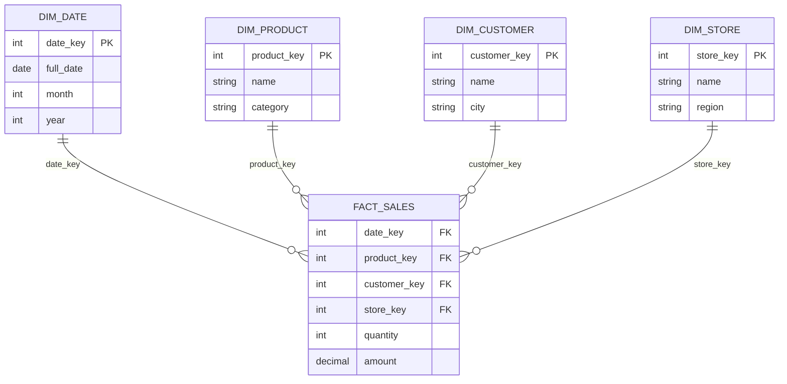

---
tags:
  - dimensional-modeling-technique
---
É uma técnica de modelagem dimensional usada em [[OLAP Database]],  [[OLTP Database]] e [[Data Warehouse|data warehouse]].

## Componentes principais

- Tabela de fatos: Armazena dados numéricos e métricas quantificáveis, na menor granularidade possível, chaves estrangeiras que apontam para dimensões.
- Tabela de dimensões: Armazena atributos descritivos e o contexto do negócio (nome do produto, dados do cliente)

## Diagrama

