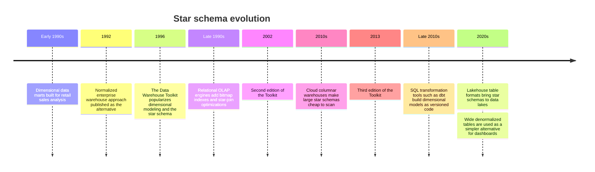
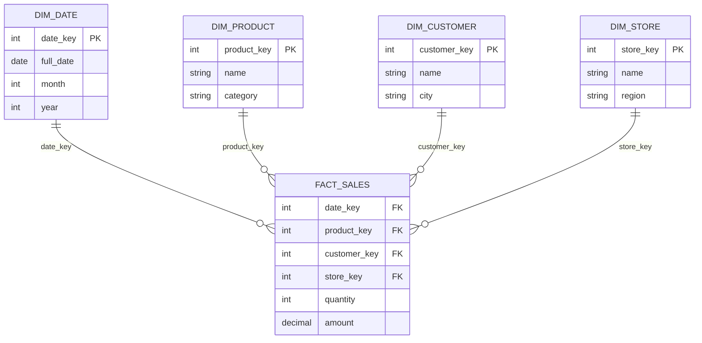

---
tags:
  - dimensional-modeling-technique
aliases:
  - Star Schema
  - Star join schema
---
A **star schema** is the simplest and most common dimensional modeling technique. A central **fact table** holds the measurable events of a business process, and it is surrounded by **dimension tables** that describe those events. Drawn as a diagram, the fact table sits in the middle and the dimensions radiate from it like the points of a star.

It is the standard model for the consumption layer of a [[data architecture/Data Warehouse/Data Warehouse.md|data warehouse]] and for [[data architecture/OLAP Database.md|OLAP]] workloads, where queries scan and aggregate many rows. It is the opposite of the normalized design used by [[data architecture/OLTP Database.md|OLTP]] systems, which optimizes writes and integrity.

## Evolution



The dates come from public sources of different quality. The origin of the terms "facts" and "dimensions" is often traced to 1960s academic and industry work, but I could not confirm this from a primary source, so it is left out. Check the Kimball Group site before citing a date.

## Main components

### Fact table

Stores the **numeric measures** of a business process at the **lowest practical grain**, plus foreign keys to the dimensions.

- **Grain:** what one row means, for example "one line of one sale". Declare it first, because every other design decision depends on it.
- **Measures:** quantity, amount, duration. They should be additive (summable) wherever possible.
- **Foreign keys:** one per dimension, usually surrogate keys.

| Fact table type | One row per | Example |
| --- | --- | --- |
| Transaction | Event | A sale line |
| Periodic snapshot | Entity per period | Account balance at month end |
| Accumulating snapshot | Process instance, updated as it progresses | An order from placement to delivery |
| Factless | Event with no measure | A student attending a class |

### Dimension tables

Store the **descriptive attributes** and business context: product name and category, customer city, the calendar attributes of a date.

- **Denormalized:** a hierarchy such as product, brand and category sits in one table, so a query needs one join, not several.
- **Surrogate key:** a meaningless integer key, independent of the source system's key.
- **Many attributes:** wide dimensions with filtering and grouping columns make the model easy to explore.
- **History:** attribute changes over time are handled with [[data architecture/dimensional modeling/SCD - Slowly Changing Dimensions.md|slowly changing dimensions]].

## Diagram



## Typical query

Join the fact table to the dimensions it needs, filter and group by dimension attributes, and aggregate the measures:

```sql
SELECT d.year,
       p.category,
       SUM(f.amount) AS revenue
FROM fact_sales f
JOIN dim_date d    ON d.date_key    = f.date_key
JOIN dim_product p ON p.product_key = f.product_key
WHERE d.year = 2025
GROUP BY d.year, p.category;
```

## How to design one

Kimball's four steps:

1. **Choose the business process**, such as sales, orders or shipments.
2. **Declare the grain** of the fact table.
3. **Identify the dimensions** that describe each row at that grain.
4. **Identify the facts**, the measures recorded at that grain.

## Pros and cons

| Pros | Cons |
| --- | --- |
| Simple and intuitive for analysts and BI tools | Redundant data in the denormalized dimensions |
| Few joins, so fast aggregation queries | Dimension updates must be applied in several places if attributes repeat |
| Easy to extend with new dimensions or measures | Less flexible than a normalized model for changing or irregular data |
| Maps well to how the business asks questions | Needs a clear grain, and care with non-additive measures |

## Compared with other models

| Model | Difference from a star schema |
| --- | --- |
| [[data architecture/dimensional modeling/Snowflake schema.md\|Snowflake schema]] | Dimensions are normalized into sub-tables: less redundancy, more joins |
| [[data architecture/dimensional modeling/Galaxy schema.md\|Galaxy schema]] | Several fact tables share dimensions, for multiple business processes |
| [[data architecture/dimensional modeling/OBT - One Big Table.md\|OBT]] | Facts and dimensions are flattened into one wide table, with no joins |

## Related

- [[data architecture/dimensional modeling/Snowflake schema.md|Snowflake schema]]
- [[data architecture/dimensional modeling/Galaxy schema.md|Galaxy schema]]
- [[data architecture/dimensional modeling/OBT - One Big Table.md|OBT - One Big Table]]
- [[data architecture/dimensional modeling/SCD - Slowly Changing Dimensions.md|SCD - Slowly Changing Dimensions]]
