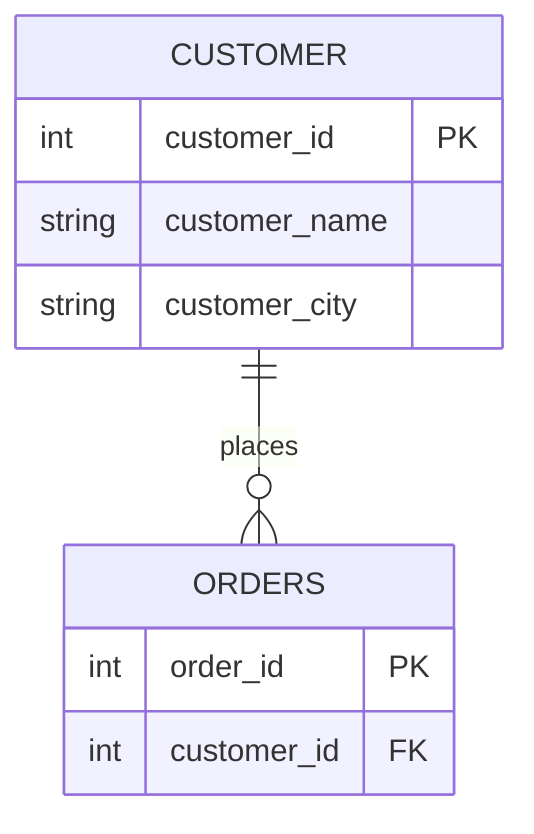

---
aliases:
  - normalization & modeling
  - normalization
  - modeling
---
Normalização organiza os dados em tabelas para reduzir redundância e evitar anomalias de inserção, atualização e exclusão. A modelagem dimensional faz o caminho inverso, desnormalizando de propósito para acelerar consultas analíticas em [[Data Warehouse|data warehouse]].
## Formas normais
As formas são cumulativas: cada uma exige a anterior.

| Forma    | Regra                                                                                               | Elimina                                                            |
| -------- | --------------------------------------------------------------------------------------------------- | ------------------------------------------------------------------ |
| **1NF**  | Valores atômicos (sem listas nem grupos repetidos na célula) e linhas identificáveis por uma chave. | Campos multivalorados                                              |
| **2NF**  | Está na 1NF e todo atributo não-chave depende da chave primária **inteira**.                        | Dependência parcial (só com chave composta)                        |
| **3NF**  | Está na 2NF e nenhum atributo não-chave depende de outro atributo não-chave.                        | Dependência transitiva                                             |
| **BCNF** | Para toda dependência `X → Y`, `X` deve ser chave candidata. É uma 3NF mais estrita.                | Anomalias restantes com múltiplas chaves candidatas                |
| **4NF**  | Está na BCNF e não há dependências multivaloradas independentes na mesma tabela.                    | Combinações redundantes (ex.: habilidades × idiomas de uma pessoa) |
| **5NF**  | Está na 4NF e a tabela não pode ser decomposta em tabelas menores e recombinada sem perda.          | Dependências de junção                                             |

Regra de bolso para a 3NF: todo atributo deve depender da chave, da chave inteira e de nada além da chave.

### Exemplos rápidos

- **1NF:** `telefones = "1111, 2222"` vira uma linha por telefone.
- **2NF:** em `(pedido_id, produto_id, nome_produto)`, `nome_produto` depende só de `produto_id`, então vai para a tabela `PRODUTO`.
- **3NF:** em `pedido → cliente_id → cidade_cliente`, a cidade vai para `CLIENTE`.

### Exemplo de 3NF

Antes: `ORDERS(order_id, customer_id, customer_name, customer_city)`. O nome e a cidade dependem de `customer_id` e não do pedido, então se repetem a cada pedido.

Depois:



### Onde cada nível é usado

- **OLTP:** normalmente vai até a 3NF/BCNF. A 4NF e a 5NF raramente são necessárias.
- **Analítico (Star Schema, OBT):** desnormaliza de propósito para ler mais rápido, com menos `JOIN`s.

## Formatos de modelagem

### Modelagem dimensional

| Formato                                | Ideia principal                                                                                                          | Quando usar                                                  |
| -------------------------------------- | ------------------------------------------------------------------------------------------------------------------------ | ------------------------------------------------------------ |
| [[Star schema]]                        | Uma tabela de fatos central ligada a dimensões desnormalizadas.                                                          | Camada de consumo (BI) com consultas simples e rápidas.      |
| [[Snowflake schema]]                   | É um star schema com as dimensões normalizadas em sub-tabelas (ex.: `DIM_PRODUCT` → `DIM_CATEGORY`, `DIM_BRAND`).        | Menos redundância e armazenamento, ao custo de mais `JOIN`s. |
| [[data architecture/dimensional modeling/Galaxy schema.md\|Galaxy Schema]] (Fact Constellation) | Várias tabelas de fatos compartilham dimensões (ex.: `FACT_SALES` e `FACT_INVENTORY` usando `DIM_PRODUCT` e `DIM_DATE`). | Data warehouses com vários processos de negócio.             |
| **Starflake**                          | Mistura os dois: algumas dimensões normalizadas, outras não.                                                             | Quando só algumas dimensões ganham com a normalização.       |

### Outras abordagens

| Formato | Ideia principal | Quando usar |
|---|---|---|
| **3NF (Inmon)** | O DW central é normalizado (3NF). Os data marts dimensionais são derivados dele. | Fonte única e consistente para a empresa toda. |
| **Data Vault** | Três tipos de tabela: *Hubs* (chaves de negócio), *Links* (relacionamentos) e *Satellites* (atributos com histórico). | Muitas fontes, mudanças frequentes e necessidade de auditoria. |
| [[OBT - One Big Table\|One Big Table (OBT)]] | Uma tabela larga e totalmente desnormalizada, sem `JOIN`s. | DWs colunares (BigQuery, Snowflake, ClickHouse) e dashboards simples. |
| **Anchor Modeling** | Altamente normalizado (6NF), com atributos e relacionamentos como tabelas próprias. | Esquemas que mudam muito e que precisam guardar o histórico. |

## Comparação rápida

```
Desempenho de consulta    → OBT > Star > Snowflake > Data Vault / 3NF
Armazenamento/redundância → Anchor / 3NF / Data Vault > Snowflake > Star > OBT
Flexibilidade a mudanças  → Anchor / Data Vault > 3NF > Snowflake > Star > OBT
```

## Arquitetura típica

- **Camada de consumo (BI):** Star Schema ou OBT.
- **Camada de integração (histórico e auditoria):** Data Vault ou 3NF.
- **Fluxo comum:** fontes → Data Vault/3NF (integração) → Star Schema (consumo).

## Links

- [[data architecture/dimensional modeling/SCD - Slowly Changing Dimensions.md|SCD - Slowly Changing Dimensions]]
