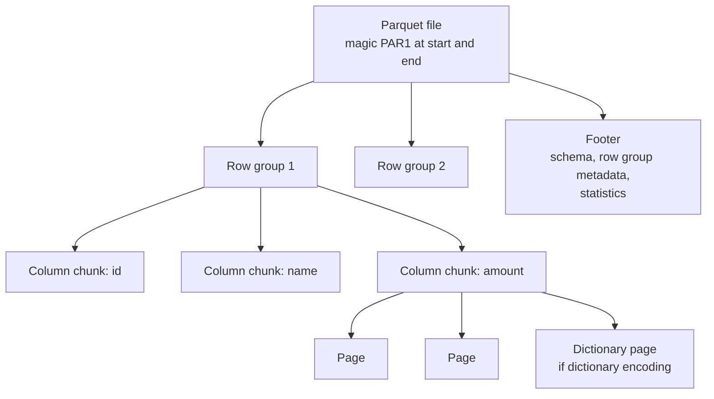

---
aliases:
  - Parquet
  - Apache Parquet
  - Parquet file format
tags:
  - data-engineering
  - file-formats
  - parquet
  - columnar
  - data-lake
description: What Apache Parquet is, a columnar binary file format for analytics, how a Parquet file is organized (row groups, column chunks, pages, footer), how pruning and pushdown make queries fast, and its limits.
---
**Apache Parquet** is an open, **columnar, binary file format** for analytical data. It stores the values of each **column** together, with **compression and encoding per column** and **statistics** that let engines skip data. It is the default format of most data lakes, and the file layer under table formats such as Delta Lake and Apache Iceberg. It was designed after Google's Dremel paper, for nested data too.

>[!tip] Parquet is built to **read less data**. Queries read only the columns they need and skip the parts of the file their filters rule out. For moving events one record at a time, see [[data architecture/file formats/Apache Avro.md|Apache Avro]].

## Row vs columnar layout

```text
Rows:     (id=1, name=A, amount=10), (id=2, name=B, amount=20), (id=3, name=C, amount=30)

Parquet   id:[ 1 2 3 ]  name:[ A B C ]  amount:[ 10 20 30 ]   one column stored together
```

`SELECT sum(amount) FROM orders` reads only the `amount` column. Values of one column have the same type and often repeat, so they **compress and encode** very well.

## How a Parquet file is organized



| Level | What it is |
|---|---|
| **Row group** | A horizontal slice of rows, often about 128 MB. It is the unit of parallelism and of skipping |
| **Column chunk** | All the values of one column in one row group |
| **Page** | The smallest unit, where encoding and compression apply (around 1 MB) |
| **Footer** | At the end of the file: the schema, the location of each chunk and **statistics** (min, max, null count). A reader reads the footer first |

## Why queries are fast

- **Column pruning:** only the needed columns are read from storage.
- **Predicate pushdown:** the footer has **min and max** values for each row group (and page index and optional bloom filters). A filter such as `amount > 1000` **skips row groups** that cannot match.
- **Partition pruning:** with data partitioned in folders (`order_date=2026-01-01/`), a filter on the partition column skips whole folders.
- **Encodings:** **dictionary**, **run-length** and **bit-packing** for repeated values, **delta** for sorted numbers.
- **Compression per column:** Snappy (the Spark default), Zstandard, Gzip, LZ4. Files are often several times smaller than CSV or JSON.
- **Vectorized reading:** engines process batches of column values at once.

## Nested data

Parquet stores nested structures (structs, arrays, maps) in columns too. It records the nesting with **repetition and definition levels**, as in Dremel, so a nested field is stored as its own column and can be read alone.

## Schema evolution

| Change | Support |
|---|---|
| Add a column | Works. Old files return `null` for it, and Spark needs `mergeSchema` when files differ |
| Remove a column | Works for readers that select columns by name |
| Rename a column | Problematic, because columns are matched by name |
| Change a type | Often breaks, only some widenings work |

Schema evolution is **more limited than in Avro**. Table formats such as **Delta Lake and Apache Iceberg** track the schema in their metadata and give safer evolution on top of Parquet files.

## Limits

- **Immutable:** a file is written once. You cannot update or delete a row in place. Table formats handle updates by writing new files.
- **Writing one record at a time is expensive:** a writer buffers a **row group** before it writes. Streaming writes create **many small files**.
- **Small files** hurt reads and metadata. Compact them to roughly **128 MB to 1 GB**.
- **Not human readable.** Use a tool to inspect it.
- **Reading whole records** needs every column chunk, so it is not better than a row format.

## Using Parquet

```python
# Spark
df = spark.read.parquet("s3://bucket/curated/orders/")

(
    df.repartition("order_date")
      .write.mode("overwrite")
      .partitionBy("order_date")
      .option("compression", "zstd")
      .parquet("s3://bucket/curated/orders/")
)

# Files with different schemas over time
spark.read.option("mergeSchema", "true").parquet("s3://bucket/curated/orders/")

# Check pruning and pushdown: look for PushedFilters and a small ReadSchema
df.filter("amount > 1000").select("order_id", "amount").explain()
```

```python
# Python, with pandas and pyarrow
import pandas as pd
import pyarrow.parquet as pq

pd.DataFrame({"id": [1, 2], "amount": [10, 20]}).to_parquet("orders.parquet", compression="zstd")

meta = pq.ParquetFile("orders.parquet").metadata      # row groups, columns, statistics
print(meta.num_row_groups, meta.num_rows)
table = pq.read_table("orders.parquet", columns=["amount"])   # column pruning
```

See [[data architecture/Apache Spark/sql and optimization/Catalyst.md|Catalyst]] for how Spark pushes filters and prunes columns, and [[data architecture/Apache Spark/core concepts/Spark Repartition.md|Spark Repartition]] for controlling the number and size of output files.

## Best practices

- Use Parquet **instead of CSV or JSON** for analytical data.
- Pick **Snappy** (fast) or **Zstandard** (smaller) compression.
- Keep files at about **128 MB to 1 GB**, and compact small files.
- **Partition by a low-cardinality column** such as date, not by user id.
- **Sort or cluster** data by the column you filter most, so min and max statistics skip more.
- Select **only the columns you need**.
- Use a **table format** (Delta, Iceberg) for updates, deletes, time travel and safe schema evolution.
- Keep one **schema contract** per dataset, and watch logical types (decimal, timestamp) across tools.

## Common pitfalls

- Many **tiny files** from streaming writes, with no compaction.
- **Partitioning by a high-cardinality column**, which creates millions of folders and files.
- **Schema drift** between files of the same table.
- `select *` on wide tables, which throws away column pruning.
- Expecting to **update a file in place**.
- Unsorted data, where min and max overlap everywhere and nothing is skipped.
- Treating timestamp and decimal types as identical in every engine.

## Interview questions

- What is Parquet, and why is it good for analytics?
- What are row groups, column chunks and pages?
- What do column pruning and predicate pushdown do, and what makes the statistics useful?
- How does Parquet compress data better than a row format?
- What are the limits of Parquet for updates and streaming writes?
- How does schema evolution differ from Avro, and what do Delta and Iceberg add?
- How do you avoid the small files problem?
- How do you check in Spark that pushdown worked?

## Related

- [[data architecture/file formats/Apache Avro.md|Apache Avro]]
- [[data architecture/data engineering/Schema Evolution.md|Schema Evolution]]
- [[data architecture/Data Lakehouse/Data Lakehouse.md|Data Lakehouse]]
- [[data architecture/Apache Spark/Apache Spark.md|Apache Spark]]
