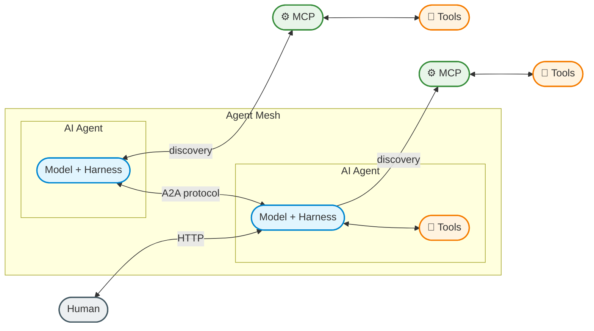

Is a specialized software component designed to perform a specific, narrow task autonomously using tools and memory.
Basic example: Components of an AI agent

> [!NOTE] About
> Model + Harness = AI Agent
> 

## References
[[MCP]]
[[Harness]]
