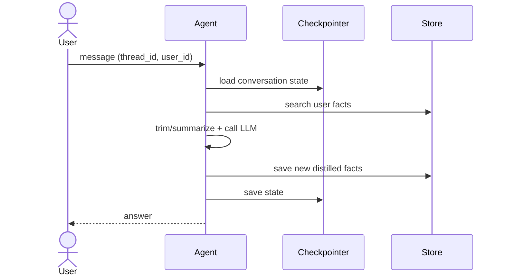

#ai #agent #llmops [[Context Management]]
# Agent Memory

Mechanisms that let an [[AI Agent]] retain information beyond a single LLM call, so it can continue a conversation and remember the user between sessions. The LLM itself is stateless: memory is always state **stored outside the model** and injected back into the prompt.

## Types of memory

| Type | Scope | Stores | Example |
|------|-------|--------|---------|
| **Short-term** | One conversation (`thread_id`) | Messages and graph state | Resume a chat after a page refresh |
| **Long-term** | Across conversations (`user_id`) | Distilled facts and preferences | "Prefers lightweight laptops, mid budget" |

See also [[Long-Term User Memory]] and [[Context Management]].

## Persistence in LangGraph

[[LangGraph SDK|LangGraph]] separates the two types:

- **Checkpointer** (short-term): saves the graph state after each step, keyed by `thread_id`.
- **Store** (long-term): key-value storage with namespaces (e.g. `("users", user_id, "profile")`) and optional semantic search.

| Backend | Use for |
|---------|---------|
| `MemorySaver` | Tests only (lost on restart) |
| `SqliteSaver` | Local development, prototypes |
| `PostgresSaver` | **Production default**: durable, transactional, queryable |
| `RedisSaver` | Low latency, or when Redis is already in the stack |

```python
from langgraph.checkpoint.postgres import PostgresSaver

with PostgresSaver.from_conn_string(DB_URI) as checkpointer:
    checkpointer.setup()  # creates tables once
    graph = builder.compile(checkpointer=checkpointer)
    graph.invoke(state, config={"configurable": {"thread_id": "user-42:conv-7"}})
```

```python
store.put(("users", user_id, "profile"), "prefs", {"budget": "mid", "likes": "ultralight"})
store.search(("users", user_id, "profile"), query="travel laptop")
```

## Memory flow



## Best practices

- Use **Postgres** (with `pgvector` for semantic search) for both checkpointer and store: one system to operate, back up and secure.
- Build `thread_id` from user + conversation (`user_id:conversation_id`) and namespace long-term data by `user_id`.
- **Do not replay the full history**: trim or summarize old messages (rolling summary) to control cost and latency.
- Store **distilled facts**, not raw chat, in long-term memory.
- Define a **retention policy (TTL)**, support "delete my data" requests (LGPD/GDPR) and avoid persisting PII or payment data.

## Links

[[AI Agent]]
[[Agentic AI]]
[[Long-Term User Memory]]
[[Context Management]]
[[LangGraph SDK]]
[[RAG]]
