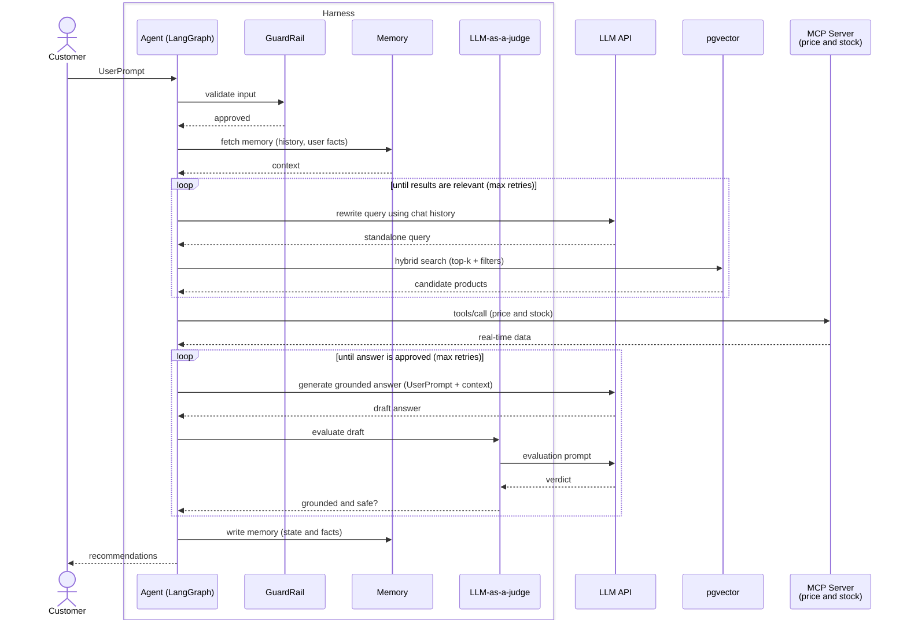

#in-context_learning [[Context Management]]
# Retrieval-Augmented Generation

They act as an external memory for LLMs (like ChatGPT (service)), allowing them to search through a company's private documents for acurate, realtime facts before answering a prompt.

==changes the model's knowledge context==, its like an "open-book" exam where the AI seaches a separate database to look up real-time information to answer a prompt.

## Example: Product Discovery Chat Agent (LangGraph)

Chat agent for a corporate portal that helps customers find products. Built as a [[LangGraph]] state graph, with conversation memory kept by a checkpointer (`thread_id`).

### How the flow works

1. **Receive the prompt**: the customer sends a message in the portal chat. The API loads the conversation state from the checkpointer using the `thread_id`.
2. **Rewrite the query**: the LLM turns the message into a standalone search query using the chat history (e.g. "and in black?" becomes "ultralight black laptop for travel").
3. **Embed the query**: an embedding model converts the rewritten query into a vector.
4. **Search in pgvector**: the agent runs a similarity search (cosine distance) on the product table in PostgreSQL, combined with keyword search and SQL metadata filters (category, price range, in stock). The top-k most similar products are returned.
5. **Grade the results**: the agent checks if the retrieved products are relevant. If not, it goes back to step 2 with a refined query (limited number of retries).
6. **Enrich with real-time data**: the agent calls a tool on the price and stock [[MCP]] server to add current price and stock, which can be stale in the vector index.
7. **Build the augmented prompt**: the system instructions, the chat history, the retrieved product data and the user question are assembled into a single prompt, with a rule to answer only from the provided context.
8. **Call the LLM**: the augmented prompt is sent to the LLM, which generates a grounded answer with product links.
9. **Judge the answer**: an [[LLM-as-a-judge]] evaluates the draft answer against the retrieved context (grounding, relevance, safety). If it fails, the answer is regenerated (limited number of retries).
10. **Respond and persist**: the answer is streamed to the customer and the updated state is saved in the checkpointer.
