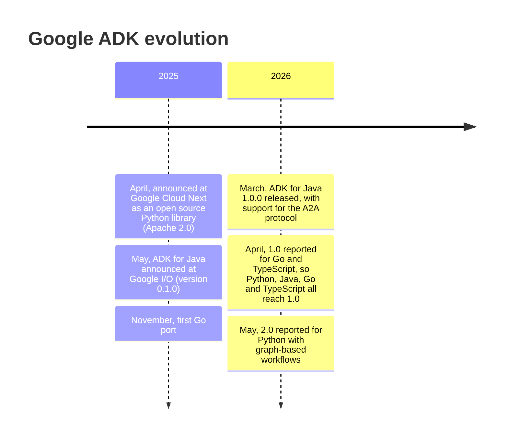
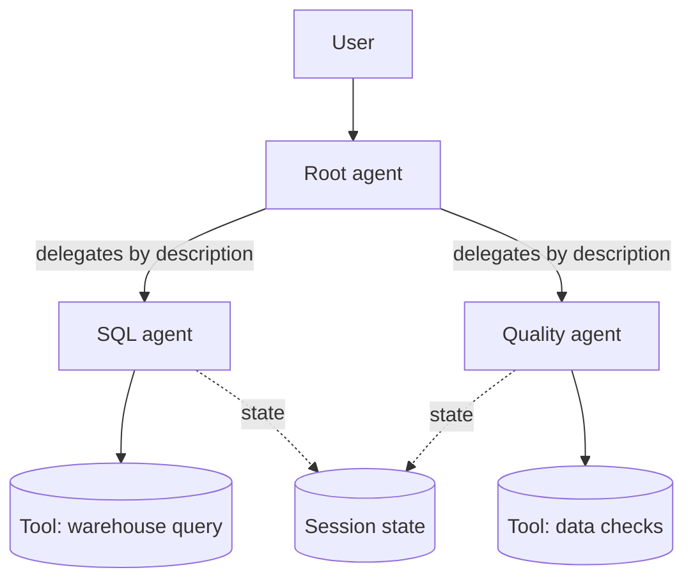

---
aliases:
  - ADK
  - Agent Development Kit
  - Google Agent Development Kit
tags:
  - framework
  - ai
  - agents
  - gcp
---


The dates come from the Google developers blog and secondary outlets. The 2026 Go, TypeScript and 2.0 entries are reported inconsistently, so check the official [release notes](https://adk.dev/release-notes/) before citing one.

**Google ADK (Agent Development Kit)** is Google's open source, **code-first framework to build, evaluate and deploy [[AI Agent|AI agents]]** and multi-agent systems. It is optimized for Gemini and the Google Cloud ecosystem, but it is model-agnostic and deployment-agnostic: the same agent can run on a laptop, in a container, on Cloud Run or on a managed runtime.

>[!tip] ADK's idea: build an agent like a normal software project. Agents, tools, workflows, tests and deployment are code in a repository, with a CLI and a dev UI to run them.

It was announced by Google in April 2025 as a Python library under the Apache 2.0 license, and later got Java, Go and TypeScript versions. Check the official release notes for the current versions, because the numbers reported by secondary sources disagree.

## Core concepts

| Concept | Meaning |
|---|---|
| **Agent** | The unit of work. An `LlmAgent` (also exposed as `Agent`) uses a model to reason and decide which tool to call |
| **Tool** | A capability the agent can call: a Python function, an OpenAPI API, an MCP server, another agent or a built-in tool |
| **Workflow agent** | A deterministic agent that controls the order of other agents, with no LLM deciding the flow |
| **Session** | One conversation, with its history and state |
| **State** | A key-value store shared by the agents in a session |
| **Memory** | Long-term knowledge that lives beyond one session |
| **Runner** | The engine that executes an agent, handles events and talks to the session service |
| **Callbacks** | Hooks before and after model calls, tool calls and agent runs, used for guardrails, logging and caching |
| **Artifacts** | Files and binary data produced or consumed by agents |

## A minimal agent

```python
from google.adk.agents import Agent


def get_row_count(table: str) -> dict:
    """Return the number of rows of a table.

    Args:
        table: Name of the table, for example "analytics.daily_revenue".
    """
    # In a real agent this would query the warehouse.
    return {"status": "success", "table": table, "rows": 1_250_000}


root_agent = Agent(
    name="data_assistant",
    model="gemini-2.5-flash",  # check the current model names
    description="Answers questions about the data platform.",
    instruction=(
        "You help data engineers. Use the tools to answer. "
        "If a tool returns an error, explain it. Never invent numbers."
    ),
    tools=[get_row_count],
)
```

Key points:
- The **type hints and the docstring** of a function become the tool schema the model sees, so write them carefully.
- Return a dict with a `status` field, so the model can understand success and failure.
- `description` is used by **other agents** to decide when to delegate to this one. `instruction` is the system prompt of this agent.
- The variable `root_agent` is the convention the CLI looks for.

## Running it

```bash
pip install google-adk

adk create my_agent        # scaffold a project
adk run my_agent           # chat in the terminal
adk web                    # dev UI with chat, events and traces
adk api_server             # expose the agent as a REST API
adk eval my_agent evalset.json   # run an evaluation set
```

Project layout:

```
my_agent/
├── __init__.py       # from . import agent
├── agent.py          # defines root_agent
└── .env              # model credentials (never commit it)
```

The `adk web` UI shows each **event** (model call, tool call, response), which is the fastest way to debug why an agent chose a tool.

## Tools

| Type | Use it for |
|---|---|
| **Function tools** | Your own Python functions |
| **Built-in tools** | Google Search, code execution, and other ready tools |
| **OpenAPI tools** | Generated from an OpenAPI spec |
| **MCP tools** | Any [[MCP]] server, so ADK reuses the MCP ecosystem |
| **Google Cloud tools** | Integrations with services such as BigQuery (check the docs for the current list) |
| **Agent as a tool** | Wrap another agent with `AgentTool`, so the parent calls it like a function and keeps control |
| **Long-running tools** | Operations that finish later, such as a human approval |

>[!warning] Tools are where agents do damage. Give each agent the minimum set of tools, use read-only credentials for analytics, and validate arguments in a `before_tool_callback`.

## Multi-agent systems

ADK builds a **tree of agents**. There are two ways to coordinate them.

### 1. LLM-driven delegation

A parent `LlmAgent` has `sub_agents`. The model reads each sub-agent's `description` and decides when to **transfer** the conversation. It is flexible, but the flow is not guaranteed. See [[Sub Agents]].

```python
root_agent = Agent(
    name="coordinator",
    model="gemini-2.5-flash",
    instruction="Route the user to the right specialist.",
    sub_agents=[sql_agent, quality_agent],
)
```

### 2. Workflow agents (deterministic)

The order is fixed in code, and the LLM only works **inside** each step.

| Workflow agent | Behavior |
|---|---|
| `SequentialAgent` | Runs sub-agents one after the other |
| `ParallelAgent` | Runs sub-agents at the same time and collects the results |
| `LoopAgent` | Repeats sub-agents until a condition is met or `max_iterations` is reached. See [[Loop Agents]] |

```python
from google.adk.agents import Agent, SequentialAgent

writer = Agent(
    name="sql_writer", model="gemini-2.5-flash",
    instruction="Write a BigQuery SQL query for the request.",
    output_key="draft_sql",          # saves the answer in session state
)
reviewer = Agent(
    name="sql_reviewer", model="gemini-2.5-flash",
    instruction="Review this SQL for cost and correctness: {draft_sql}",
)

root_agent = SequentialAgent(name="sql_pipeline", sub_agents=[writer, reviewer])
```

`output_key` writes a result to the **session state**, and `{draft_sql}` in the next instruction reads it. That is how agents pass data without extra code.



**Rule of thumb:** use workflow agents when the process is known (pipelines, review loops), and LLM delegation when the user's intent decides the path. Mixing both is common: a deterministic skeleton with LLM steps.

## Sessions, state and memory

- **Session service** stores history and state: in memory (development), in a database, or in the managed Google Cloud service.
- State keys can be scoped to the session, to the user or to the whole app.
- **Memory service** gives long-term recall across sessions. See [[Agent Memory]] and [[Session context]].

In production use a persistent session service, because the in-memory one loses everything on restart and does not work with several instances.

## Callbacks and safety

Callbacks run **around** the model and the tools:

| Callback | Typical use |
|---|---|
| `before_model_callback` | Block unsafe input, add context, cache |
| `after_model_callback` | Filter or rewrite the answer |
| `before_tool_callback` | Validate arguments, check permissions, block dangerous SQL |
| `after_tool_callback` | Trim large results, mask sensitive columns |

They are the main place to implement [[Guardrails]] and [[Human-in-the-Loop]] approvals.

## Evaluation

ADK has a built-in evaluation flow, run with `adk eval` or from the web UI:

- An **eval set** lists user inputs, the expected **tool calls** (trajectory) and the expected final answer.
- It checks the **trajectory** (did the agent call the right tools in the right order) and the **response quality**.
- Results go into CI, so a prompt or tool change that breaks behavior is caught before release.

For open-ended answers combine it with [[LLM-as-a-judge]].

## Interoperability

- **[[MCP]]:** ADK can use MCP servers as tools, and expose tools as an MCP server.
- **[[A2A]]:** ADK agents can call remote agents, and publish themselves, through the Agent2Agent protocol with an [[Agent Card]]. This allows agents built with different frameworks to cooperate.
- **Models:** Gemini first, and other models through connectors such as LiteLLM.

## Deployment

| Target | Notes |
|---|---|
| Local / `adk web` | Development and debugging |
| **Container** (Docker) | Any platform, including Kubernetes |
| **Cloud Run** | Serverless containers, scales to zero. `adk deploy cloud_run` automates it |
| **Vertex AI Agent Engine** | Google's managed runtime for agents, with managed sessions and scaling |

Treat the agent as a normal service: package it, run it in CI, manage the cloud resources with **Terraform**, give it its own **service account** with least privilege, and send traces to your observability stack.

## ADK in data engineering

A data engineer can use ADK agents to automate work around the data platform:

- **Natural-language access to the warehouse:** an agent with a BigQuery tool that writes and runs read-only SQL.
- **Pipeline assistant:** an agent that reads the failed run logs of a [[data architecture/Data Warehouse/Google Dataform.md|Dataform]] workflow and proposes a fix.
- **Data quality triage:** a `SequentialAgent` that runs checks, summarizes failures and opens a ticket.
- **Documentation:** an agent that writes table and column descriptions from the schema and sample data.

Always keep the human in the loop for anything that **writes** (DDL, `MERGE`, deployments).

## ADK vs other frameworks

| | Google ADK | [[LangGraph SDK]] | [[LangChain SDK]] |
|---|---|---|---|
| Main idea | Tree of agents plus workflow agents | Explicit state graph of nodes and edges | Chains, tools and agent building blocks |
| Multi-agent | Built in (sub-agents, workflow agents) | Built with graphs | Possible, less central |
| Cloud fit | Best on Google Cloud, runs anywhere | Cloud-neutral | Cloud-neutral |
| Dev tools | `adk web`, `adk eval`, deploy commands | LangGraph Studio, [[LangSmith platform\|LangSmith]] | LangSmith |
| Models | Gemini first, others by connector | Any | Any |
| Control of the flow | Workflow agents, or the LLM decides | You define the graph | Mostly the LLM decides |

The concepts map between them: a LangGraph node is close to an ADK agent step, and a graph edge is close to a workflow agent. Recent ADK versions also moved toward graph-style workflows, so check the release notes.

## Best practices

- One agent, one clear job. Write a precise `description`, because it drives delegation.
- Prefer **workflow agents** when the steps are known, to get predictable behavior and lower cost.
- Few tools per agent, with clear names, typed arguments and docstrings.
- Return structured results from tools, with `status` and an error message the model can read.
- Pass data through **state** (`output_key`), not by copying text into prompts.
- Add `max_iterations` to every `LoopAgent`.
- Validate and limit tool actions in callbacks. Use read-only credentials by default.
- Write eval sets from real conversations and run them in CI.
- Persist sessions in production, and trace every run.

## Common pitfalls

- Too many sub-agents with vague descriptions, so the model transfers to the wrong one.
- A tool without a docstring or type hints, so the model cannot use it well.
- Letting the agent run free-form SQL with write permissions.
- In-memory sessions in production.
- No iteration limit in a loop, which burns tokens.
- Putting credentials in the repository instead of the environment or a secret manager.
- Trusting the answer without evals, since agent behavior changes with any prompt or model change.

## Related

- [[AI Agent]]
- [[Multi-agent orchestration]]
- [[LangGraph SDK]]
- [[MCP]]
- [[A2A]]
- [[data architecture/Data Warehouse/Google Dataform.md|Google Dataform]]

## Interview questions

- What is an `LlmAgent`, and how does it differ from a workflow agent?
- When would you use `SequentialAgent`, `ParallelAgent` and `LoopAgent`?
- How do agents share data in ADK, and what does `output_key` do?
- How does a tool's docstring affect the agent's behavior?
- How would you stop an agent from running a destructive SQL statement?
- How do you evaluate an agent, and what is the difference between trajectory and response evaluation?
- What changes between running an agent locally and in production?
- How do MCP and A2A relate to ADK?
- How would you compare ADK with LangGraph?
