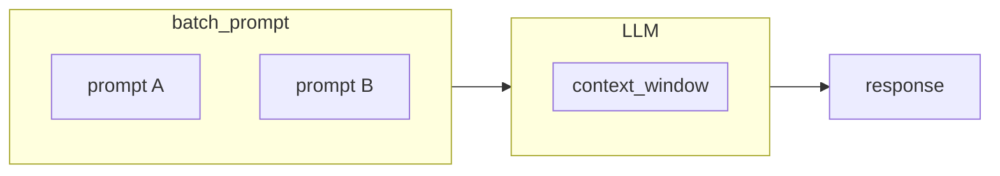

Focused in batch prompting in the same request, in the same context window
### Benefits
- Lower cost
- Lower response time
- Response consistency (same context)
### Caveats
- Format and objective must be the same
### Use case
- System logs analysis


```python
BUG_ANALYSER_PROMPT = """
You are a bug analyser Agent, an expert in analyzing system logs to identify and classify sofware bugs.

Return to the Root Agent json response in following structure:
Analise os logs abaixo e retorne em json na seguinte extrutura:
{
	"log_type": 
	"log_content": {
		// complete the original log content as nested JSON object
	}
}
"""
# <FEW SHOT HERE>
```
### Reference
[[Prompt engineering]]
[[Sub Agents]]