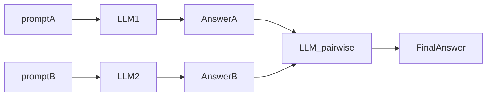
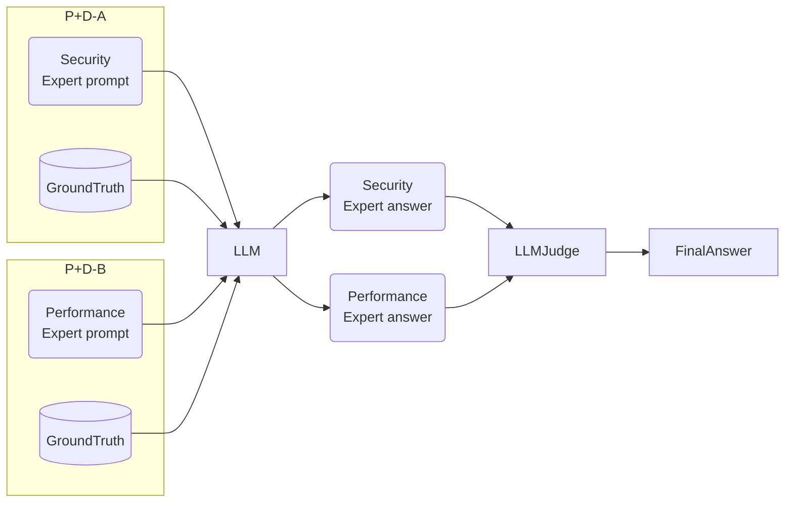

Comparação de duas respostas usando o mesmo input, uma [[LLM-as-a-judge]] vai julgar quem acertou.
### Example:
Question: How to work with timeout in a HTTP request with Go language
Answer A: `context.WithTimeout`
Answer B: `time.Sleep`

Kind of evaluation: [[metrics/Correctness|Correctness]]
Result: `{"key": "pairwise_preference", "value": "A"}`



In this example, occurs 3 request, for A, B and evaluation.

Example of Judge (prompt), to code review:
```yaml
_type: prompt
input_variables:
	- code
	- answer_a
	- answer_b
input_types:
	code: str
	answer_a: str
	answer_b: str
template_format: f-string
template: |
You are a IMPARTIAL judge evaluating code reviews.
Code analyzed: {code}
Answer A (Security Expert): {answer_a}
Answer B (Performance Expert): {answer_b}
TASK: Evaluate OBJECTIVELY wich answer is more valuable for this SPECIFIC code.
EVALUATION CRITERIA:
1. REAL EXISTENCE: Did both find issues that REALLY exist in the code?
2. IMPACT: Which set of issues has GREATER IMPACT on code quality?
3. ACTIONABILITY: Which answer provides clearer and more actionable feedback?
   
IMPORTANT RULES:
- DO NOT favor security automatically just because is "sounds more critical"
- If A found REAL and CRITICAL vulnerabilities -> choose A
- If A found REAL and CRITICAL performance issues -> choose B
- If BOTH found equality important issues -> TIE
- Consider: a vulnerability code AND a slow code are both problematic!
  
Which answer is more valuable for THIS specific code?
Answer ONLY: A, B or TIE
```


