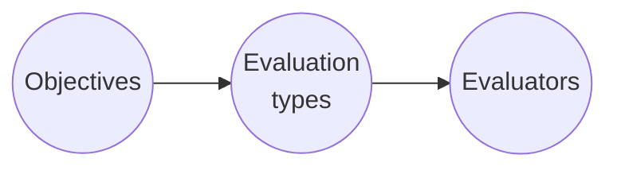
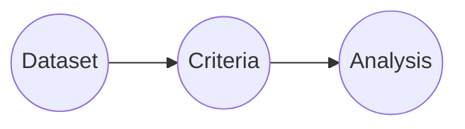

Evaluating

Comparing

[[Code Evaluation]]: Code-based evalution
[[LLM-as-a-judge]]: LLM-based evaluation
[[Pairwise evaluator]]: On a same input, generate two or more responses, them choose the best of them.
[[Summary evaluator]]: 
[[Composite evaluator]]: Combine multiple different metrics in a one score

### Exemple
- Upload a dataset to [[Datasets & Experiments]]